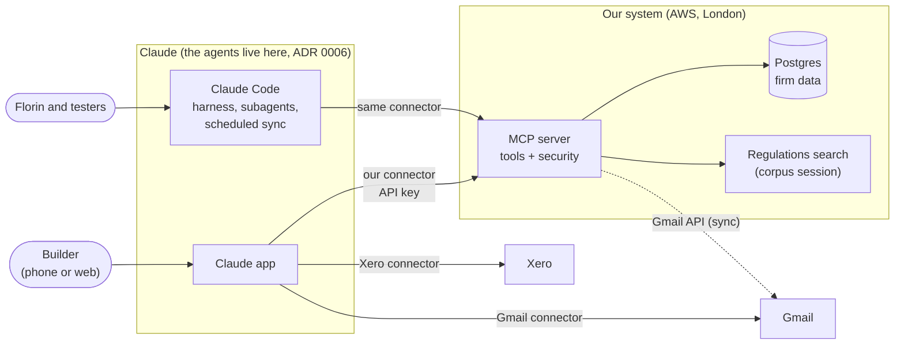
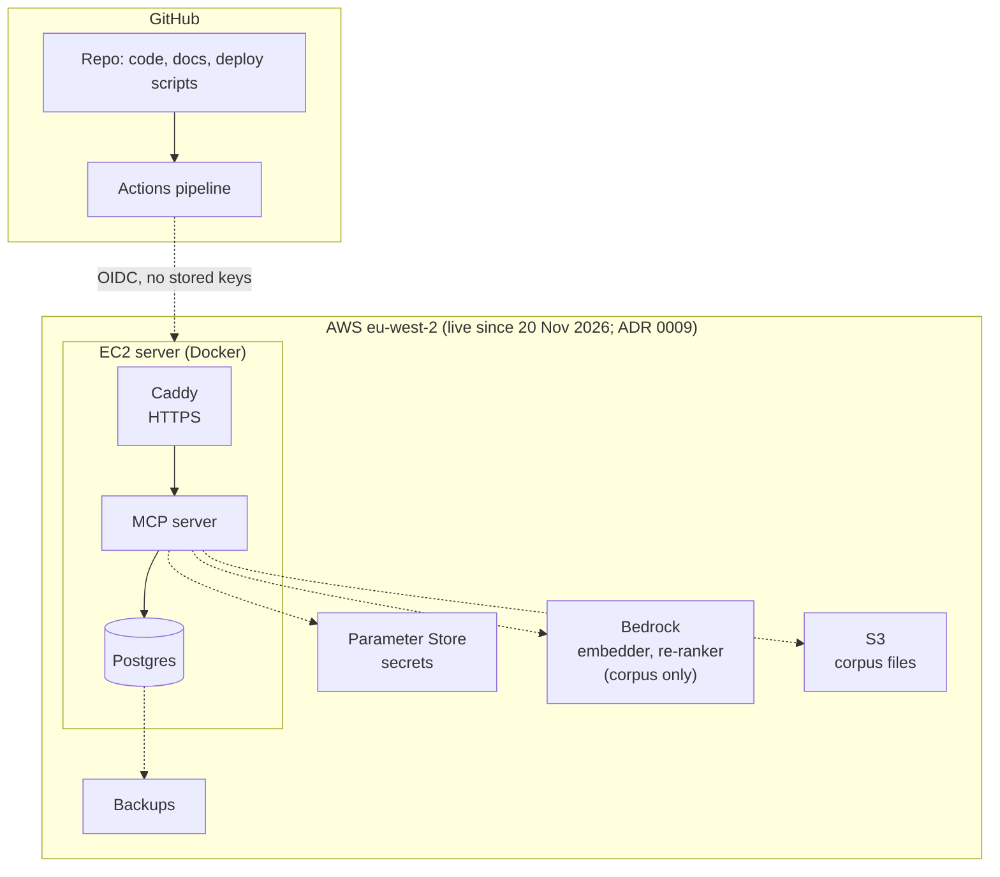
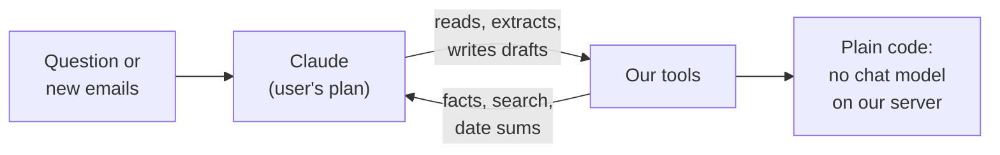

# Architecture

Builders Lab: an AI assistant that works where a builder's work already is. High level only. Details: [designs](#map).

Updated 20 Nov 2026. Solid lines = built. Dashed lines = planned.

## 1. Who talks to what

## 2. Where things run

## 3. Where the intelligence is

## Map

| Level | Document |
|---|---|
| Design | [Server: MCP, security, data, deployment](design/server.md) |
| Design | [Regulations corpus and search](design/regulations-corpus.md) (corpus session) |
| Sequences | [Server flows](sequences/server.md) |
| Decisions | [ADRs](../decisions/) |
| Gaps | [Parking lot](../requirements/parking-lot.md) |
