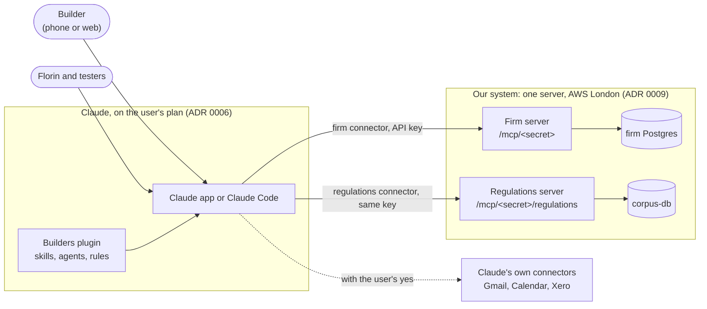
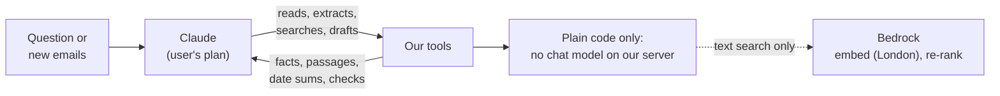

# Architecture

Builders Lab: an AI assistant for UK building firms. Claude, on the user's own plan, does the thinking. Our MCP
servers hold the firm's data, the regulations library and the checks. High level only; details are in the
[designs](#4-map). Updated 26 Nov 2026. Solid lines = built. Dashed lines = planned or optional.

## 1. Who talks to what

- **Two servers, one process** (ADR 0015). The regulations server holds public text only and cannot reach firm data.
- **Mock data only.** The firm is "Marcus Limited" (`system/data/mock/`).

## 2. Where the intelligence is

- **No model on our server** (ADR 0006). The server runs queries, date sums and checks. `verify_answer` checks
  each answer against the sources in plain code before Claude replies.
- **Bedrock** only turns search text into vectors and re-ranks passages. It never writes an answer.

## 3. The agents

All agents are Claude, on the user's plan or on a developer's machine. None runs on our server.

| Agent | Where | Job | Details |
|---|---|---|---|
| Main model + `builders-workflow` skill | Claude app, Claude Code | routes the question, runs the task skill, checks, replies in short spoken chunks | [runtime design](design/runtime/design.md) |
| Task skills | plugin | emails, approved changes, payments, missing items, delays, regulations | [plugin/README.md](../plugin/README.md) |
| `builders-translate` skill | plugin | Romanian in, English to the tools, Romanian out (ADR 0012) | [runtime design](design/runtime/design.md) |
| Haiku sub-agents | plugin | big jobs only: more than 5 emails or three or more jobs (ADR 0019) | `plugin/agents/` |
| Corpus checkers | Claude Code, developer machine | check tables, figures and unclear parses; saved as fixes (ADR 0010) | [ingest design](design/ingest/design.md) |
| Judges | Claude Code, developer machine | judge passages and answers, blind | [eval design](design/eval/design.md) |

## 4. Map

| Design | What it covers |
|---|---|
| [Runtime](design/runtime/design.md) and [flows](design/runtime/flows/) | the plugin, the two servers, tools, guardrails, deploy and upgrade |
| [Data](design/data/design.md) | where every kind of data lives; firm tables and the regulations library |
| [Ingest](design/ingest/design.md) and [flows](design/ingest/flows/) | harvest, parse, checks, chunk, embed, load |
| [Evals](design/eval/design.md) and [flows](design/eval/flows/) | golden set, metrics, judges, the gate, mixed vs lanes |

Also: [decisions (ADRs)](../decisions/), [gaps and shortcuts](../requirements/parking-lot.md),
[deploy](../deploy/README.md), [tool list](../system/api/README.md).
