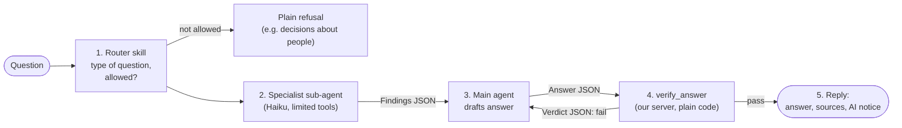
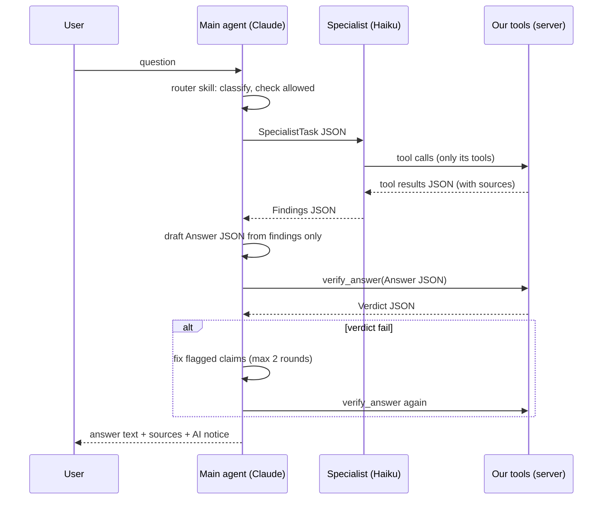

# Design: agent contracts (JSON in, JSON out)

The mini harness inside Claude: every answer goes through fixed steps, and every step speaks JSON, so our server can check it with plain code. No model runs on our server (ADR 0006); all model work is on the user's Claude plan.
Up: [architecture](../ARCHITECTURE.md). Server side: [server.md](server.md).

Contract version: `contracts.v2` (20 Nov 2026; v2 added the translator messages). **Source of truth: `system/api/builders_api/contracts.py`** (Pydantic). Generated schema: `plugin/shared/contracts.schema.json`. The JSON below explains it; `tests/test_contracts.py` checks the schema file is current and every example in `plugin/` is valid. Any change makes a new version.

## Pipeline



## Sequence



Where sub-agents are not available (Claude phone or web app), the main agent plays the specialist itself, but steps 1, 3, 4 and 5 stay the same.

## Specialists

| Specialist | Model | Tools it may call | Questions |
|---|---|---|---|
| `inbox-clerk` | haiku | `sync_inbox`, `save_facts`, `list_jobs` | "check my emails", "what came in" |
| `variations` | haiku | `get_job`, `search_job_documents` | approved changes, final account |
| `payments` | haiku | `get_payment_dates`, `search_regulations`, `get_job` | payment and pay less notices |
| `paperwork` | haiku | `list_missing_items`, `get_job` | missing items, subcontractor papers |
| `regulations` | haiku | `search_regulations`, `get_job` | building regs, asbestos rules, CDM |

## Common types

```json
{
  "Source": {
    "type": "email | document | regulation | calculation",
    "id": "uuid (email, document); passage key (regulation); job ref (calculation: dates from get_payment_dates, recomputed by the server)",
    "label": "Email from Victoria Hartley, 2026-11-10: \"Our WhatsApp chat\"",
    "date": "YYYY-MM-DD",
    "page": "int, optional",
    "section": "regulations only, e.g. s111(1)-(7)",
    "edition_date": "regulations only, YYYY-MM-DD",
    "url": "regulations only"
  }
}
```

## Tool envelope (every tool, built)

```json
{ "ai_notice": "AI-generated, check before use. Mock data only.",
  "access_notice": "optional: key expiring or in grace period",
  "untrusted_content_notice": "present when the result holds email or document text",
  "trace_id": "uuid",
  "...": "tool-specific fields, sources as Source objects" }
```

Error: `{ "error": { "code": "not_found | invalid_input | quota_exceeded | not_configured | access_ended | upstream_error | internal_error", "message": "plain words", "retryable": false, "details": {} }, "trace_id": "uuid" }`

## SpecialistTask (main agent to specialist)

```json
{
  "contract": "contracts.v2",
  "question": "user's words",
  "kind": "inbox | variations | payments | paperwork | regulations",
  "job": "job ref or words, optional",
  "as_of_date": "YYYY-MM-DD, optional"
}
```

## Findings (specialist to main agent)

```json
{
  "contract": "contracts.v2",
  "kind": "variations",
  "job": "ELM-22",
  "claims": [
    {
      "id": "c1",
      "text": "Client approved underfloor heating in the kitchen, +£2,400 + VAT",
      "status": "approved | not_approved | missing | present | expired | expiring_soon | deadline | rule | info",
      "quote": "Yes, go ahead with the underfloor heating in the kitchen.",
      "source": { "type": "document", "id": "uuid", "label": "WhatsApp Chat with Victoria Hartley.txt", "date": "2026-11-10" },
      "values": { "amount_gbp": 2400, "date": "2026-11-03" }
    }
  ],
  "gaps": ["What the tools did not answer, in plain words"],
  "tool_trace_ids": ["uuid"]
}
```

Rules: one claim per fact; every claim has a source; quotes copied exactly; nothing from memory.

## Answer (main agent to verify_answer)

```json
{
  "contract": "contracts.v2",
  "text": "The answer as it will be shown, including the AI notice",
  "claims": [ { "id": "c1", "quote": "exact words", "source": { "type": "document", "id": "uuid" } } ]
}
```

## Verdict (verify_answer to main agent)

```json
{
  "contract": "contracts.v2",
  "pass": false,
  "problems": [
    { "code": "QUOTE_NOT_IN_SOURCE", "claim": "c2", "message": "Quote not found in the cited source." }
  ],
  "checked": { "claims": 3, "numbers": 4 }
}
```

| Code | What the server checks (plain code) |
|---|---|
| `SOURCE_NOT_FOUND` | the cited email, document or regulation passage exists for this firm |
| `QUOTE_NOT_IN_SOURCE` | the quote appears word for word (spacing and case ignored) in that source |
| `NUMBER_NOT_IN_SOURCES` | every £ amount and date in the answer text appears in at least one cited source |
| `BANNED_PHRASE` | e.g. "no asbestos", "asbestos-free", "I have sent", "I've paid" |
| `PERSONAL_DATA` | phone numbers, email addresses, NI numbers in the answer text (flag, not block) |
| `MISSING_AI_NOTICE` | the text carries "AI-generated, check before use" |
| `NO_CLAIMS` | an answer with facts but no claims to check |

`verify_answer` is a read-only tool, traced like every other tool. It never changes data.

## Translator messages (v2)

| Message | From → to | Fields |
|---|---|---|
| TranslationIn | main → translator | `direction: "in"`, `text` (user's words) |
| TranslatedQuestion | translator → main | `language` (ro/en), `english_question`, `terms` [romanian, english, mismatch, note], `clarifying_question` |
| TranslationOut | main → translator | `direction: "out"`, `language`, English `chunks`, `keep_english` (quotes, official terms) |
| TranslatedAnswer | translator → main | `language`, `chunks` (what is verified and spoken) |

Full schemas: `plugin/shared/contracts.schema.json`.

## Build status (20 Nov 2026)

| Piece | Status |
|---|---|
| Tool envelope, Source, errors | built |
| `verify_answer` | built (`service/verify.py`), tested |
| Specialist sub-agents (Haiku) and router skill in `plugin/` | built, validates; not yet run in Claude Code or Cowork |
| Phone and web fallback (`plugin/claude-app/PROJECT_INSTRUCTIONS.md`, skill ZIPs) | built; not yet tried in the app |
