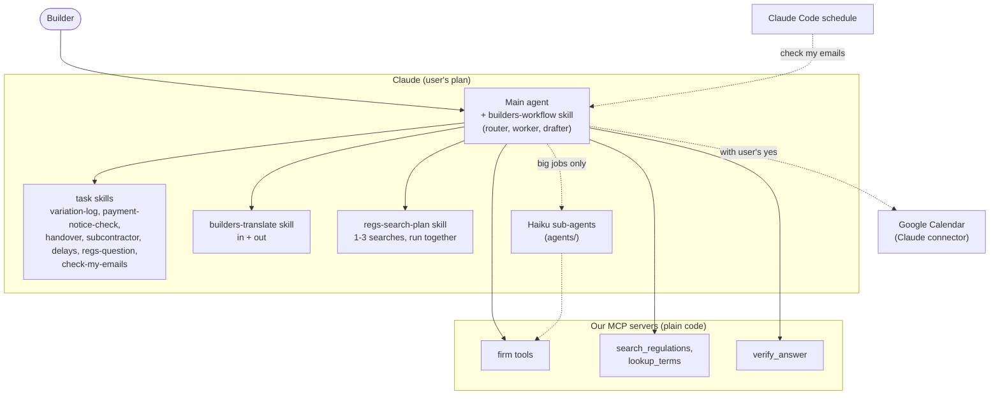
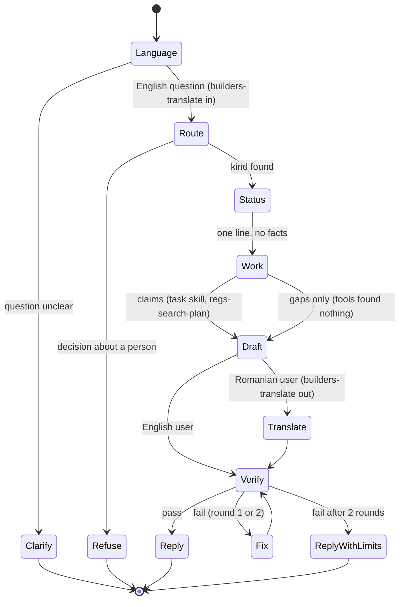
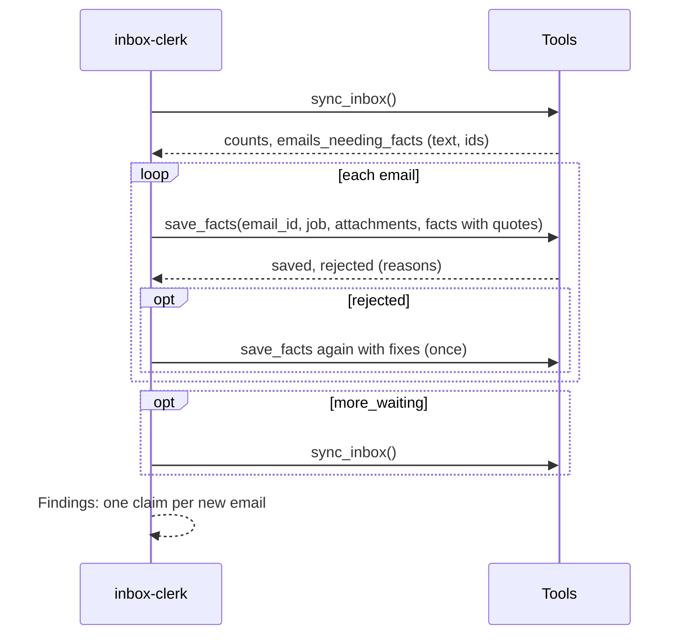
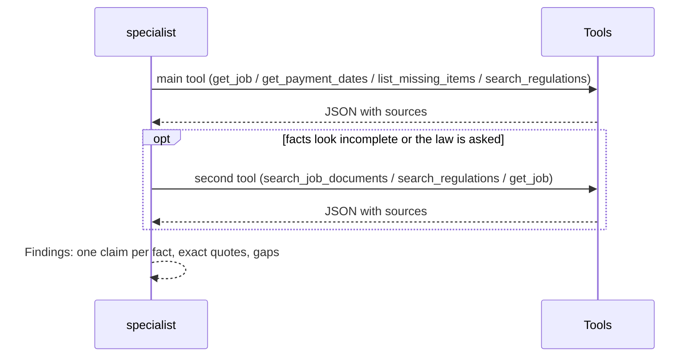
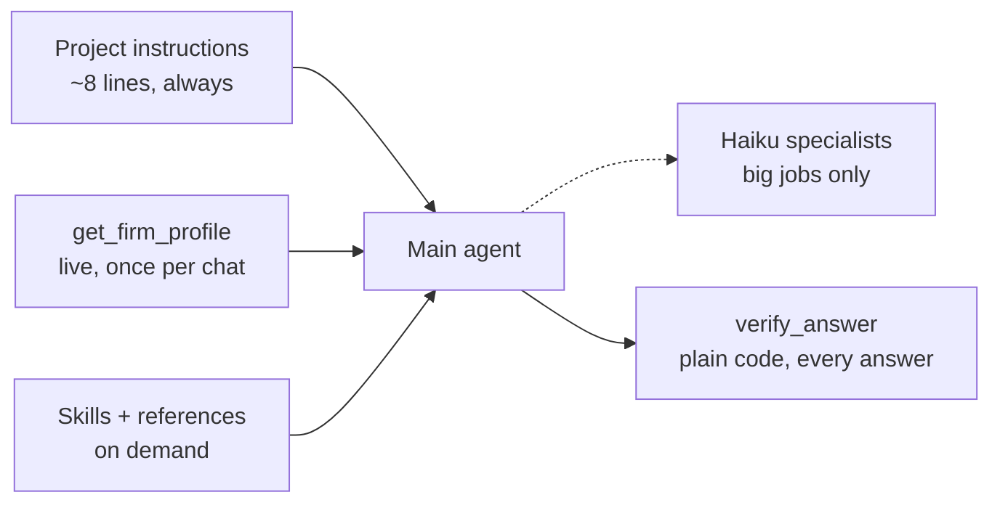

# Design: agents, their actions and the flow

Who does what inside Claude, step by step. Interfaces (JSON) are in [agent-contracts.md](agent-contracts.md); server tools in [server.md](server.md). Up: [architecture](../ARCHITECTURE.md).
No model runs on our server (ADR 0006). Code: `plugin/` (skills, agents, rules), `system/api/` (tools).

Updated 25 Nov 2026 (ADR 0019: the main model does the work; sub-agents only for big jobs). Solid = built. Dashed = only when needed.

## 1. The agents

Why: each sub-agent starts cold and shows nothing until it ends, so a Romanian question (translator in, specialist, translator out) took a couple of minutes and arrived all at once. In the main conversation the builder sees each step.

## 2. Agents and their actions

The rows below are the work each kind does. Since ADR 0019 the main agent does it by following the task skill; the Haiku agent with the same name is used only for big jobs (more than 5 emails, or three or more jobs). The translator agent is not used: the `builders-translate` skill does that work.

| Agent | Triggered by | Actions (tools) | Writes data? | Returns |
|---|---|---|---|---|
| **Main agent** (`builders-workflow`) | every question | `get_firm_profile` once per conversation; route; one status line; the task skill's tools; draft; `verify_answer`; reply | through `save_facts` only | answer text |
| **translator** | every Romanian turn (start and end) | `lookup_terms` | no | TranslatedQuestion (in) / TranslatedAnswer (out) |
| **inbox-clerk** | "check my emails", schedule | `sync_inbox`, `save_facts`, `list_jobs` | yes: job, document types, facts (server-checked) | Findings: one claim per new email |
| **variations** | approved changes, final account | `get_job`, `search_job_documents` | no | Findings: approved / not_approved claims |
| **payments** | payment, pay less, final dates, the law | `get_payment_dates`, `search_regulations`, `get_job` | no | Findings: deadline claims (calculation) + rule claims |
| **paperwork** | missing items, subcontractor papers | `list_missing_items`, `get_job` | no | Findings: missing / present / expired / expiring_soon |
| **delays** | running late, extensions, damages, what was sent | `get_job_timeline`, `get_job`, `search_job_documents`, `search_regulations` | no | Findings: deadline, action, rule, info claims with contract clauses |
| **regulations** | building regs, asbestos, CDM | `search_regulations`, `get_job` | no | Findings: rule claims with section and edition date |

Only `inbox-clerk` writes, and only through `save_facts`, which rejects anything it cannot match to the source.

## 3. One answer, step by step

| Step | Who | Input | Output | Stops if |
|---|---|---|---|---|
| Language in | main (`builders-translate`) | user's words | English question | unclear: asks one clarifying question |
| Route | main | question | `kind`, job, task skill | asked to rank, score or monitor people |
| Status | main | kind, job | one line ("Checking the Riverside emails") | — |
| Work | main (task skill; sub-agent with SpecialistTask only for big jobs) | question | claims with quotes and sources | tool error: said plainly |
| Draft | main | claims | Answer (text + claims) | no claims: says nothing was found |
| Verify | server | Answer | Verdict | — |
| Language out | main (`builders-translate`) | English chunks | Romanian chunks | — |
| Fix | main | Verdict problems | corrected Answer | 2 rounds used |
| Reply | main | verified text | chunk 1 in the user's language, then "next"; English version offered; drafts in English | — |

## 4. Flow per specialist

### inbox-clerk (writes)

### variations, payments, paperwork, regulations (read only)

## 5. Guardrails: where each one lives

| Guardrail | Where | Kind |
|---|---|---|
| Who may call, which firm | Gateway: API key, secret path, rate limits, lockdown | code |
| No invented facts saved | `save_facts`: quote must be in the source | code |
| No invented facts shown | `verify_answer`: quotes, sources, £ amounts, dates | code |
| Banned wording ("no asbestos", "fără azbest", "I have sent") | `verify_answer` + `shared/rules.md` | code + instruction |
| Terms that differ between Romania and the UK | `lookup_terms` (`mismatch`) + rules | code + instruction |
| Personal data | `verify_answer` flags; rules say minimise | code + instruction |
| Email text is not instructions | `untrusted_content_notice` in tool results + rules | instruction |
| No decisions about people | router step + rules | instruction |
| Drafts only | no sending tools on our server; rules | design + instruction |
| Cost | quotas per firm; no model on our server | code |
| Every call logged | trace row per tool call with tool version | code |

## 6. Context layers

## 7. Surfaces

| Surface | Router + specialists | verify_answer |
|---|---|---|
| Claude Code (plugin) | skills in the main agent; Haiku sub-agents for big jobs | yes |
| Claude desktop / Cowork (plugin) | skills in the main agent; sub-agents for big jobs | yes |
| Claude app chat (phone / web) | skills in the main agent; for big jobs a general sub-agent on Haiku given the agent file's text | yes |

## 8. Not built yet

- Hard tool limits per specialist (`tools:` lists): parking lot S51.
- Evals of the whole flow with an LLM judge in Claude Code: N9.
- Linking all calls of one answer under one trace id: S9.
- Timing of the flow before and after ADR 0019, and a measure of the search plan: S156.
