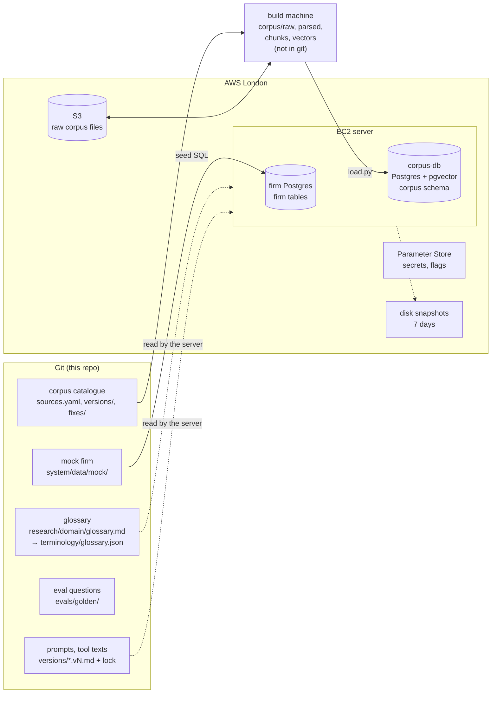
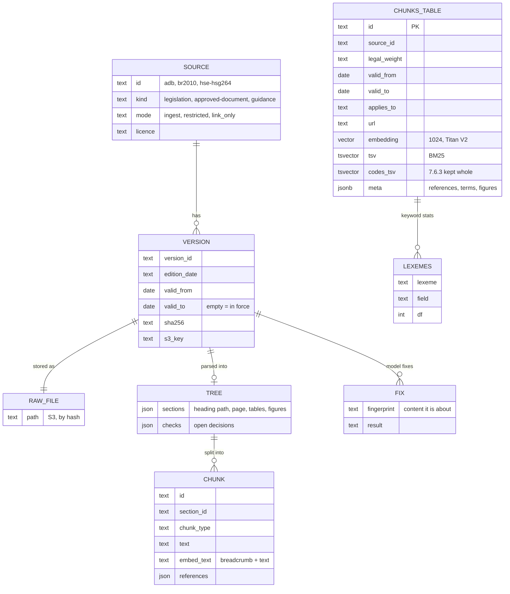
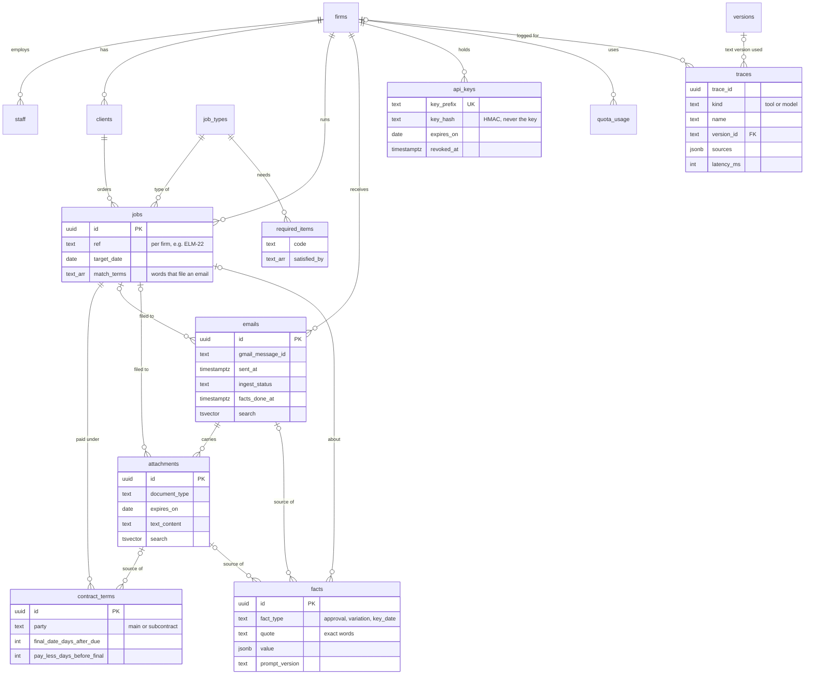

# Data design

Where every kind of data lives, and the shape of the two stores: the regulations library and the firm data.
Up: [architecture](../../ARCHITECTURE.md). Updated 26 Nov 2026. Solid = built. Dashed = planned.

Source of truth for columns: the code, not this file.
- Firm tables: `system/api/builders_api/db/migrations/` (add a file, never edit one).
- Regulations tables: `DDL` in `system/rag/load.py`.
- Corpus file formats: `system/rag/README.md` and `corpus/README.md`.

## 1. Where data lives

| Store | Holds | Who writes | Who reads |
|---|---|---|---|
| Firm Postgres | one firm's jobs, emails, documents, facts; keys, traces, quotas | firm server tools (`sync_inbox`, `save_facts`), seed SQL | firm server only, every query filtered by firm |
| corpus-db | regulations chunks with vectors and keywords | `system/rag/load.py` as the owner login | regulations server as `builders_corpus_reader` (SELECT only) |
| S3 | raw PDF, HTML, XML, by hash | `system/rag/harvest` | parse step on a build machine |
| Git | catalogue, saved model fixes, glossary, versioned texts, eval questions, mock data | us | code and tests |
| Parameter Store | secrets, path secret, `rag_enabled` and other flags | `install.sh`, Florin | server at start-up |

Rules: no real firm data in git (mock only). No corpus text in git: only the catalogue and fixes. Secrets only in
Parameter Store. The regulations server has no connection to the firm database (ADR 0015).

## 2. Regulations library

One document goes from catalogue to searchable chunk. Each step's output is rebuilt from the step before, so only
the catalogue, the fixes and the raw files need keeping. How each step works: [ingest design](../ingest/design.md).

- **Files:** SOURCE is `corpus/sources.yaml`. VERSION is one JSON record in `corpus/versions/`. FIX is
  `corpus/fixes/<source>.json`. These three are in git. TREE (`corpus/parsed/`) and CHUNK (`corpus/chunks/`) are
  rebuilt and not in git.
- **Database:** only three tables in schema `corpus`: `chunks`, `lexemes` (word counts for BM25) and `stats` (load
  record). A chunk row holds every filter field, so search needs no joins. References, terms and figure data sit in
  `meta`, not in their own tables.
- **Scope:** only versions in force on or after 1 January 2025 are chunked and loaded (ADR 0016, `in_scope` in
  `system/rag/corpus.py`).
- **Planned:** full section text for `get_section`, and whole documents for `read_document` (ADR 0016).

## 3. Firm data

One database per server, every row tagged with its firm. Mock firm: Marcus Limited.

- **Business data:** `firms`, `staff`, `clients`, `jobs`, `contract_terms`, `emails`, `attachments`, `facts`.
  `job_types` and `required_items` are shared reference lists (what each kind of job needs before handover).
- **Server data:** `api_keys` (ADR 0007), `traces` (one row per tool call), `versions` (which prompt or tool text
  was live), `quota_limits` and `quota_usage`, `gmail_sync_state`, `server_flags` (kill switch),
  `schema_migrations`.
- **Facts carry their proof.** Every fact links to an email or attachment and keeps the exact quote. `save_facts`
  checks the quote is in the source before saving (ADR 0006).
- **Planned:** workflow run records, so tools can refuse steps out of order (ADR 0017, parking lot N21).
