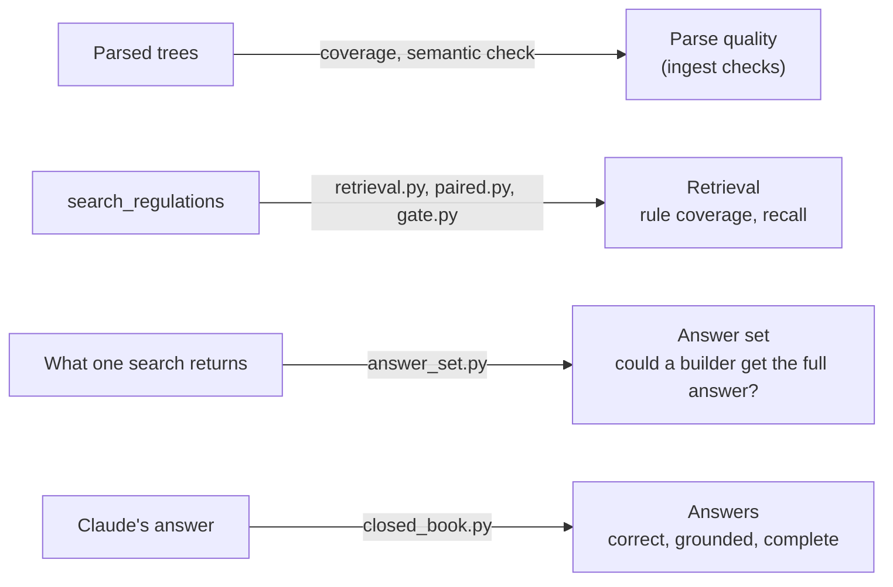
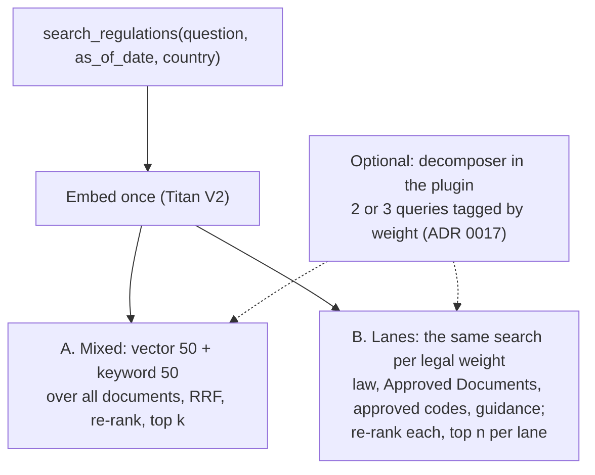

# Design: evals

How we measure search and answer quality, and decide changes. Up: [architecture](../../ARCHITECTURE.md).
Decisions: ADR 0013 (hybrid search), ADR 0016 (measure first, lanes), ADR 0017 (agent queries), ADR 0006 (no
model on our server). Code: `evals/`. Plan and status: [evals/PLAN.md](../../../evals/PLAN.md). Runs and results:
`evals/experiments/`. Terms and theory: [evals/knowledge/](../../../evals/knowledge/README.md).

## 1. What we measure

Parse quality is in the [ingest checks](../ingest/design.md#4-checks). This design covers the other three.

## 2. Ground rules

- **Dev only for decisions.** The holdout (about 20% per role, `evals/golden/holdout-ids.txt`) is checked once per
  milestone and never used for tuning.
- **No model on AWS** except the embedder (Titan V2) and the re-ranker (Amazon Rerank). Answers and judges run
  in Claude Code on the user's plan, as sub-agents or `claude -p`.
- **One judge per comparison.** Before and after are judged by the same model; rates name the judge.
- **Blind judging.** Packets are shuffled and hide which run made them; planted lines with a known verdict catch
  a careless judge.
- **No corpus text in git.** Packets, passages and answers stay in the scratchpad. Git holds ids, verdicts, grades
  and short reasons.
- **Every result** goes to `evals/results/` and a short note to `evals/experiments/`.

## 3. The golden set

| File | What |
|---|---|
| `golden/business/<role>.jsonl` | questions and reference answers, written from the raw documents (`tools/read_source.py`), blind to section ids |
| `golden/labelled/<role>.jsonl` | expected sections, from a separate labelling pass (`tools/find_sections.py`) |
| `golden/questions.jsonl` | the built set: question, expected sections, `also_acceptable`, split |
| `golden/pooled/rules.jsonl` | per question: its scope and its rules (one fact each the answer depends on) |
| `golden/pooled/judgments.jsonl` | pool judge verdicts, rule by rule, per passage |
| `golden/pooled/answer-sets-v2.jsonl` | answer-set grades |

Six roles: asbestos, building control, fire safety, housing repairs, money, site safety. Labels carry a
`labels_version`; remaps and relabels are logged (`remap.py`, `relabel.py`).

## 4. Metrics

- **Rule coverage at n** (main score since 25 Nov 2026, `paired.coverage()`): the share of a question's rules that
  the first n passages state, by the pool judge's verdicts. Two of three rules covered scores 0.67. It is nugget
  recall (TREC RAG) or context recall (RAGAS). A shown passage with no verdict counts as unjudged.
- **Recall at k, MRR, nDCG, all@k** (`metrics.py`): on section keys, never chunk text, so any chunker can be scored.
  "Found" counts an expected section or one the pool judge accepted.
- **Answer pass** (`closed_book.py`): the judge's verdict on each answer.

## 5. Statistics

- **By document, not question.** Questions from one document move together, so `paired.compare()` uses a
  permutation test and a bootstrap 95% interval over documents.
- **Several runs:** every pair compared, Holm-corrected (`paired.holm()`).
- **Yes/no outcomes:** exact McNemar on the discordant pairs (`metrics.mcnemar()`, `closed_book.mcnemar()`).
- **Judge agreement:** Cohen's kappa on the re-check sample (`answer_set.kappa()`).

## 6. What we are deciding now: mixed or lanes (ADR 0016)

| | A. Mixed | B. Lanes |
|---|---|---|
| Strength | Simple; the best passages win | Law is never pushed out by long guidance |
| Risk | Guidance (most of the corpus) crowds out the law | More passages; a weak lane still returns hits |
| Status | Live | Built in code and evals only (`pgsearch.search_lanes()`, S143) |

Mixed documents (L143, HSG248) are split by section: ACoP parts go to the approved-codes lane. Runs and results:
[B-mixed-vs-lanes.md](../../../evals/experiments/B-mixed-vs-lanes.md).

## 7. Flows

| Flow | What it covers |
|---|---|
| [Build the golden set](flows/build-golden-set.md) | questions, labels, splits, rules |
| [Retrieval run and gate](flows/retrieval-run-and-gate.md) | run search on dev, score, keep or drop a change |
| [Pool judging](flows/pool-judging.md) | judge passages that are not labelled, rule by rule |
| [Answer evals](flows/answer-evals.md) | answer-set judge and answers with and without the connector |

## 8. Not built yet

- Calibration: Florin or a builder reads about 50 judged items; agreement with the judge is reported.
- Multi-turn scenarios (follow-ups, corrections, a safety push), PLAN.md step 4.
- Answers through the full plugin flow (router, skill, `verify_answer`) as the thing judged.
- `evals/judge.py` is the first answer judge (Bedrock answer model and judge, 21 Nov 2026). It breaks the "no model
  on AWS" rule above and is not used for new runs; PLAN.md step 3 ports it to Claude Code.
