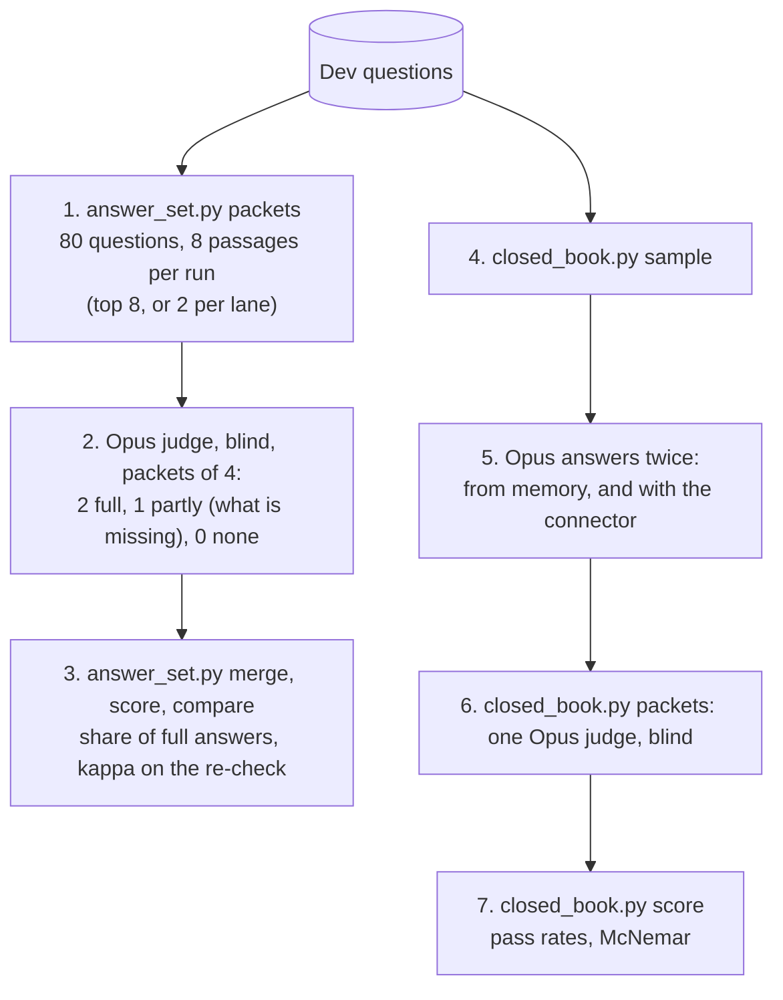

# Flow: answer evals

Two checks on what a builder would get: the passages one search returns, and the answer Claude writes.
Up: [eval design](../design.md). Both use dev questions only and one Opus judge.

- **Answer sets.** The same number of passages per run, so lanes do not win only by showing more. "What is
  missing" points at the fix: a missing law at lanes, a missing second rule at the decomposer. Grades:
  `pooled/answer-sets-v2.jsonl`; brief: `evals/golden/ANSWER-SET-BRIEF.md`.
- **Closed book (C1)** shows what the connector adds over the model's memory. Answers and packets stay out of git.
