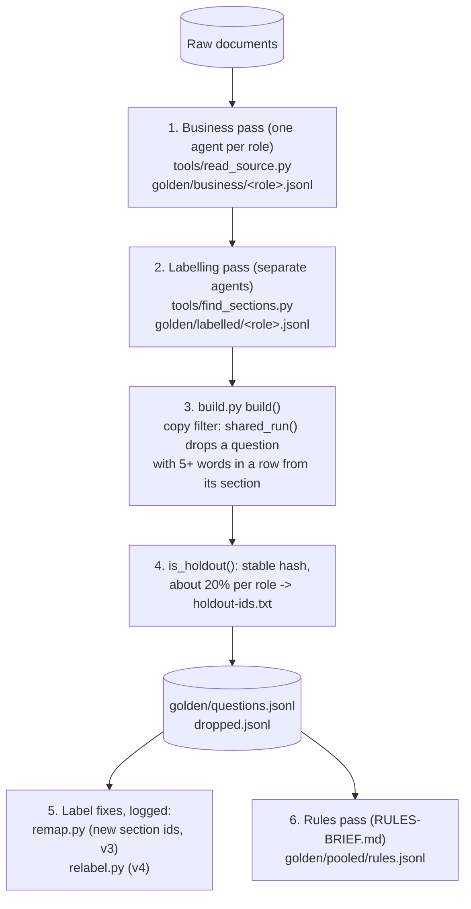

# Flow: build the golden set

Questions a builder would ask, the sections that answer them, and the rules each answer needs.
Up: [eval design](../design.md). Briefs for each pass: `evals/golden/*-BRIEF.md`.

- **Blind on purpose.** The business pass never sees section ids, so questions are not written from the parser's
  view. The labelling pass never writes questions.
- **The holdout** is fixed by the hash, so a rebuild keeps the same split. It is never used for tuning.
- **Rules** are the facts an answer depends on, one per line. The pool judge and rule coverage use them.
