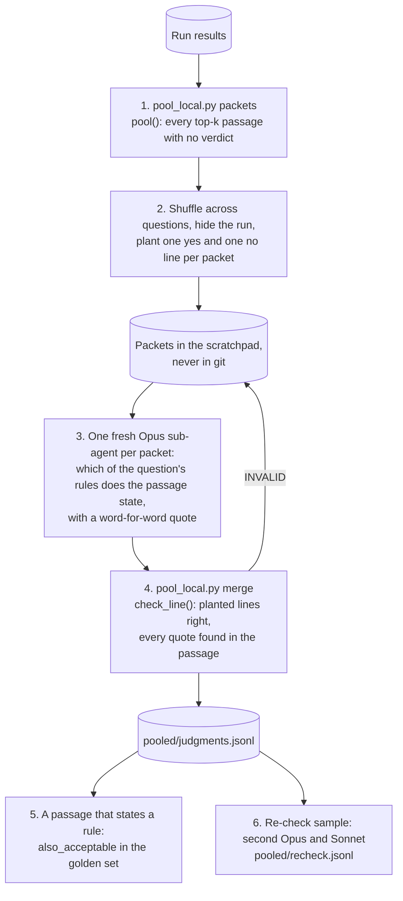

# Flow: pool judging

Passages search found that are not in the labels get a verdict, rule by rule. Up: [eval design](../design.md).
Brief: `evals/golden/POOL-JUDGE-BRIEF.md`. The pool is a test tool only; nothing of it runs in live search.

- **Bad packets** (a planted line wrong, a quote not in the passage) are judged again in a new packet.
- **Re-check.** Opus against Opus shows noise; Opus against Sonnet shows the model gap. If Sonnet agrees as well as
  Opus agrees with itself, later pools can use Sonnet. Florin checks a small sample as tie-breaker.
