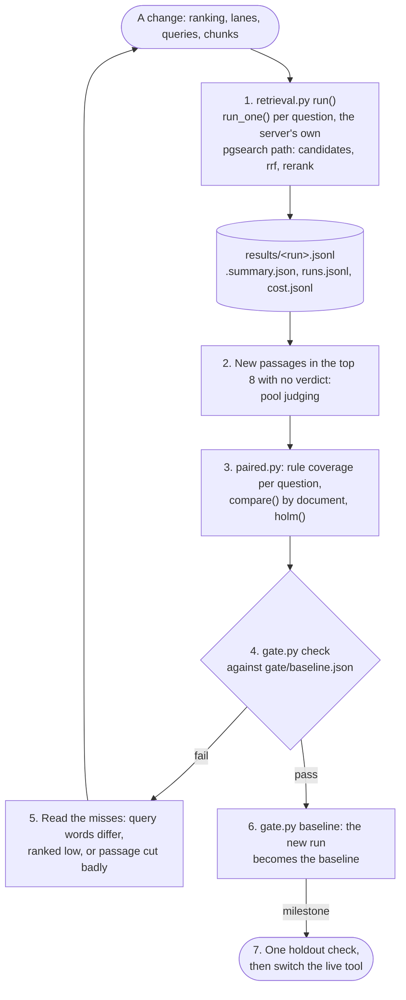

# Flow: retrieval run and gate

Run search on every dev question, score it, and keep or drop the change. Up: [eval design](../design.md).
Runs so far: `evals/experiments/`. Settings: `evals/README.md`.

1. **Run.** `EVAL_LANES` turns on lanes (`lanes_search()`), `EVAL_QUERIES_FROM` uses agent queries saved from an
   earlier run (`fused_search()`). `rescore()` scores an old run again with a new floor or new verdicts, without
   searching.
2. **Pool.** See [pool judging](pool-judging.md). An unjudged passage makes the gate fail, so nothing is scored on
   a guess.
4. **Gate.** Fails when the change loses more questions than it gains, drops rule coverage at 8 by more than 2
   points, or loses a must-pass question (`gate.py must-pass` picks them per role).
5. **Misses** route the fix: different words go to the query side (decomposer, terms), low rank to ranking (lane
   sizes, re-rank, k), a bad cut to re-chunking, only if the numbers show it.
