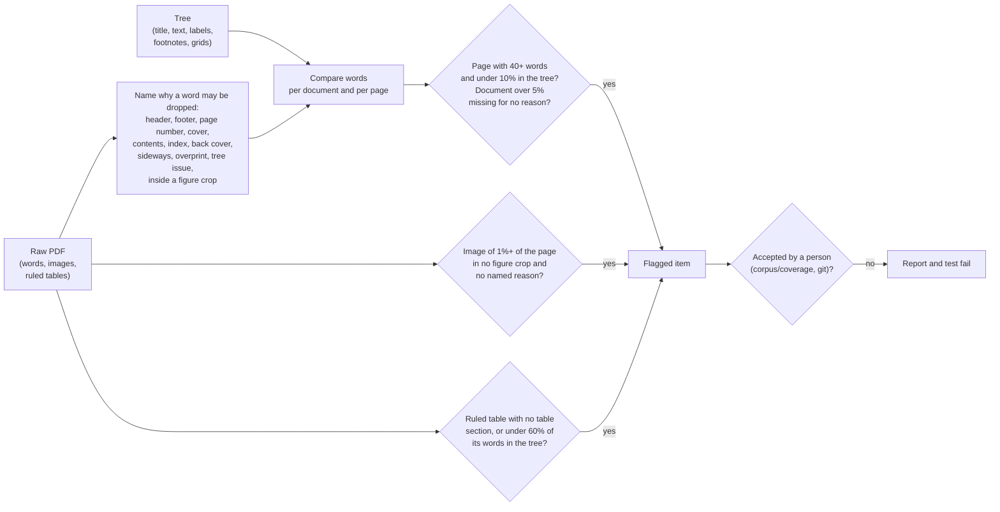
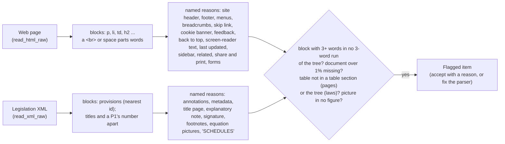
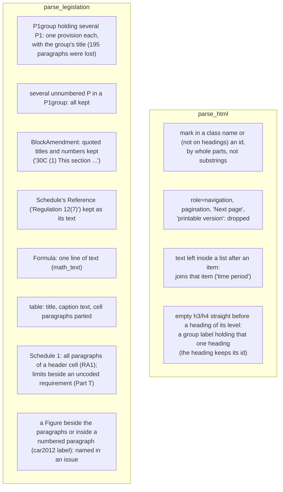

# Check: coverage (raw file against tree)

Counts words, images and tables the tree lost. Up: [ingest design](../design.md). Flow: [checks](../flows/checks.md). Code: `system/rag/coverage.py`. Report: `corpus/coverage.md`.

Six PDFs once parsed to empty trees and nobody noticed (parking lot S103). `system/rag/coverage.py` now compares
each raw PDF with its tree. Plain code, no model (ADR 0006). It reads the PDF itself with pdfplumber, not through
the parser's reader, so reader bugs show up too.

Pages before the first section are judged as front matter; a parse_pdf "Front matter" chapter (content kept from
before the first chapter title) does not end them, so the imprint page after a cover blurb is still front matter.
A "ruled table" as large as the page is a frame round it, not a table. Images use parse_pdf's own signature, logo and
cover-thumbnail rule (S107). A tree issue that quotes the few lines it skipped explains only those lines; one that
skips a whole page explains the page. "A short page" counts upright words only (not a cover's sideways spine). A
ruled table wholly inside a figure crop is kept as the picture, as the words inside a crop are.

Words are compared as a multiset after normalising (case, ligatures, punctuation, hyphens, bullets). Split words
("W hat") and ligatures the font dropped ("fre" for "fire") still match. The report also lists tree words that
are not in the PDF: from text fields (parser glue, such as words run together) and from model-built grids apart.

## Web pages and legislation XML (S106, built 22 Nov 2026)

Two more readers, plain lxml, not the parsers' own readers. Both give blocks of visible text; the same check runs on
both (`check_blocks`).

A class mark matches whole parts of a class name split at - and _ ("hse-back-to-top__link" has back-to-top;
"research" does not have search). parse_html now uses the same rule; it used to match substrings, and the heading
ids "searching-for-opportunities", "declare-and-share" and "...shared-ownership-homes" dropped real headings.

What the readers found and the parsers now do (22 Nov 2026):

Pictures on web pages are kept only as alt text; 38 GOV.UK pictures with no alt text are accepted with that reason
(S121). Shortcuts: S122.

