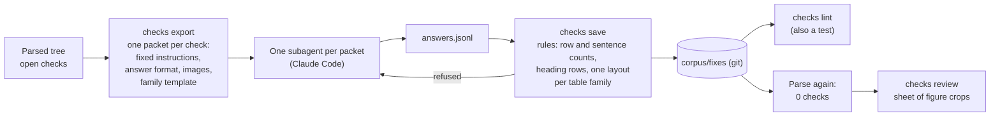

# Check: model checks and saved fixes

Up: [ingest design](../design.md). Flow: [checks](../flows/checks.md). Code: `system/rag/checks.py`, `fixes.py`. Runbook: `.claude/skills/corpus-document/SKILL.md`.

Same steps for every document. Runbook: `.claude/skills/corpus-document/SKILL.md`. Code: `system/rag/checks.py`.

Tables in one family (same title before " for ", like the HSG227 worked examples) share one layout: the first one goes alone, and the rest get its saved fix as a template. A table whose title only looks like a family's, but whose printed layout differs (checked on the page), is listed in `NOT_A_FAMILY` in `checks.py` with the reason (AD H Table 12, AD L Volume 2 Table 5.4).

Table columns (23 Nov 2026): when headings are printed in two or more rows, a column's name joins them from the top down
with ": " ("Alternative minimum provisions when tested to BS 476 (minutes): Integrity"), so no column loses its group
heading. Before, the instruction asked for the lowest header row only, and the semantic check found AD B Tables B1,
B3, B4 and B5 with columns such as "Walls", "Door leaf", "Walls", "Door leaf".

To do a saved fix again (a better instruction, a wrong fix), set `CORPUS_REDO=key1,key2` while parsing, exporting
and saving: the fix file is read as if those fixes were not there, the checks come back, and `checks save` writes
the new answer over the old one. The file is never edited by hand. When a parser fix only changes a section's id
(its text and labels are the same), the saved fix is re-keyed by script, with the reason added to the fix.

A model answer can vary between runs, so every model fix is saved in `corpus/fixes/` (git) with a fingerprint of the content it is about, and reused. The parser lists what is still open as `checks`. Re-parsing gives the same result unless we choose to redo a fix. Counting fixes shows what the library should learn next.
