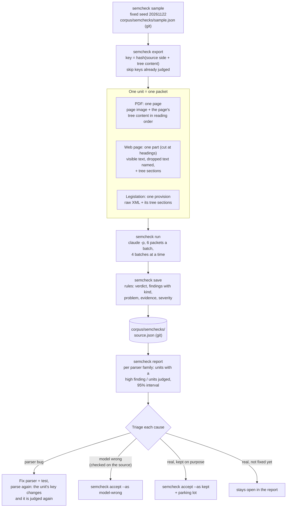

# Check: semantic (a model reads source and tree side by side)

Up: [ingest design](../design.md). Flow: [checks](../flows/checks.md). Code: `system/rag/semcheck.py`.

The coverage check counts words. It cannot see a value in the wrong column, a heading read as body text or a
paragraph under the wrong number. `system/rag/semcheck.py` asks a model (headless Claude Code on the user's plan; no
model on our server, ADR 0006; the judge is a setting, `--model` or `SEMCHECK_MODEL`, default Opus 5.5 since
23 Nov 2026, Fable 5.2 in the first round) to compare the source with the tree, one unit at a time.

- **Verdicts:** ok, missing, garbled, order, structure, table, figure, extra. Each finding has a one-sentence
  problem, quoted evidence and a severity: high (changes meaning or loses a rule, number or limit) or low.
- **A PDF page's tree content** is every section that `coverage.section_pages` puts on the page. A section that
  started on an earlier page is shown only when five of its words in a row are on this page, and a long one is cut
  to that part. Tables are shown as grid, columns and their printed text (the notes under a table are only there).
- **The sample** (rule and counts are in `sample.json`): every web page; per PDF a random 10% of pages, at least 3,
  plus every other page with a table; about 300 provisions over all laws. Rates per parser family come from the
  random (base) pages; table pages are reported apart because they are picked, not drawn.
- **Judge noise (23 Nov 2026):** unchanged units judged again flip their high flag 5% of the time (13% of high
  units lose it, 2.5% of the others gain it). A fix is judged by a paired before/after table on the units it
  changed (McNemar exact test), read against that noise, and every unit it "broke" is looked at.
- **Legislation versions:** a provision printed twice under one id (for E+W+S and for N.I.) is shown in the
  version whose extent is the tree's `applies_to`. `semcheck run` judges only packets with no verdict.
- **One store per judge (23 Nov 2026):** Fable 5.2's verdicts stay in `corpus/semchecks/<source>.json`, any other
  model's go to `corpus/semchecks/<model>/<source>.json`, each verdict naming its model. A paired before/after table
  uses one judge on both sides; rates are always given with the judge named.
- **Not a gate.** The report lists open findings and exits 1 while any are open. No test asserts zero: a finding is
  never accepted only to make the report pass.

Method, numbers and limits of the first run: [evals/experiments/P-semantic-validation.md](../../../../evals/experiments/P-semantic-validation.md).

