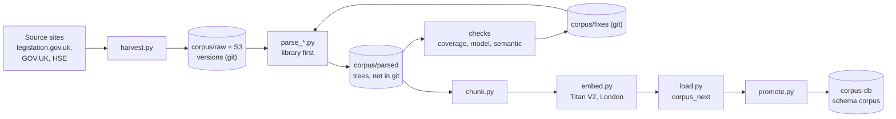

# Design: ingest (regulations corpus)

How public regulations become the search index. Up: [architecture](../../ARCHITECTURE.md).
Decisions: ADR 0008 (harvest, storage, fingerprints), ADR 0010 (library first, model checks), ADR 0013 (hybrid
search), ADR 0016 (scope and retrieval). What is stored: [data design](../data/design.md#2-regulations-library).
How search uses it: [search flow](../runtime/flows/search-regulations.md). Corpus files: [corpus/README.md](../../../corpus/README.md).
Step by step for one document: `.claude/skills/corpus-document/SKILL.md`.

## 1. Pipeline

Everything up to the load runs on a developer machine, in Claude Code (model work on the user's plan, ADR 0006).
The server only stores and searches.

- **Parse and chunk are separate.** A tree can be checked on its own, and the chunker can change without parsing
  again. Trees, chunks, vectors and images are rebuilt from raw files and saved fixes, so they stay out of git.
- **One command rebuilds it all:** `python -m system.rag.build` (harvest missing files, parse, chunk, embed,
  local index; `--load` loads). It stops while any tree has open model checks.

## 2. Library first, the model fills the gaps (ADR 0010)

Plain code (lxml, pdfplumber) does the parse. A model checks only what code cannot decide: tables, figures and
unclear cases. Each model answer is saved in `corpus/fixes/` with a fingerprint of the content it is about, and
reused, so a re-parse gives the same tree. Counting fixes shows what the code should learn next.

## 3. Parsers

The parser for each source is named in `corpus/sources.yaml` (`corpus.parser_for`).

| Parser | Documents | Rules |
|---|---|---|
| `parse_legislation` | Laws and regulations (legislation.gov.uk XML) | Coverage findings: [coverage check](checks/coverage.md#web-pages-and-legislation-xml-s106-built-22-nov-2026) |
| `parse_adoc` | Approved Documents | [parse_adoc](parsers/parse_adoc.md) |
| `parse_pdf` | HSE and other guidance PDFs | [parse_pdf](parsers/parse_pdf.md) |
| `parse_guide`, `parse_flats`, `parse_booklet` | Home Office fire safety guides | [fire guides](parsers/fire-guides.md) |
| `parse_html` | GOV.UK and other web pages | Coverage findings: [coverage check](checks/coverage.md#web-pages-and-legislation-xml-s106-built-22-nov-2026) |

What the first files looked like (profiled 20 Nov 2026):

- **Building Regulations XML:** Wales-only regulations sit in a separate `Versions` block. Schedule 1 Parts K, M
  and O appear twice with no extent attribute (the notes say which copy is which). Before 1 Oct 2015, Schedule 1
  is images only.
- **Approved Documents:** a watermark on every page; diagram labels mix into the text; one font drops "fi"; no
  library extracts the tables cleanly, so the model checks every table.
- **HSG227** (2002) is older than CAR 2012: answers show its date.

## 4. Checks

Three checks, each with its own reference. None is a model on the server.

| Check | What it finds | Reference |
|---|---|---|
| Coverage | words, images and tables the tree lost (plain code) | [coverage](checks/coverage.md) |
| Model checks | tables, figures and unclear cases, saved as fixes | [model checks](checks/model-check.md) |
| Semantic | wrong column, heading read as text, wrong numbering (a model judges a sample) | [semantic](checks/semantic.md) |

## 5. Scope (ADR 0016)

`corpus.in_scope`: a version is in scope when its `valid_to` is empty or on or after 1 January 2025. Chunking,
loading, model checks, crop checks and the coverage check use it. Older versions keep their records and raw files;
they are not chunked or checked. Pages that list old editions side by side (`adb-historical`) take each part's
dates from `in_force_parts` in `sources.yaml`. The corpus is English only (`corpus.english`).

## 6. Chunks

| Document | One chunk per | Notes |
|---|---|---|
| Legislation | regulation | Split at (1), (2) only when long; every split is in `corpus/chunk-report.md`. |
| Schedule 1 | requirement (B1, M4(1)) | With its "limits on application" text. |
| Regulation 2 | definition | One chunk per defined term. |
| Guidance PDFs | numbered paragraph (2.5, 47) | With its lettered lists. Boxes and notes are their own chunks. |
| Tables | table, plus one sentence per row | Row sentences come from the saved model fixes. |
| Figures | figure | Image cut from the PDF; caption, labels and model description are searchable. |

Headings give no chunks; they are the breadcrumb. Chunk field rules:

- **Filter fields are copied onto every chunk**, so search filters without joins.
- **The breadcrumb goes into the embedded text** (`embed_text`), for example "Building Regulations › Part B › B1
  Means of warning and escape › ...". A short paragraph alone often does not say what it is about.
- **Codes stay whole.** "7.6.3", "B1" and "M4(1)" are one keyword (`codes_tsv`).
- **`kind` and `legal_weight`** come from `corpus/sources.yaml`, so answers can say "the law requires" or "the
  guidance says". Approved Documents are statutory guidance; HSE "L" books are approved codes of practice.
- **Long chunks** (over 2,500 characters) are split: regulations at (1), (2), guidance at list items.
- **Citations** use the printed page number; the file page is internal.

## 7. Flows

| Flow | What it covers |
|---|---|
| [Harvest](flows/harvest.md) | source sites to raw files and version records |
| [Parse](flows/parse.md) | raw file to a document tree, with saved fixes |
| [Checks](flows/checks.md) | coverage, model checks and the semantic check |
| [Chunk, embed, load](flows/chunk-embed-load.md) | trees to the live index, with promote and rollback |

## 8. Not built yet

- `get_section(section_id)` and `read_document`: the full text of a passage's section (N15, ADR 0016).
- Lanes by legal weight: `pgsearch.search_lanes()` is built, not live ([retrieval-tuning.md](../retrieval-tuning.md)).
- Optional passage keys for the server (`section_id`, `applies_to`, `legal_weight`, `printed_page`, `image_url`):
  to agree in the contract, [system/rag/README.md](../../../system/rag/README.md).
- Figure images are not served to answers yet.
