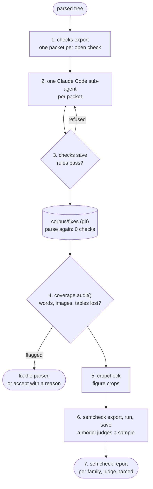

# Flow: check a document tree

The three checks on a tree, coverage, model checks, crop check and semantic check. Up: [ingest design](../design.md).
Details: [coverage](../checks/coverage.md), [model checks](../checks/model-check.md), [semantic](../checks/semantic.md).

- **Steps 1 to 3** are `system/rag/checks.py`; `checks lint` is also a test.
- **Step 4** is plain code and a test: an item fails until it is fixed or accepted by a person (`corpus/coverage/`).
- **Step 6** is not a gate. Open findings stay in the report until a parser fix or a reasoned accept; one store per
  judge (`corpus/semchecks/`).
