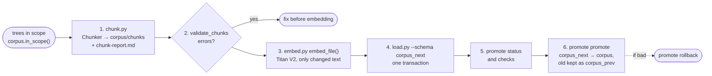

# Flow: chunk, embed and load

Trees in scope to the live index. Up: [ingest design](../design.md). Store: [data design](../../data/design.md#2-regulations-library).

- **Step 1** writes one JSON line per chunk with filter fields, `text`, `embed_text`, `references` and `terms`.
  Units and field rules: [ingest design](../design.md#6-chunks).
- **Step 3** writes `corpus/vectors` (not in git). A fingerprint per chunk means unchanged text costs nothing.
- **Steps 4 to 6** run as `builders_corpus_owner`, with the owner URL from Parameter Store. Each swap is one
  transaction, so the server sees the old corpus or the new one, never half. The server reads as
  `builders_corpus_reader`.
