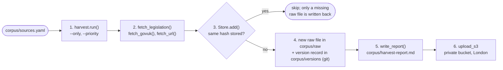

# Flow: harvest

Source sites to raw files and version records. Up: [ingest design](../design.md). Decision: ADR 0008.
Code: `system/rag/harvest.py`, `system/rag/corpus.py`. Sources: `corpus/sources.yaml`.

1. **Versions by hash.** A stored version is never overwritten. Legislation keeps every version
   (`leg_versions()`); the record carries `valid_from`, `valid_to` and the content hash.
2. **Raw files are not in git.** They live in `corpus/raw` and S3 (`upload_s3 --download` fills a new machine).
   The five laws whose raw files are in neither are fetched again with `--accept-refetch` (S126).
3. **The bucket name** comes from `CORPUS_BUCKET` and is never written to the repo.
