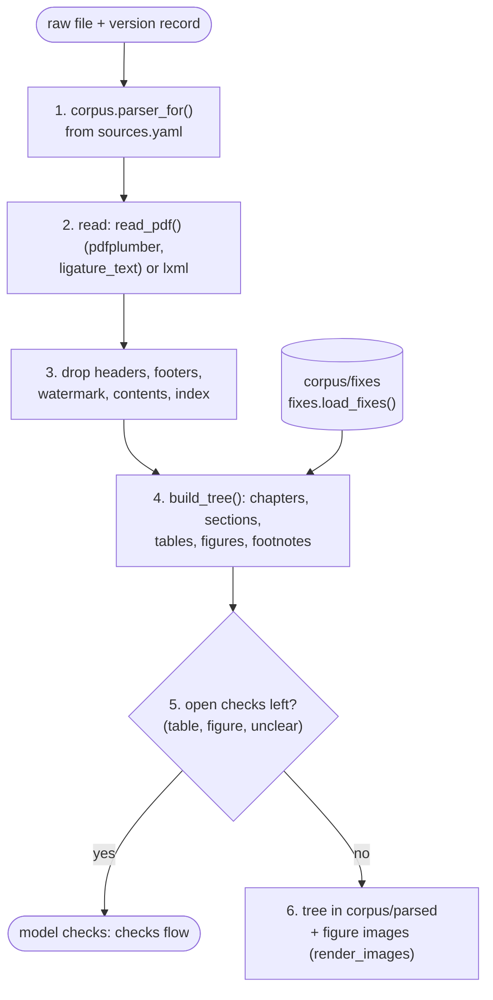

# Flow: parse one document

Raw file to a checked document tree. Up: [ingest design](../design.md). Decision: ADR 0010.
Runbook: `.claude/skills/corpus-document/SKILL.md`. Rules per parser: [parsers](../design.md#3-parsers).

- **Steps 2 to 4** are each parser's own code (`parse_pdf`, `parse_adoc`, `parse_guide`, `parse_flats`,
  `parse_booklet`, `parse_html`, `parse_legislation`). They share one tree format.
- **Saved fixes** are matched by `fixes.content_key()`, a fingerprint of the content. `CORPUS_REDO=key1,key2`
  reads the file as if those fixes were not there, to redo them.
- **Same result everywhere.** The same raw file and fixes give the same tree on any machine.
