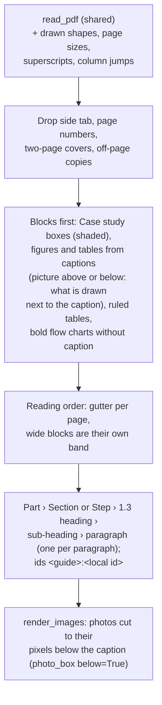
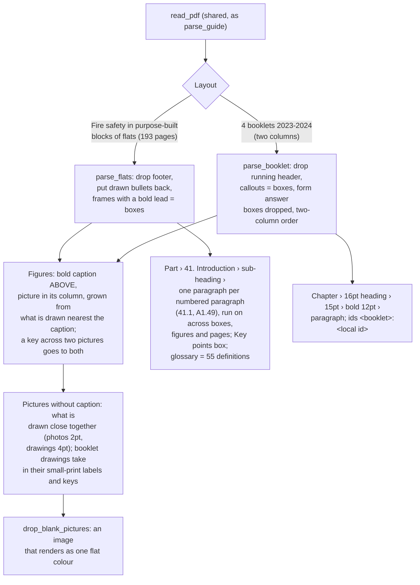

# Parser rules: fire safety guides (parse_guide, parse_flats, parse_booklet)

Up: [ingest design](../design.md). Flow: [parse](../flows/parse.md). Code: `system/rag/parse_guide.py`, `parse_flats.py`, `parse_booklet.py`.

## Home Office fire risk assessment guides (parse_guide, built 22 Nov 2026)

The 2006 "Fire safety risk assessment" sector guides and the disabled people supplement share one template that
parse_pdf (numbered paragraphs, captions under pictures) reads badly. `parse_guide` takes these 13 files of
`fso-guidance-collection`; `sources.yaml` names them by version id prefix (`parser.files`), parse_pdf skips them
and `build` runs both. Styles are told apart by role, since the guides use different fonts.

Known source quirks are listed as tree issues (a figure or table number printed twice, a heading printed without
its number). Shortcuts: parking lot S90 to S92.

## Purpose-built flats guide and Home Office booklets (parse_flats, parse_booklet, built 22 Nov 2026)

The other five PDFs of `fso-guidance-collection` have two more layouts, so each has its own parser
(`sources.yaml` `parser.files`). Both reuse GuideBuilder's helpers (drawn objects, ruled tables, sections) and
parse_pdf's reading and rendering; their own passes leave parse_guide's output unchanged.

Printing gaps (paragraphs 71.6, 82.2, 83.3 not printed; 79.9 to 79.11 blacked out; "1.62" for A1.62) are tree
issues and listed in `corpus/README.md`. Shortcuts: parking lot S93 to S95.

