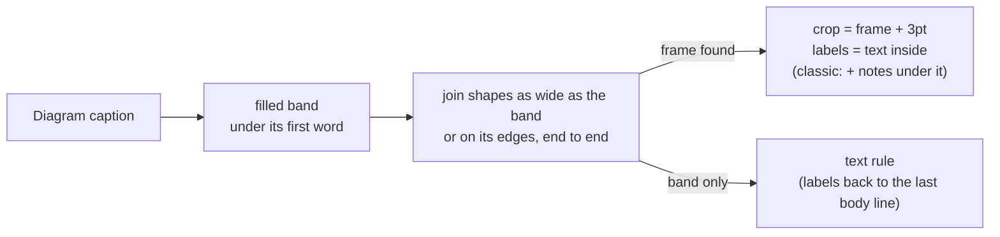
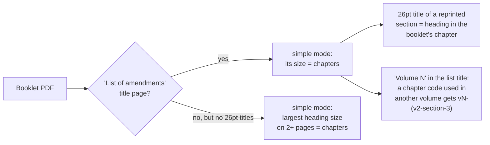
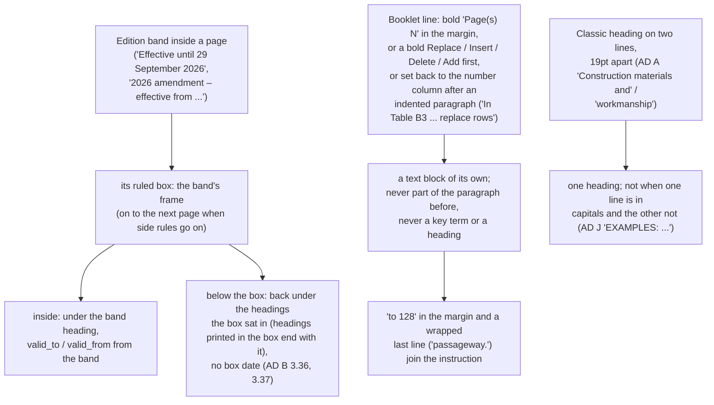

# Parser rules: parse_adoc (Approved Documents)

Up: [ingest design](../design.md). Flow: [parse](../flows/parse.md). Code: `system/rag/parse_adoc.py`.

## Approved Documents (parse_adoc, built 20 Nov 2026)

The 2019-layout Approved Documents are read by fonts, sizes and colours: 26pt chapters, 20/15pt headings, semibold paragraph numbers, white diagram captions on a green band, bold table captions, green words as links to key terms. Edition banners ("Effective until 1 September 2029", "effective from 2 September 2029") date the two copies of Appendices B and C. Letters dropped from "fi"/"fl" by the PDF font are put back by checking the document's own words, and counted. Diagram crops are made for the model check; `images: check-only` in `sources.yaml` keeps them from users.

Diagram crops follow the drawn frame (22 Nov 2026). Each AD diagram sits in a ruled box with its caption on a filled band: at the bottom (2013+ layout) or the top (classic layout). The parser finds the band under the caption's first word, then joins every shape that lines up with it (a box or line as wide as the band, or a side drawn at its edge, even in pieces) until a gap or another band. The crop is that frame plus 3pt. Text inside the frame is the diagram's labels; in the classic layout small notes straight under the frame are too. A band with no frame (AD F Diagram 3.1, AD J Diagram 16) keeps the older text rule.

Amendment booklets and short notes have no 26pt chapters, so the largest heading size used on two or more pages
is the chapter size (simple mode). A booklet is also known by its "List of amendments" title pages, one per volume
(22 Nov 2026). The June 2022 AD B booklet reprints whole sections in the 2019 layout, with 26pt titles; it used
to lose Volume 1 (pages 2 to 17), because the parser skipped everything before the first 26pt title.

Pages before the first chapter are skipped (cover, contents). The older editions (AD B 2006, C, D, E, G, H, J, M
volume 2) print a "Main changes" page there (page 2); a bold heading starting "MAIN CHANGES" now opens a "Main changes"
chapter, read like any other. AD A and AD C 2013 print that page again near the back (the inside cover spread): the
repeat is a tree issue, and the document ends there.

Requirement boxes are `requirement` sections. In the 2019 layout they are small print under green bands; in the
classic editions (AD B 2006, AD M volume 2, AD Q) they are body-size type in a ruled frame, which used to come out
as running text with "Requirement Limits on application" glued to the line before. A ruled table whose first cell
starts "Requirement", with a "Limits on application" column and body-size lines inside, is now the box; its grid
goes to the model check like any requirement box.

Three smaller rules (22 Nov 2026): a line with every character printed twice ("AA ppeerrssoonn", AD P 2013's
quoted regulation 12(6A), AD K's Diagram 9.1 caption) is halved and counted in `repairs`, as tripled lines already
were; a ruled table with no caption, set in body type, with two or more filled rows (the FAQ notes' "which edition
applies" tables) is a table named after the heading above it; and in a booklet a one- or two-line block of small
print is a replacement table row, kept as text, not skipped as a picture of a page.

Fixes from the semantic check (23 Nov 2026, synthetic tests, [report](../../../../evals/experiments/P-semantic-validation.md)):

The ligature fix (both readers): some PDFs map the "fi" and "fl" glyphs to a bare "f" ("frst", "foor"). The reader
now takes a named ligature glyph's letters from its glyph name when the file's text table gives only the start of
them (`parse_pdf.ligature_text`).

