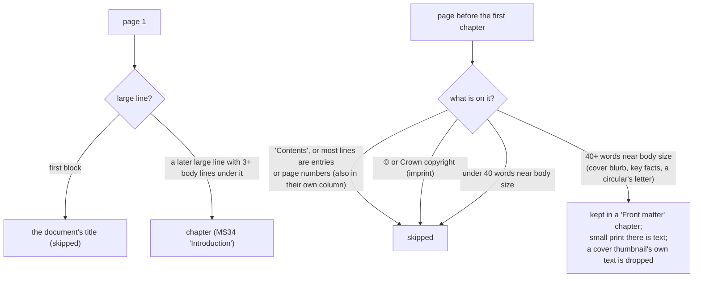
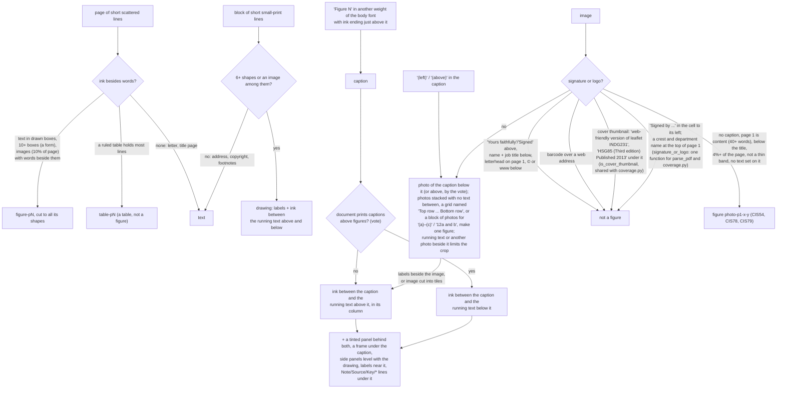
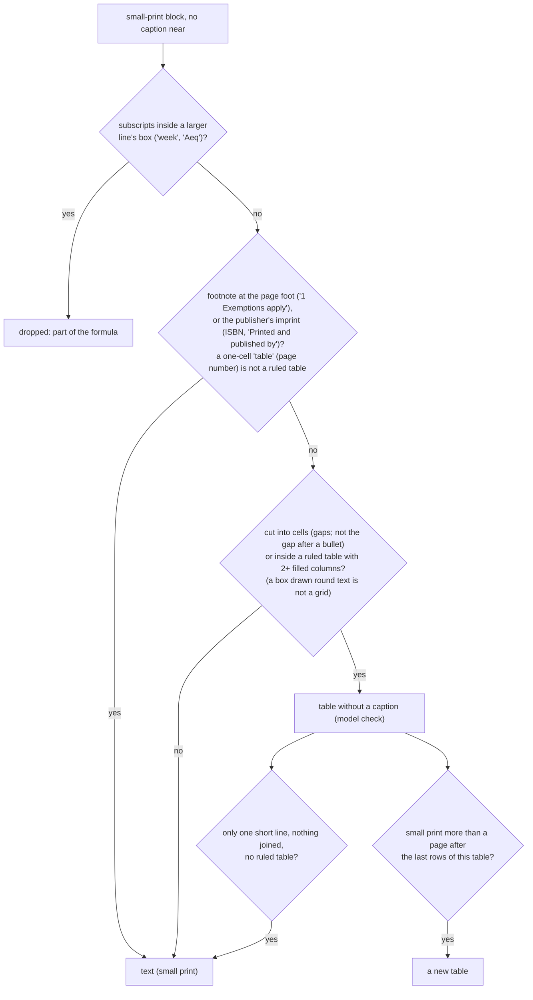
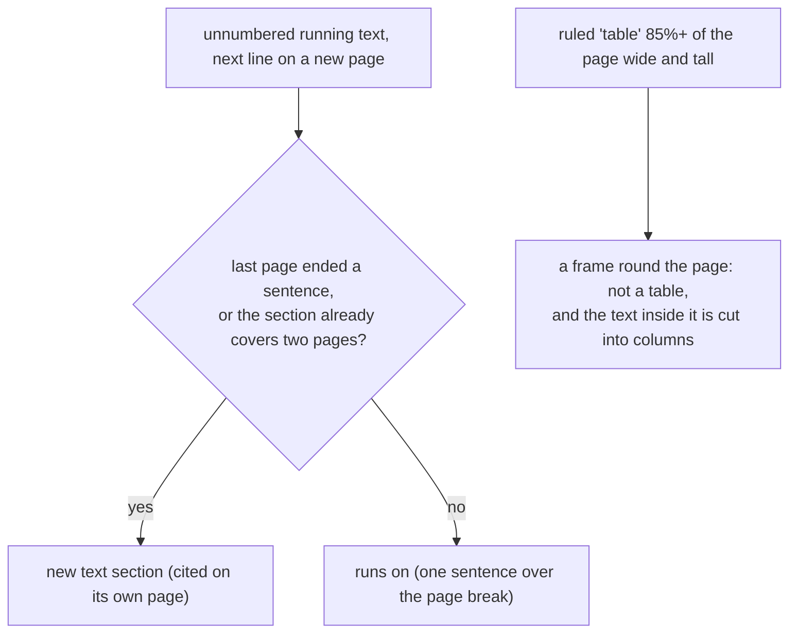
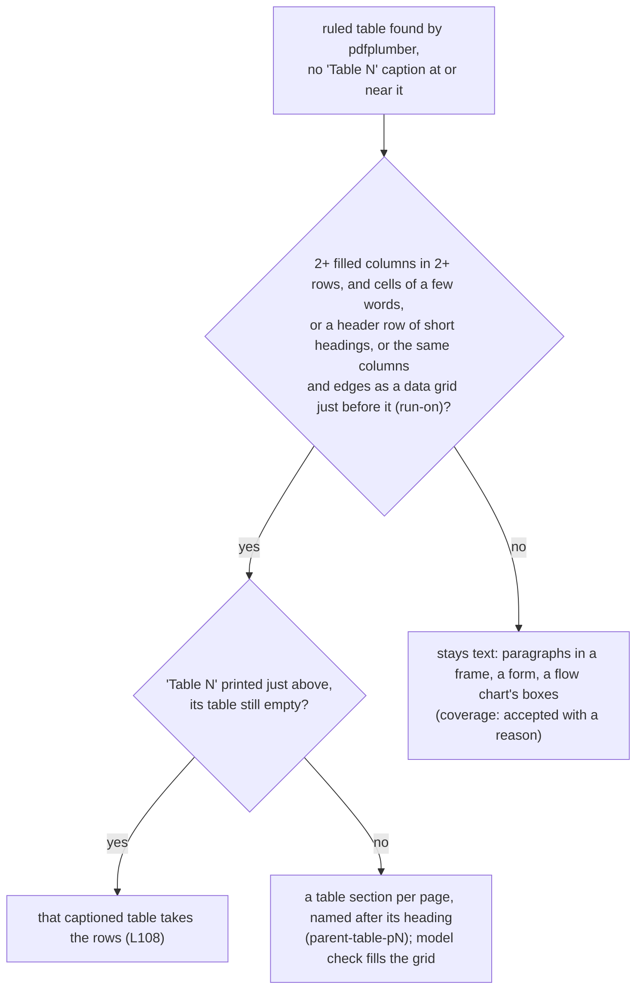
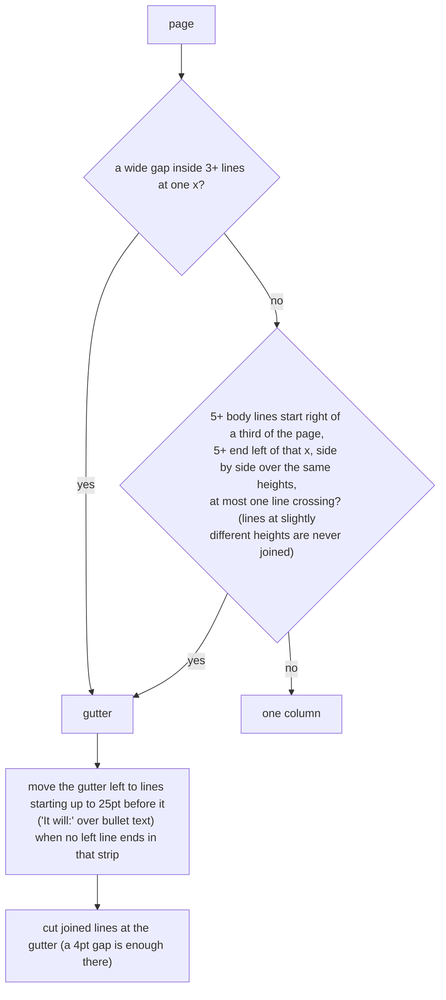
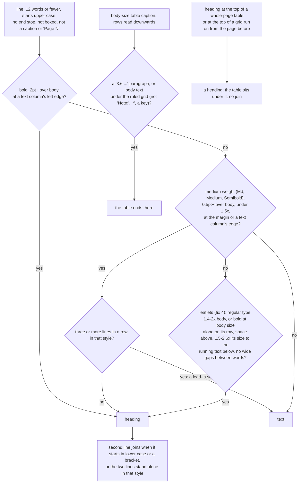
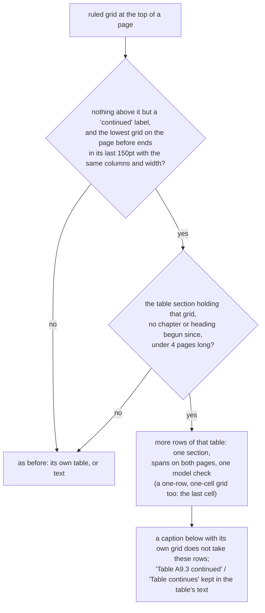

# Parser rules: parse_pdf (guidance PDFs)

Detailed rules for HSE and other guidance PDFs. Up: [ingest design](../design.md). Flow: [parse](../flows/parse.md). Code: `system/rag/parse_pdf.py`.

## Guidance PDF chapters (parse_pdf, 22 Nov 2026)

```mermaid
flowchart TD
    line["line after page 1"] --> big{"2x body size, or 1.5x in a condensed font,<br/>or PART / SCHEDULE / Contents set larger?"}
    big -->|yes| ch["chapter title<br/>(ANNEX A: an appendix, 23 Nov 2026)"]
    big -->|no| only{"is 'Contents' the only chapter title after page 1?<br/>(the whole document would be skipped as front matter)"}
    only -->|no| body["heading or body text"]
    only -->|yes| style["chapter style = the largest later lines whose text<br/>is a contents-page entry; every line in that style"]
    style --> ch
    big -->|"yes, but a phone number or web address ('Tel: 0800 ...'),<br/>'Schedule 3 to the ...' (running text),<br/>or a contents entry with dot leaders"| body
```

Before the first chapter title (coverage check, S105, 22 Nov 2026):



"ANNEX A" set larger than body text (building regulations circulars: 20pt over 12pt) counts like PART and
SCHEDULE (23 Nov 2026); before, the annex title and its notice of approval ran on in the last paragraph
("ENQUIRIES"). This was the largest single cause in the semantic check's guidance PDFs. Annex titles also match
in small capitals read as lower case ("Annex c"), without a space ("AnnexA", a scan) and with a point ("Annex B.1"),
and may be a point or two smaller than the largest. A circular whose only titles are annexes is read like a document
without chapters up to the first annex (its letter and page 1 are content), then one appendix per annex. A picture
over a "Signed ..." line is a signature, not a figure.

HHSRS operating guidance Parts 1 and 2, the HHSRS enforcement guidance and three Procurement Act short guides parsed
to empty trees before the contents-page rule (parking lot S103). Before the front-matter rule INDG285 kept only its
back page, MS34 lost paragraphs 1 to 12, and three circulars lost their letter (S105).

## Guidance PDF figures (parse_pdf, 22 Nov 2026)

parse_pdf reads the drawn shapes and page sizes too (`read_guidance`). A figure is only made where there is ink
besides words, and it is cut to that ink, not to its words.



Small print with no caption becomes a table only when it looks like one (22 Nov 2026, from the model checks that
said "not a table"):



Pages and frames (coverage check, S105, 22 Nov 2026):



Ruled tables with no caption (coverage check, S105, 22 Nov 2026). EH40 Table 1 (13 pages under a chapter title) and
the circulars' Annex tables were running text:



Two columns (S128 fix 3, 23 Nov 2026), in the reader (`split_columns`):



HSE headings and text after tables (S128 fix 2, 23 Nov 2026):



Tables over pages (S118, 23 Nov 2026). A table that ran on to the next page became a second table, named after the
heading above it (HSG248 Table 4.1), or its rows were taken by the next table's caption (Table 3.2 into Table 3.3):



A table caption with no rows next to it takes a grid up to 120pt below, and the note printed between (HSG248 Table
A9.5). Ids of later tables and notes stay as they were. Long tables are cut into parts of four pages (S132).

Running text is body-size text of six words or more not set in a drawn box, starting at a left edge many long
lines share, at a bullet or list number, or in a block of such lines; plus the lines hanging under it, subheadings
over it, bold-italic callouts, "Box N" titles, headings, captions (also caption-like lines the caption rules did not
take) and lines hanging under a caption. Sub-captions ("3b Machined ...") are labels and widen the figure's column
to every part. A ruled table that does not reach the caption is not the figure's ink; one level with the drawing is
(a key). A large picture on its own is trimmed only of white margin (`photo_whole`). Labels join a drawing when a
run of their words is within 30pt (60pt for a short label) and is not a text column's run (`page_edges`). A long
thin line is a rule only when no other shape touches it (a pipe in a gas diagram is not). Hand-made test documents
without `graphics` keep the older text rules. Crops a rule cannot fix are kept with a named defect
(`cropcheck accept`, parking lot S98).

