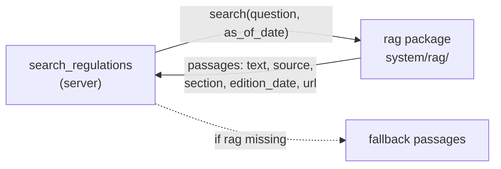

# Design: regulations corpus and search

**Owner: the corpus session.** Placeholder written 20 Nov 2026 by the server session. Up: [architecture](../ARCHITECTURE.md).

To fill in (diagrams first, little text): harvesting, storage (S3), chunking, embeddings, hybrid search, re-ranking, edition history.

## Agreed interface with the server

Contract: [system/rag/README.md](../../system/rag/README.md).
