# Design: regulations corpus and search

**Owner: the corpus session.** Up: [architecture](../ARCHITECTURE.md). Decisions: ADR 0008 (harvest, storage, fingerprints), ADR 0010 (parsing). Corpus files: [corpus/README.md](../../corpus/README.md).

Updated 20 Nov 2026 after the parsing design session. Solid = built. Dashed = planned.

## Pipeline

Everything up to the database runs on Florin's PC, in Claude Code. The server only stores and searches.

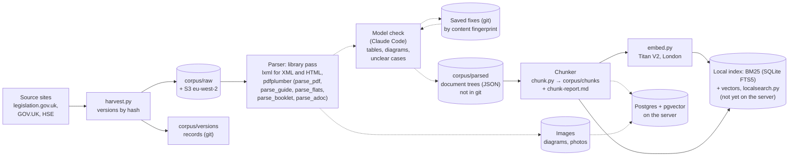

Parse and chunk are separate steps. The parsed tree can be checked on its own, and chunkers can change without parsing again. Parsed trees and images are rebuilt from raw files, so they stay out of git.

## Parse: library first, model fills the gaps

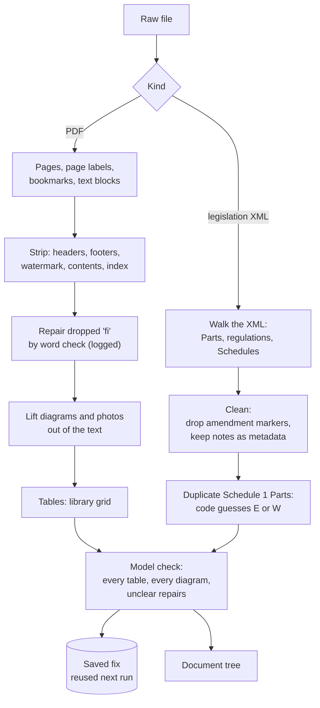

### Guidance PDF chapters (parse_pdf, 22 Nov 2026)

```mermaid
flowchart TD
    line["line after page 1"] --> big{"2x body size, or 1.5x in a condensed font,<br/>or PART / SCHEDULE / Contents set larger?"}
    big -->|yes| ch["chapter title"]
    big -->|no| only{"is 'Contents' the only chapter title after page 1?<br/>(the whole document would be skipped as front matter)"}
    only -->|no| body["heading or body text"]
    only -->|yes| style["chapter style = the largest later lines whose text<br/>is a contents-page entry; every line in that style"]
    style --> ch
```

HHSRS operating guidance Parts 1 and 2, the HHSRS enforcement guidance and three Procurement Act short guides parsed
to empty trees before this rule (parking lot S103).

### Guidance PDF figures (parse_pdf, 22 Nov 2026)

parse_pdf reads the drawn shapes and page sizes too (`read_guidance`). A figure is only made where there is ink
besides words, and it is cut to that ink, not to its words.

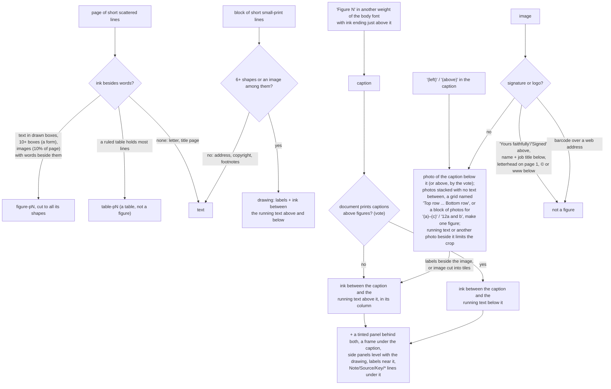

Small print with no caption becomes a table only when it looks like one (22 Nov 2026, from the model checks that
said "not a table"):

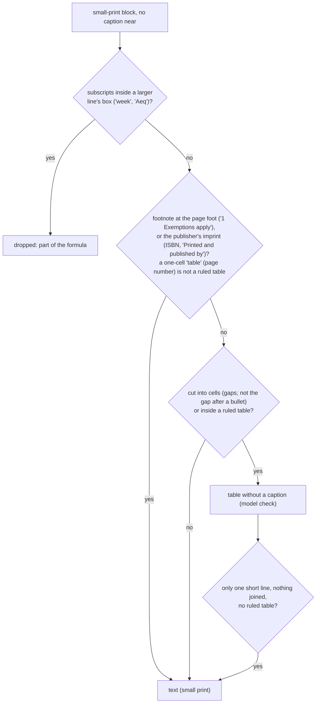

Running text is body-size text of six words or more not set in a drawn box, starting at a left edge many long
lines share, at a bullet or list number, or in a block of such lines; plus the lines hanging under it, subheadings
over it, bold-italic callouts, "Box N" titles, headings, captions (also caption-like lines the caption rules did not
take) and lines hanging under a caption. Sub-captions ("3b Machined ...") are labels and widen the figure's column
to every part. A ruled table that does not reach the caption is not the figure's ink; one level with the drawing is
(a key). A large picture on its own is trimmed only of white margin (`photo_whole`). Labels join a drawing when a
run of their words is within 30pt (60pt for a short label) and is not a text column's run (`page_edges`). A long
thin line is a rule only when no other shape touches it (a pipe in a gas diagram is not). Hand-made test documents
without `graphics` keep the older text rules. Crops a rule cannot fix are kept with a named defect
(`cropcheck accept`, parking lot S98).

### Approved Documents (parse_adoc, built 20 Nov 2026)

The 2019-layout Approved Documents are read by fonts, sizes and colours: 26pt chapters, 20/15pt headings, semibold paragraph numbers, white diagram captions on a green band, bold table captions, green words as links to key terms. Edition banners ("Effective until 1 September 2029", "effective from 2 September 2029") date the two copies of Appendices B and C. Letters dropped from "fi"/"fl" by the PDF font are put back by checking the document's own words, and counted. Diagram crops are made for the model check; `images: check-only` in `sources.yaml` keeps them from users.

Diagram crops follow the drawn frame (22 Nov 2026). Each AD diagram sits in a ruled box with its caption on a filled band: at the bottom (2013+ layout) or the top (classic layout). The parser finds the band under the caption's first word, then joins every shape that lines up with it (a box or line as wide as the band, or a side drawn at its edge, even in pieces) until a gap or another band. The crop is that frame plus 3pt. Text inside the frame is the diagram's labels; in the classic layout small notes straight under the frame are too. A band with no frame (AD F Diagram 3.1, AD J Diagram 16) keeps the older text rule.

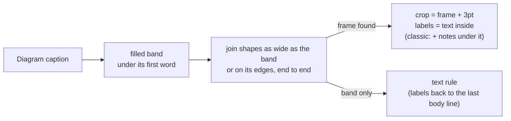

### Home Office fire risk assessment guides (parse_guide, built 22 Nov 2026)

The 2006 "Fire safety risk assessment" sector guides and the disabled people supplement share one template that
parse_pdf (numbered paragraphs, captions under pictures) reads badly. `parse_guide` takes these 13 files of
`fso-guidance-collection`; `sources.yaml` names them by version id prefix (`parser.files`), parse_pdf skips them
and `build` runs both. Styles are told apart by role, since the guides use different fonts.

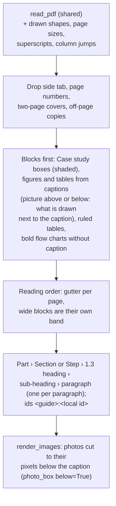

Known source quirks are listed as tree issues (a figure or table number printed twice, a heading printed without
its number). Shortcuts: parking lot S90 to S92.

### Purpose-built flats guide and Home Office booklets (parse_flats, parse_booklet, built 22 Nov 2026)

The other five PDFs of `fso-guidance-collection` have two more layouts, so each has its own parser
(`sources.yaml` `parser.files`). Both reuse GuideBuilder's helpers (drawn objects, ruled tables, sections) and
parse_pdf's reading and rendering; their own passes leave parse_guide's output unchanged.

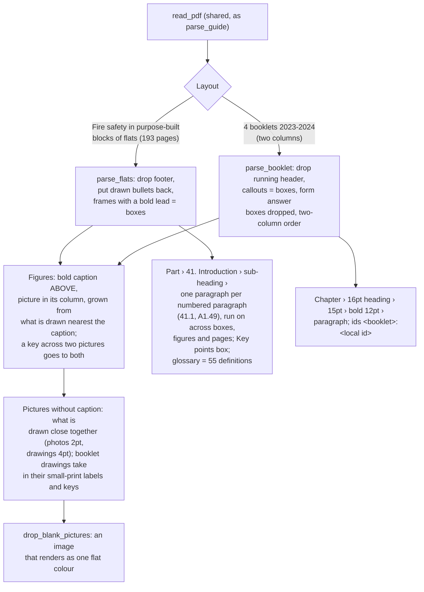

Printing gaps (paragraphs 71.6, 82.2, 83.3 not printed; 79.9 to 79.11 blacked out; "1.62" for A1.62) are tree
issues and listed in `corpus/README.md`. Shortcuts: parking lot S93 to S95.

### Coverage check: raw file against tree (built 22 Nov 2026)

Six PDFs once parsed to empty trees and nobody noticed (parking lot S103). `system/rag/coverage.py` now compares
each raw PDF with its tree. Plain code, no model (ADR 0006). It reads the PDF itself with pdfplumber, not through
the parser's reader, so reader bugs show up too.

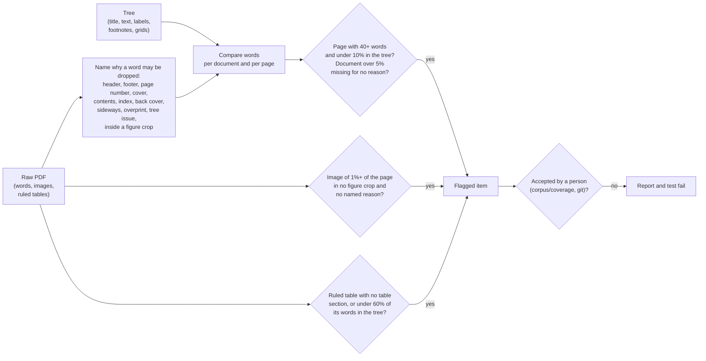

Words are compared as a multiset after normalising (case, ligatures, punctuation, hyphens, bullets). Split words
("W hat") and ligatures the font dropped ("fre" for "fire") still match. The report also lists tree words that
are not in the PDF: from text fields (parser glue, such as words run together) and from model-built grids apart.
Web pages and legislation XML can get their own reader later; the checks stay the same.

### The model-check step (built 20 Nov 2026)

Same steps for every document. Runbook: `.claude/skills/corpus-document/SKILL.md`. Code: `system/rag/checks.py`.

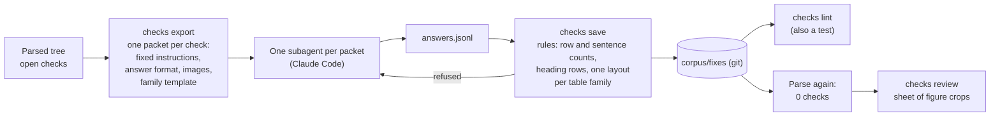

Tables in one family (same title before " for ", like the HSG227 worked examples) share one layout: the first one goes alone, and the rest get its saved fix as a template. A table whose title only looks like a family's, but whose printed layout differs (checked on the page), is listed in `NOT_A_FAMILY` in `checks.py` with the reason (AD H Table 12, AD L Volume 2 Table 5.4).

A model answer can vary between runs, so every model fix is saved in `corpus/fixes/` (git) with a fingerprint of the content it is about, and reused. The parser lists what is still open as `checks`. Re-parsing gives the same result unless we choose to redo a fix. Counting fixes shows what the library should learn next.

## Data model

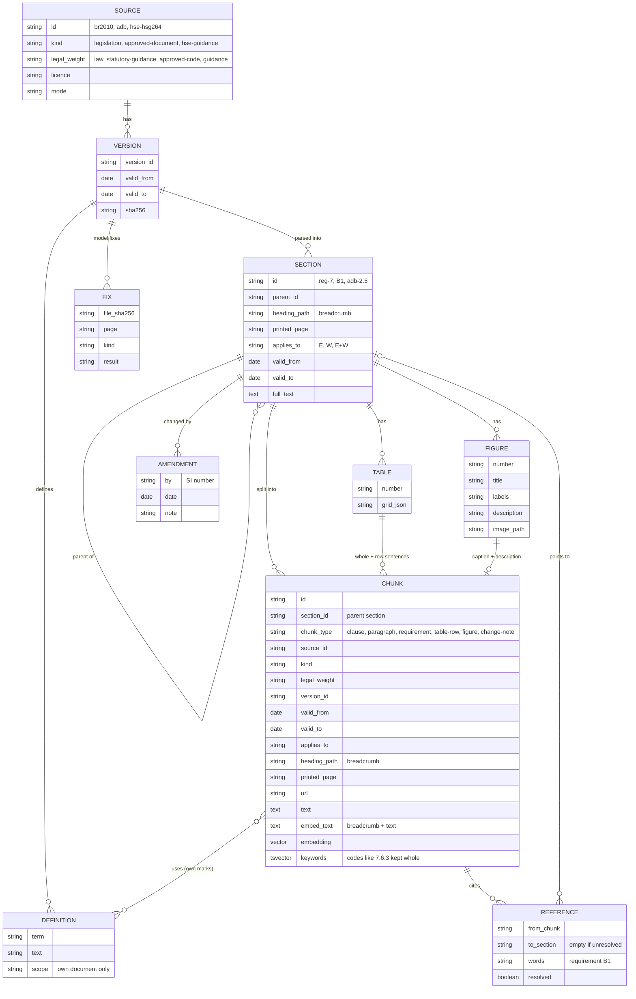

- **Two links between chunks and sections.** A section is *split into* its own chunks (one to many). A chunk *cites* other sections through REFERENCE (many to many). REFERENCE keeps the original words and whether code resolved them, so unresolved references are easy to list.
- **Filter fields are copied onto every chunk**, so search filters without joins.
- **The breadcrumb goes into the embedded text** (`embed_text`), for example "Building Regulations › Part B › B1 Means of warning and escape › ...". A short paragraph alone often does not say what it is about.
- **Keyword search from the start.** Each chunk has a Postgres full-text column, so hybrid search can be added later without re-loading. Codes like "7.6.3", "B1" and "M4(1)" must stay whole.
- **`kind` and `legal_weight`** come from `corpus/sources.yaml`. Answers must say "the law requires" (law) or "the guidance says" (approved documents are statutory guidance; HSE approved codes of practice such as L143 have special legal standing; other HSE documents are guidance).
- **AMENDMENT** comes from the legislation's change notes: which later law changed a clause, and when.
- **FIX** is a saved model correction, one per file and page.

## Chunk units

| Document | One chunk per | Notes |
|---|---|---|
| Building Regulations 2010 | regulation | Split at (1), (2) only when long. The ingestion report counts and lists every split. |
| Schedule 1 | requirement (B1, M4(1)) | With its "limits on application" text. Each is a graph node. |
| Regulation 2 | definition | Definition items, not one large chunk. |
| AD B, HSG264, HSG227 | numbered paragraph (2.5, 47) | With its lettered lists and heading path. HSG264 boxes are their own chunks. |
| Tables | table, plus one sentence per row | Model checks every table against the page image. |
| Diagrams, photos | figure | Original image cut from the PDF (a photo is cut to its own pixels above its caption, since the PDF's image box can be padded); caption, labels and model description are searchable. No Mermaid redraw. |
| AD B change notes | change note | Linked to the sections they mention. |

### Chunks as built (20 Nov 2026)

`python -m system.rag.chunk` writes one JSON line per chunk to `corpus/chunks/<source>/<version>.jsonl` (not in git, rebuilt from the trees) and `corpus/chunk-report.md` (in git). Each chunk carries `id`, `chunk_type`, the filter fields above, `text`, `embed_text` (breadcrumb + text), `references` (resolved to a section id in the same document, to another document such as `br2010`, or unresolved), `terms` (key terms the text marks) and, for figures, `image_path` and `image_display`. Legal weight comes from `kind` in `sources.yaml` (legislation = law, Approved Documents = statutory guidance, HSE "L" books = approved code, the rest guidance), or from `legal_weight` if a source sets it. Regulations and paragraphs longer than 2,500 characters are split (regulations at (1), (2); guidance at list items), and every split is listed in the report.

## Search

**Built 20 Nov 2026 (not wired to the server yet):** `system/rag/localsearch.py` does the ADR 0013 hybrid search locally: Titan V2 vectors from `system/rag/embed.py` (exact cosine in memory), BM25 keywords, top 50 each, RRF (k = 60), one passage per section, Amazon Rerank in Frankfurt to 5. First tries: vectors find what keywords miss ("licence" finds CAR 2012 regulation 8). Earlier keyword-only notes: keyword search over the chunks with SQLite FTS5 (Porter stemmer, codes such as "B1" and "7(2)" in their own column, bm25), filtered by date and country. It follows the server contract. First tries on the builder questions (`research/domain/builder-questions.md`) find the right documents for most questions, but miss where the builder's word differs from the document's ("licence" vs "licensable work"). **Decided (ADR 0013):** hybrid search: Titan V2 vectors (London) and BM25 keywords, top 50 each, reciprocal rank fusion, then Amazon Rerank (Frankfurt) to 5. Evals compare the variants.


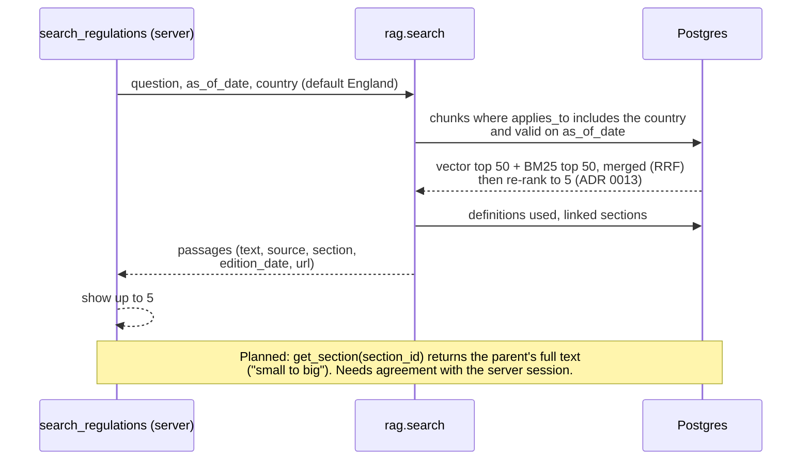

- Wales-only text is kept and marked. Search takes a country, England by default; Wales is a filter, not a re-parse.
- Each passage says its legal weight, so answers can tell law from guidance.
- Dates come from the versions. AD B appendices B and C are split into "until 1 Sep 2029" and "from 2 Sep 2029".
- Citations use the printed page number. The file page is internal only.
- Embedding model, hybrid search and re-ranking are not decided yet. Evals decide them.

## Pilot

Documents: Building Regulations 2010 (current, plus the 2026 versions of 1 Jul, 20 Jul, 1 Oct and 6 Nov), Approved Document B volume 1 (current), HSG264, HSG227 (priority assessment, Appendix 3).

Done when these counts pass as automatic tests:

| Check | Expected |
|---|---|
| Regulations in the current Building Regulations | 170 |
| Schedule 1 requirements | every one in the tables, with an E or W label on duplicated Parts K, M, O |
| AD B tables and diagrams | 16 tables, 56 diagrams |
| Numbered paragraphs | match contents pages and bookmarks |
| Broken "fi" words left | 0 |
| Header, footer or watermark text in chunks | 0 |
| New duplicate Schedule 1 Part without a label | test fails |

## What the files look like (profiled 20 Nov 2026)

- **Building Regulations XML:** 15 Parts, 170 regulations, 8 Schedules. Wales-only regulations sit in a separate `Versions` block, linked by `AltVersionRefs`. Schedule 1 is 22 tables; Parts K, M and O appear twice with no extent attribute (the notes say which copy is which). Before 1 Oct 2015, Schedule 1 is images only. Amendments are tagged (`Addition`, `Substitution`, `Repeal`); 197 defined terms (`Term`); 3,209 references (`CitationSubRef`).
- **AD B volume 1:** 200 pages, text on every page, page labels give printed numbers. Watermark on every page; diagrams are vectors whose labels mix into the text; one font drops "fi" (about 200 words). Neither library extracts the 16 tables cleanly. Defined terms are green links to Appendix A.
- **HSG264:** 73 pages, clean. pdfplumber extracts the material assessment table (Appendix 4) well. No priority assessment table.
- **HSG227:** 85 pages (2002, older than CAR 2012: show its date). Priority assessment: Table 3, page 54, with worked examples in Tables 4 to 14.

## Agreed interface with the server

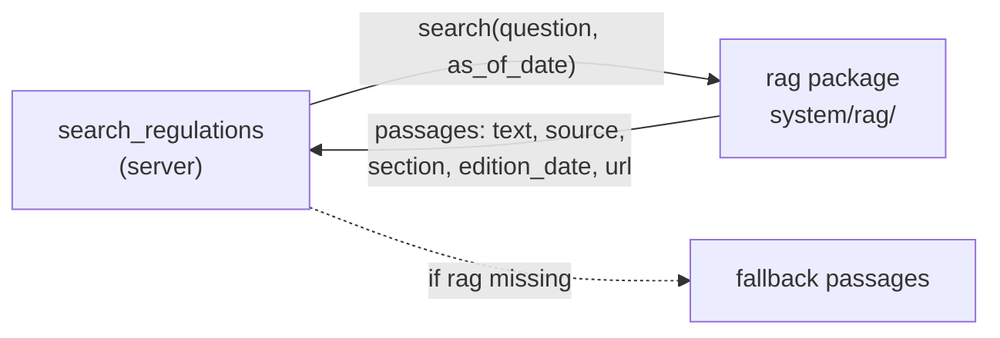

Contract: [system/rag/README.md](../../system/rag/README.md). Proposed additions, to agree with the server session:

- `search(question, as_of_date, country="E")`: a country argument, England by default.
- `get_section(section_id)`: the parent section's full text.
- Optional passage keys: `section_id`, `applies_to`, `kind`, `legal_weight`, `printed_page`, `image_url`.
