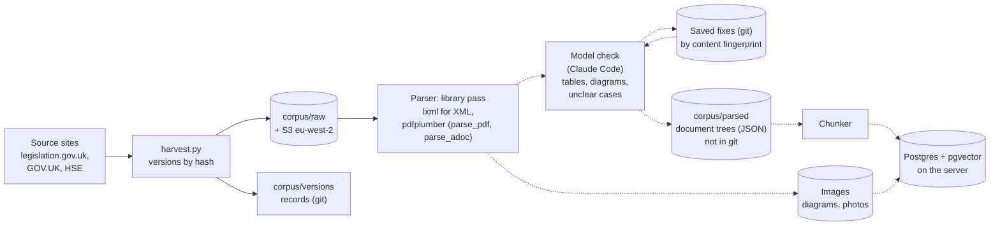
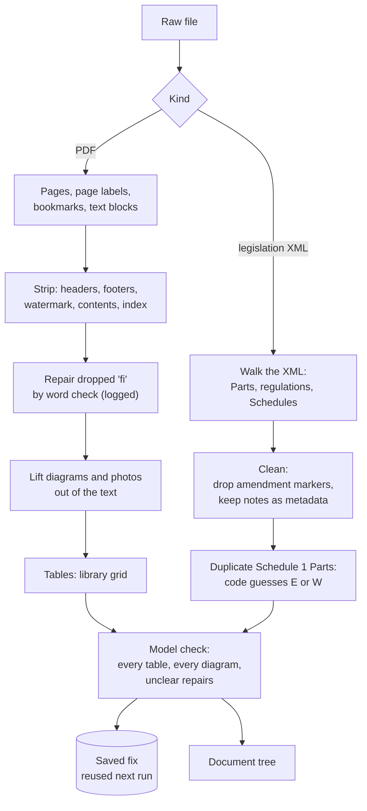
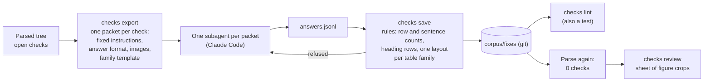
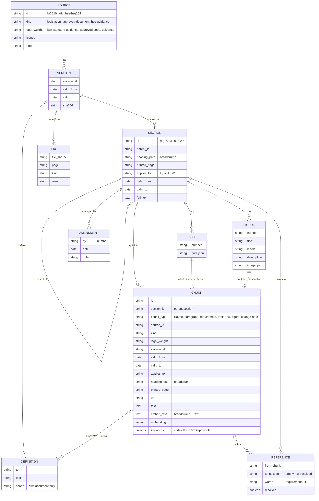
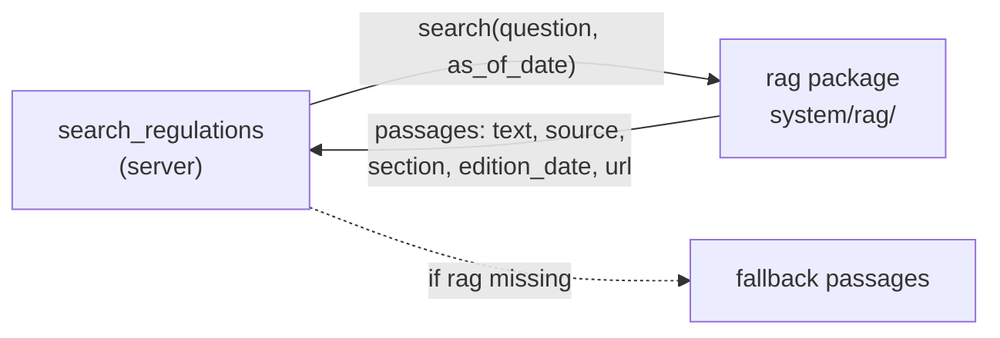

# Design: regulations corpus and search

**Owner: the corpus session.** Up: [architecture](../ARCHITECTURE.md). Decisions: ADR 0008 (harvest, storage, fingerprints), ADR 0010 (parsing). Corpus files: [corpus/README.md](../../corpus/README.md).

Updated 20 Nov 2026 after the parsing design session. Solid = built. Dashed = planned.

## Pipeline

Everything up to the database runs on Florin's PC, in Claude Code. The server only stores and searches.



Parse and chunk are separate steps. The parsed tree can be checked on its own, and chunkers can change without parsing again. Parsed trees and images are rebuilt from raw files, so they stay out of git.

## Parse: library first, model fills the gaps



### Approved Documents (parse_adoc, built 20 Nov 2026)

The 2019-layout Approved Documents are read by fonts, sizes and colours: 26pt chapters, 20/15pt headings, semibold paragraph numbers, white diagram captions on a green band, bold table captions, green words as links to key terms. Edition banners ("Effective until 1 September 2029", "effective from 2 September 2029") date the two copies of Appendices B and C. Letters dropped from "fi"/"fl" by the PDF font are put back by checking the document's own words, and counted. Diagram crops are made for the model check; `images: check-only` in `sources.yaml` keeps them from users.

### The model-check step (built 20 Nov 2026)

Same steps for every document. Runbook: `.claude/skills/corpus-document/SKILL.md`. Code: `system/rag/checks.py`.



Tables in one family (same title before " for ", like the HSG227 worked examples) share one layout: the first one goes alone, and the rest get its saved fix as a template.

A model answer can vary between runs, so every model fix is saved in `corpus/fixes/` (git) with a fingerprint of the content it is about, and reused. The parser lists what is still open as `checks`. Re-parsing gives the same result unless we choose to redo a fix. Counting fixes shows what the library should learn next.

## Data model



- **Two links between chunks and sections.** A section is *split into* its own chunks (one to many). A chunk *cites* other sections through REFERENCE (many to many). REFERENCE keeps the original words and whether code resolved them, so unresolved references are easy to list.
- **Filter fields are copied onto every chunk**, so search filters without joins.
- **The breadcrumb goes into the embedded text** (`embed_text`), for example "Building Regulations › Part B › B1 Means of warning and escape › ...". A short paragraph alone often does not say what it is about.
- **Keyword search from the start.** Each chunk has a Postgres full-text column, so hybrid search can be added later without re-loading. Codes like "7.6.3", "B1" and "M4(1)" must stay whole.
- **`kind` and `legal_weight`** come from `corpus/sources.yaml`. Answers must say "the law requires" (law) or "the guidance says" (approved documents are statutory guidance; HSE approved codes of practice such as L143 have special legal standing; other HSE documents are guidance).
- **AMENDMENT** comes from the legislation's change notes: which later law changed a clause, and when.
- **FIX** is a saved model correction, one per file and page.

## Chunk units

| Document | One chunk per | Notes |
|---|---|---|
| Building Regulations 2010 | regulation | Split at (1), (2) only when long. The ingestion report counts and lists every split. |
| Schedule 1 | requirement (B1, M4(1)) | With its "limits on application" text. Each is a graph node. |
| Regulation 2 | definition | Definition items, not one large chunk. |
| AD B, HSG264, HSG227 | numbered paragraph (2.5, 47) | With its lettered lists and heading path. HSG264 boxes are their own chunks. |
| Tables | table, plus one sentence per row | Model checks every table against the page image. |
| Diagrams, photos | figure | Original image cut from the PDF (a photo is cut to its own pixels above its caption, since the PDF's image box can be padded); caption, labels and model description are searchable. No Mermaid redraw. |
| AD B change notes | change note | Linked to the sections they mention. |

## Search

```mermaid
sequenceDiagram
    participant S as search_regulations (server)
    participant R as rag.search
    participant DB as Postgres
    S->>R: question, as_of_date, country (default England)
    R->>DB: chunks where applies_to includes the country<br/>and valid on as_of_date
    DB-->>R: best chunks (vector now; keyword + re-rank after evals)
    R->>DB: definitions used, linked sections
    R-->>S: passages (text, source, section,<br/>edition_date, url)
    S-->>S: show up to 5
    Note over S,DB: Planned: get_section(section_id) returns the parent's full text<br/>("small to big"). Needs agreement with the server session.
```

- Wales-only text is kept and marked. Search takes a country, England by default; Wales is a filter, not a re-parse.
- Each passage says its legal weight, so answers can tell law from guidance.
- Dates come from the versions. AD B appendices B and C are split into "until 1 Sep 2029" and "from 2 Sep 2029".
- Citations use the printed page number. The file page is internal only.
- Embedding model, hybrid search and re-ranking are not decided yet. Evals decide them.

## Pilot

Documents: Building Regulations 2010 (current, plus the 2026 versions of 1 Jul, 20 Jul, 1 Oct and 6 Nov), Approved Document B volume 1 (current), HSG264, HSG227 (priority assessment, Appendix 3).

Done when these counts pass as automatic tests:

| Check | Expected |
|---|---|
| Regulations in the current Building Regulations | 170 |
| Schedule 1 requirements | every one in the tables, with an E or W label on duplicated Parts K, M, O |
| AD B tables and diagrams | 16 tables, 56 diagrams |
| Numbered paragraphs | match contents pages and bookmarks |
| Broken "fi" words left | 0 |
| Header, footer or watermark text in chunks | 0 |
| New duplicate Schedule 1 Part without a label | test fails |

## What the files look like (profiled 20 Nov 2026)

- **Building Regulations XML:** 15 Parts, 170 regulations, 8 Schedules. Wales-only regulations sit in a separate `Versions` block, linked by `AltVersionRefs`. Schedule 1 is 22 tables; Parts K, M and O appear twice with no extent attribute (the notes say which copy is which). Before 1 Oct 2015, Schedule 1 is images only. Amendments are tagged (`Addition`, `Substitution`, `Repeal`); 197 defined terms (`Term`); 3,209 references (`CitationSubRef`).
- **AD B volume 1:** 200 pages, text on every page, page labels give printed numbers. Watermark on every page; diagrams are vectors whose labels mix into the text; one font drops "fi" (about 200 words). Neither library extracts the 16 tables cleanly. Defined terms are green links to Appendix A.
- **HSG264:** 73 pages, clean. pdfplumber extracts the material assessment table (Appendix 4) well. No priority assessment table.
- **HSG227:** 85 pages (2002, older than CAR 2012: show its date). Priority assessment: Table 3, page 54, with worked examples in Tables 4 to 14.

## Agreed interface with the server



Contract: [system/rag/README.md](../../system/rag/README.md). Proposed additions, to agree with the server session:

- `search(question, as_of_date, country="E")`: a country argument, England by default.
- `get_section(section_id)`: the parent section's full text.
- Optional passage keys: `section_id`, `applies_to`, `kind`, `legal_weight`, `printed_page`, `image_url`.
