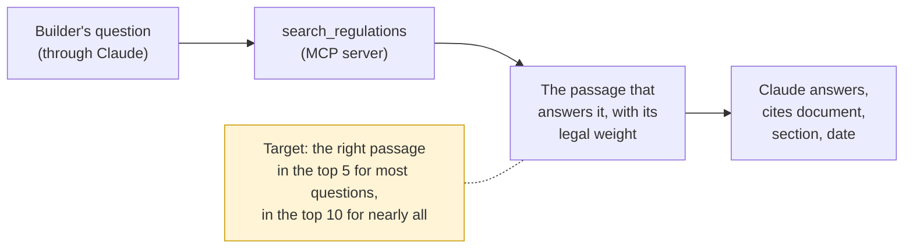
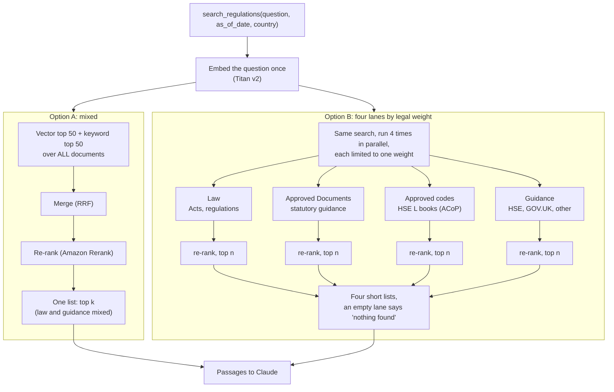
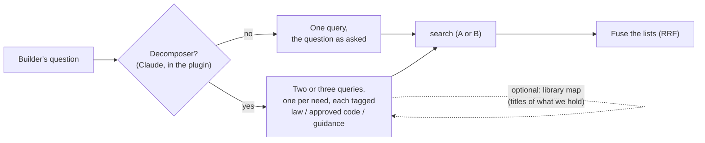
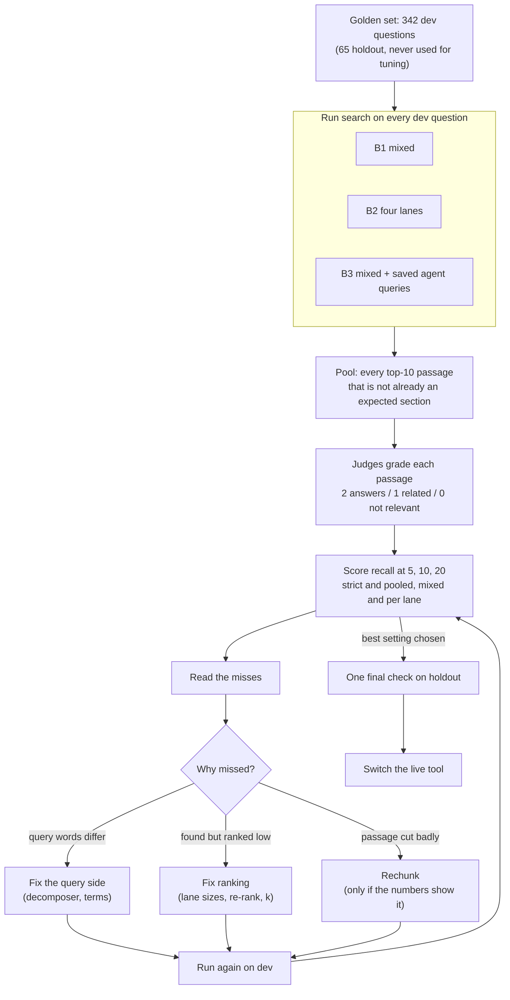
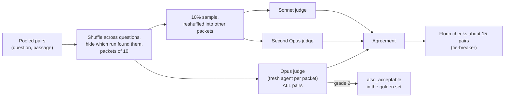
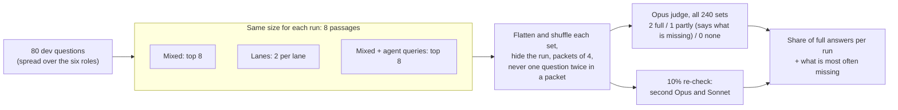

# Regulations search: aim, two options, how we tune (25 Nov 2026)

What we are building for the firm visits on 28 Nov and 5 Dec, and how we decide. Search details: [regulations-corpus.md](regulations-corpus.md#search). Lanes: [ADR 0016](../../decisions/0016-retrieval-strategy-lanes-measure-first.md) point 8. Eval runner: `evals/retrieval.py`. Pooling: `evals/golden/pool_local.py`.

## Aim

- Measured as recall at 5, 10 and 20 on the golden set, strict (expected sections only) and pooled (also passages a judge says answer the question).
- Top 5 is not fixed. If top 10 is clearly better and fits, we show 10.

## Two options for one search call

The server takes one question. Inside the tool, search runs one of two ways.

| | Option A: mixed | Option B: lanes |
|---|---|---|
| Strength | Simple. Best passages win, whatever the source. | The law is never pushed out by long guidance. Claude sees law versus guidance at once. |
| Risk | Guidance (most of the corpus) crowds out the law. | More passages to read. A lane with only weak hits still returns them. |
| Size | k = 5, 10 or 20 | n per lane, tuned on dev (2 is a placeholder) |
| Status | Live today | Built in code and eval only (S143) |

Mixed documents (L143, HSG248) are split by section: the ACoP parts go to lane 3, the plain guidance to lane 4.

## Where agent queries fit (optional, on top of A or B)

- The decomposer runs in Claude on the user's plan, never on our server (ADR 0006, ADR 0017).
- Its tags map onto the lanes, so B and the decomposer fit together.
- The library map is tested later as its own experiment, against the decomposer without it.

## How we decide: measure, then tune

## How the judging works

Two judges, two questions. The passage judge asks "does this one passage answer it?" (finds the right material). The answer-set judge asks "could a builder get the full answer from everything this search returned?" (what the firms will feel). Only the second sees a set with the law but no guidance, or one rule of two.

### Passage judge (every pooled pair)

- Opus against Opus shows drift and noise. Opus against Sonnet shows the model gap. If Sonnet agrees as well as Opus agrees with itself, future pools use Sonnet.
- If agreement is poor, packets shrink to one question per judge.
- The pool is a test tool only. Nothing of it runs in the live search.

### Answer-set judge (80 dev questions, `evals/golden/answer_set.py`)

- Same number of passages per run, so lanes don't win only by showing more.
- "What is missing" tells us the fix: a missing law points at lanes, a missing second rule at the decomposer.
