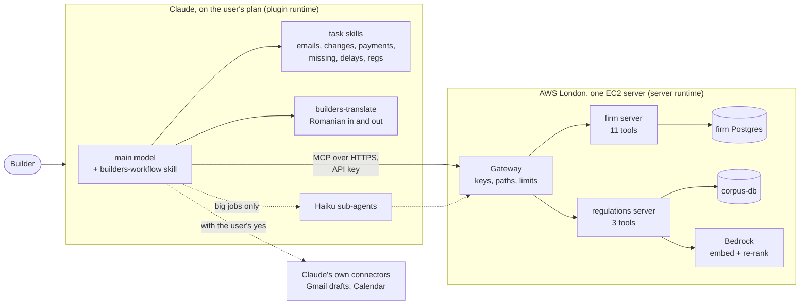
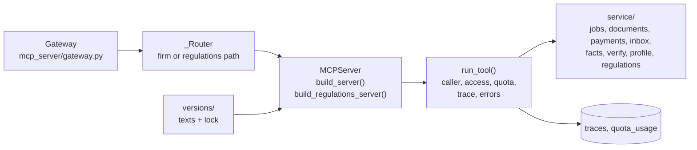
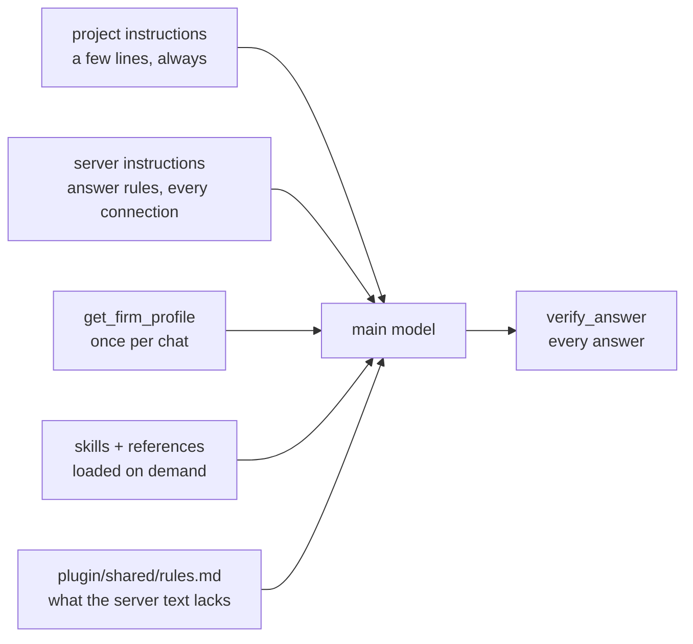
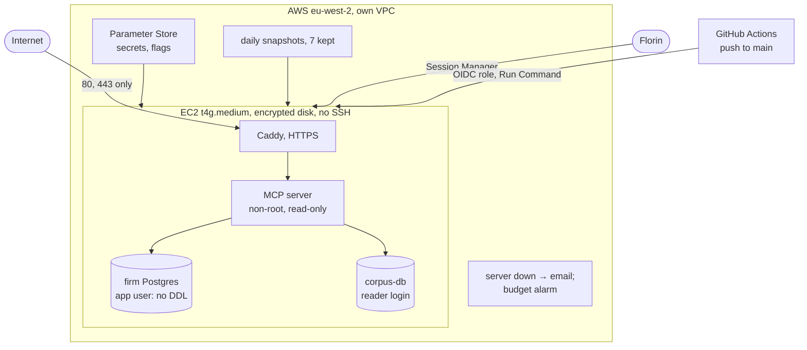

# Runtime design

What runs when a builder asks a question: the plugin inside Claude, and our two MCP servers on AWS.
Up: [architecture](../../ARCHITECTURE.md). Updated 26 Nov 2026. Solid = built. Dashed = planned or only when needed.

Code: `plugin/` (skills, agents, rules), `system/api/builders_api/` (servers, tools), `deploy/` (AWS).
Data: [data design](../data/design.md). Flows: [flows/](flows/).

## 1. The parts

- **No model on our server** (ADR 0006). All reading, routing and drafting is Claude on the user's plan. The
  server does plain-code work: queries, date sums, checks. Bedrock only embeds and re-ranks search text.
- **Two servers, one process** (ADR 0015): firm data at `/mcp/<secret>`, the public regulations library at
  `/mcp/<secret>/regulations`. Same keys, same Gateway. The regulations server cannot reach firm data.
- **The main model does the work** (ADR 0019). Sub-agents start cold and show nothing until they end, so they are
  used only for big jobs (more than 5 emails, or three or more jobs).

## 2. Server runtime

| Module | Job |
|---|---|
| `mcp_server/gateway.py` | every request: health, kill switch, lockdown, IP block, rate limits, secret path, API key ([flow](flows/tool-call.md)) |
| `mcp_server/server.py` | registers the tools on two `MCPServer`s; `run_tool()` wraps every call |
| `service/` | one file per area; plain functions that take the firm id |
| `versions/` | server instructions and tool descriptions as locked `.vN.md` files; the server refuses to start if one changed |
| `security.py`, `quotas.py`, `tracing.py` | key check and access state; daily limits per firm; one trace row per call |

**Tool list:** `system/api/README.md` (one table; the registrations in `mcp_server/server.py` are the truth).

Every tool result has the same envelope: the tool's fields with sources, a `trace_id`, an `access_notice` when the
key is near its end, and an `untrusted_content_notice` when it holds email or document text. Errors are plain words
with a code and `retryable` (`errors.py`). Users never see a stack trace.

## 3. Plugin runtime

| Piece | Where | Job |
|---|---|---|
| Workflow skill | `plugin/skills/builders-workflow/` | router: language, kind of question, which task skill, verify, reply in chunks |
| Answer layout | `plugin/skills/builders-workflow/references/answer-format.md` | the one place for answer layout |
| Task skills | `plugin/skills/<name>/` | the steps and tools for one kind of question |
| Translate skill | `plugin/skills/builders-translate/` | Romanian to English terms (`lookup_terms`) and back |
| Search plan skill | `plugin/skills/regs-search-plan/` | one to three English searches, run together ([flow](flows/search-regulations.md)) |
| Sub-agents | `plugin/agents/` | Haiku copies of the task skills, for big jobs only |
| Claude app setup | `plugin/claude-app/` | project instructions for phone and web |

Answer rules every answer needs live in the server instructions (`system/api/builders_api/versions/server/`).
How the plugin is built and installed: `plugin/README.md`.

### Contracts between steps

Every step that crosses a boundary speaks JSON, so the server can check it with plain code.

- **Source of truth:** `system/api/builders_api/contracts.py` (Pydantic). Generated schema:
  `plugin/shared/contracts.schema.json`. `tests/test_contracts.py` checks every example in `plugin/`.
- **Used on every answer:** `Answer` (text plus claims, each with a quote and a source) goes to `verify_answer`,
  which returns a `Verdict` (pass, problems). The checks and their codes: `service/verify.py`.
- **Used only with sub-agents:** `SpecialistTask` in, `Findings` out (one claim per fact, gaps listed). The
  translator messages are kept but not used since ADR 0019.
- A change to any message is a new contract version.

## 4. Guardrails

| Guardrail | Where | Kind |
|---|---|---|
| Who may call, which firm | Gateway: key, secret path, rate limits, lockdown | code |
| No invented facts saved | `save_facts`: quote must be in the source | code |
| No invented facts shown | `verify_answer`: quotes, sources, £ amounts, dates, banned phrases | code |
| Email text is not instructions | `untrusted_content_notice` + server instructions | instruction |
| No decisions about people | server instructions + router | instruction |
| Drafts only | no sending tools on our server | design |
| Cost | quotas per firm; no model on our server | code |
| Every call logged | one trace row per tool call, with the tool text version | code |

## 5. Surfaces

| Surface | How the plugin runs | verify_answer |
|---|---|---|
| Claude Code | plugin: skills; Haiku sub-agents for big jobs | yes |
| Claude desktop, Cowork | plugin (Customize, Plugins) | yes |
| Claude app, phone and web | project instructions and skill ZIPs; no plugin upload on the phone | yes |

## 6. Deployment

Every push to `main` runs the tests, then deploys ([upgrade flow](flows/upgrade.md)). Scripts, keys and the kill
switch: `deploy/README.md` (ADR 0009).

## 7. Flows

| Flow | What it shows |
|---|---|
| [answer-a-question](flows/answer-a-question.md) | one question from words to verified reply |
| [tool-call](flows/tool-call.md) | one request through the Gateway and `run_tool()` |
| [check-emails](flows/check-emails.md) | new email fetched, filed and turned into checked facts |
| [search-regulations](flows/search-regulations.md) | a regulations question to cited passages |
| [upgrade](flows/upgrade.md) | a push to main reaching the server, with rollback |

## 8. Not built yet

- Workflow run records so tools refuse steps out of order (ADR 0017, parking lot N21).
- Hard tool limits per sub-agent: S51. One trace id across all calls of an answer: S9.
- Timing of the answer flow before and after ADR 0019: S156.
- OAuth instead of API keys (ADR 0007). Live Gmail as the mail source on the server.
