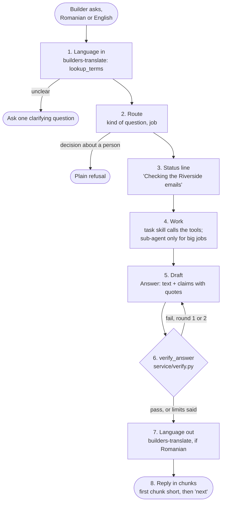

# Flow: answer a question

One question from the builder's words to a verified reply. Up: [runtime design](../design.md).
Steps follow `plugin/skills/builders-workflow/SKILL.md`.

1. **Language in.** A Romanian question becomes English with the official UK terms from `lookup_terms`.
2. **Route.** The workflow skill picks the task skill and the job. Ranking, scoring or monitoring people is refused.
3. **Status.** One line, no facts, so the builder hears something at once.
4. **Work.** The task skill calls the firm or regulations tools. `get_firm_profile` runs once per conversation.
5. **Draft.** Only from what the tools returned. Each fact is a claim with an exact quote and a source.
6. **Verify.** `verify_answer` checks sources exist, quotes are word for word, £ amounts and dates appear in the
   sources, and no banned phrase. Two fix rounds at most, then the reply says what could not be checked.
7. **Language out.** Romanian, with UK terms and quotes kept in English.
8. **Reply.** Layout in `answer-format.md`. Drafts that leave the firm are in English.
