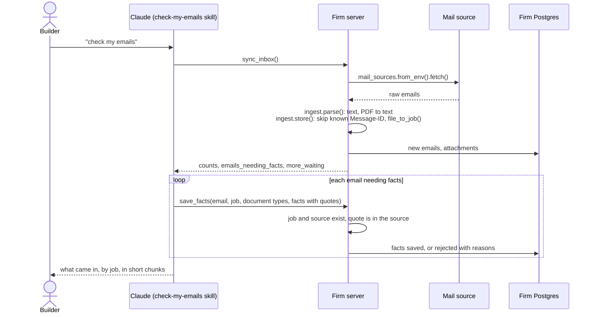

# Flow: check emails

"Check my emails" ("Verifică mail-urile"): new email is fetched, filed by job and turned into checked facts.
Up: [runtime design](../design.md). Decisions: ADR 0005 (demo inbox), ADR 0006 (Claude reads, server checks).

1. **Mail source.** `service/mail_sources.py`: the demo mail folder (`EmlFolder`) and the Gmail label
   (`GmailLabel`, label `marcus-limited` only, never the rest of the inbox). Both together never double-count: same
   Message-ID is skipped.
2. **Filing.** `ingest.file_to_job()` uses the job's match words and the sender's history. Unfiled emails stay
   unfiled for Claude to suggest a job.
3. **Facts.** Claude reads each email and calls `service/facts.py` `save_facts()` once. The server rejects a fact
   whose quote is not in the email or attachment.
4. **Big batches.** More than 5 emails or three or more jobs: the `inbox-clerk` sub-agent does steps 3 and 4.

Demo set-up (simulated council and client emails, the live simulator): `system/data/mock/README.md`.
