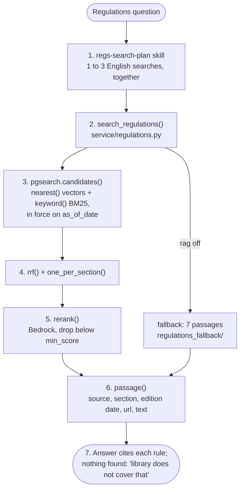

# Flow: search the regulations

A regulations question to cited passages. Up: [runtime design](../design.md).
How the index is built: [ingest design](../../ingest/design.md). Search contract: `system/rag/README.md`.

- **Steps 3 to 6** are `system/rag/pgsearch.py` `search()`, on `corpus-db` with the reader login. The question is
  embedded with Titan V2 (London); re-rank runs in Frankfurt.
- **Errors.** A failed search is retried (`retry.py`), then reported as `upstream_error`. If the corpus is switched
  off (`rag_enabled`), the small fallback set answers and the result says so.
- **Dates.** `as_of_date` comes from the job, so the answer uses the version in force then (ADR 0016).
- **Planned:** lanes by legal weight (`search_lanes()`, built, not live), `get_section`, `read_document` (ADR 0016).
