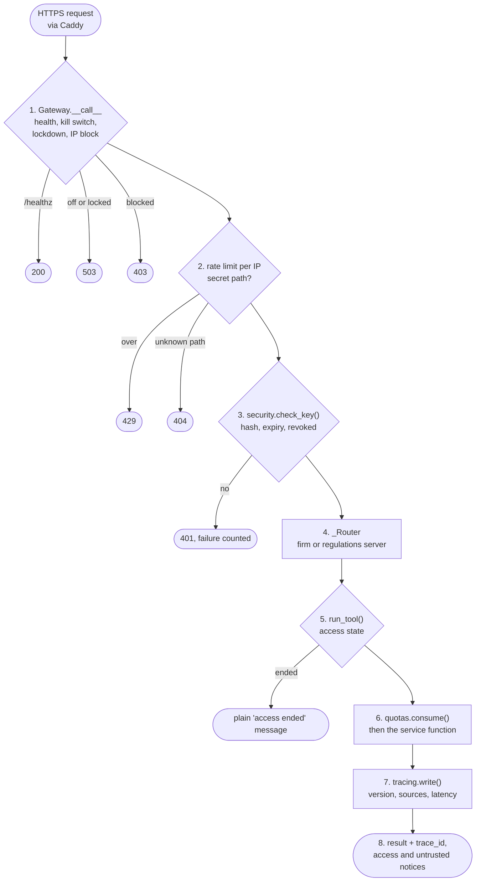

# Flow: a tool call

One MCP request through security, the tool wrapper and the service layer. Up: [runtime design](../design.md).
Security decision: ADR 0007.

- **Steps 1 to 3** are in `mcp_server/gateway.py` and `security.py`. Too many failures from one IP block it; too
  many overall start a lockdown (`security.Guard`).
- **The key decides the firm.** `check_key()` returns a `Caller` with the firm and access state: ok, expiring
  (within 14 days), grace, or ended.
- **Steps 5 to 8** are `run_tool()` in `mcp_server/server.py`. An `AppError` becomes a plain error with a code;
  anything else is logged and returned as `internal_error` with the trace id.
