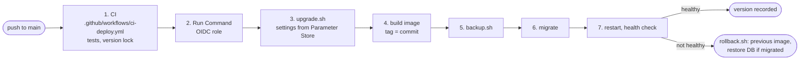

# Flow: upgrade the server

A push to `main` reaching the live server, with automatic rollback. Up: [runtime design](../design.md).
Decision: ADR 0009. Commands and keys: `deploy/README.md`.

- All scripts are in `deploy/scripts/`. The app user cannot change the schema.
- Settings are read from Parameter Store on every upgrade, so new flags such as `rag_enabled` take effect.
