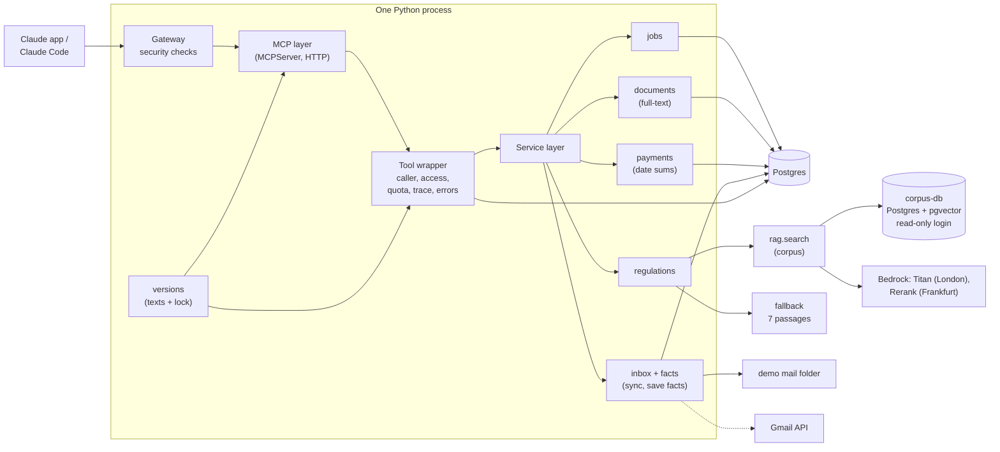
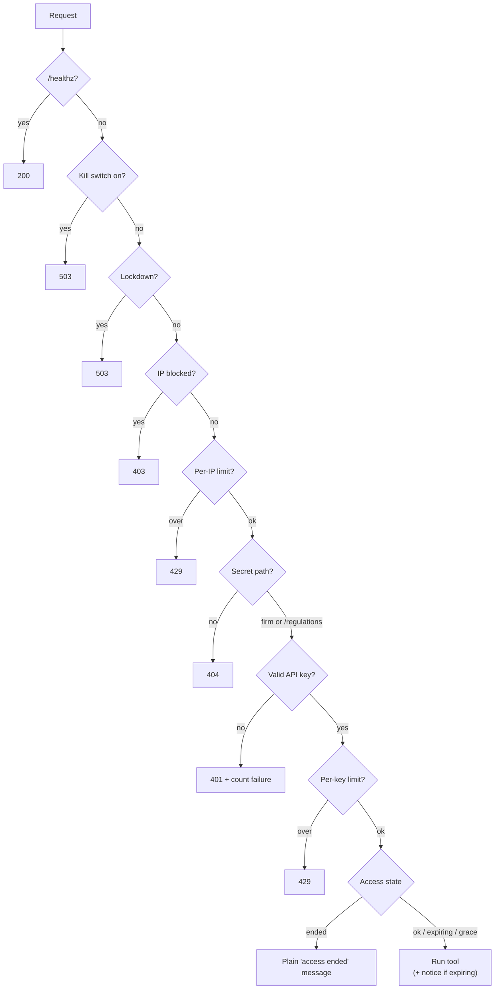
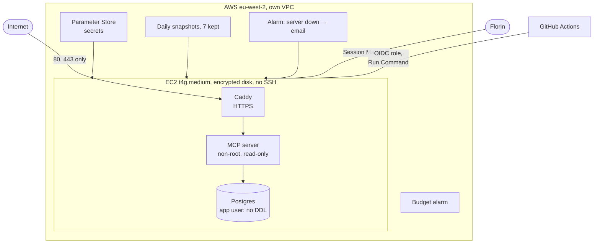
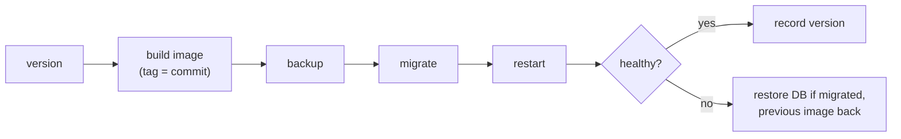

# Design: server

MCP server, security, data and deployment. Code: `system/api/`. Flows: [sequences/server.md](../sequences/server.md). Up: [architecture](../ARCHITECTURE.md).

Updated 24 Nov 2026. Solid = built. Dashed = planned.

## Components

## Security layers (ADR 0007)

## Tools

Two servers in one process (ADR 0015): **firm** at `/mcp/<secret>`, **regulations** at `/mcp/<secret>/regulations`. Same keys, same Gateway.

| Tool | Server | Reads | Demo moment |
|---|---|---|---|
| `list_jobs` | firm | jobs, emails | 1 |
| `get_job` | firm | jobs, emails, attachments, facts, contract terms | 2 |
| `search_job_documents` | firm | emails, attachments | 2 |
| `list_missing_items` | firm | required items, attachments, facts | 3 |
| `search_regulations` | regulations | corpus or fallback | 4, 7 |
| `get_payment_dates` | firm | contract terms | 7 |
| `sync_inbox` | firm | mail source (demo folder; Gmail planned), stores and files emails | 1 |
| `save_facts` | firm | writes job, document types and facts after server checks | 1 |
| `verify_answer` | firm | read-only checks on a draft answer (agent contracts) | all |
| `lookup_terms` | both | Romanian <-> English glossary lookup (ADR 0012) | all (Romanian) |
| `about_regulations_library` | regulations | corpus stats and documents (live) + `regulations_fallback/library.json` (built from `corpus/sources.yaml` by `python -m system.rag.library`) | "what does the library cover?", empty searches (S100) |
| `get_firm_profile` | firm | live firm context: people, jobs, contacts, due in 14 days | start of every conversation |
| `get_job_timeline` | firm | emails received and sent, documents, dated facts, upcoming | delays, "what have I sent" |

## Data

Tables and stores: [data design](data/design.md).

## Deployment (ADR 0009; code in `deploy/`, live since 20 Nov 2026)

## Upgrade

## Rules this design keeps

- No chat model on the server (ADR 0006).
- Every tool call: one trace row with tool version and sources.
- Texts versioned, never edited in place.
- Retries only for retryable errors. Users see plain errors, never stack traces.
- Every shortcut in the [parking lot](../../requirements/parking-lot.md).
