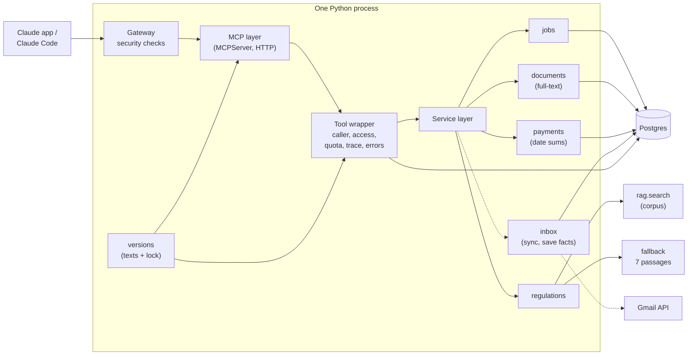
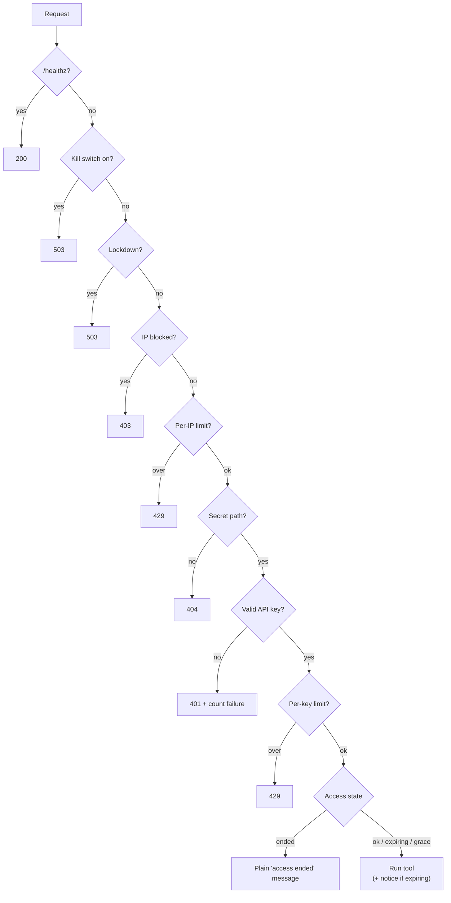
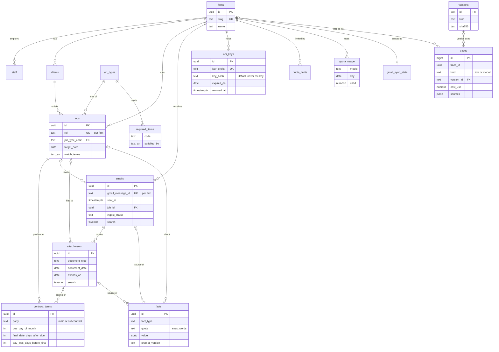
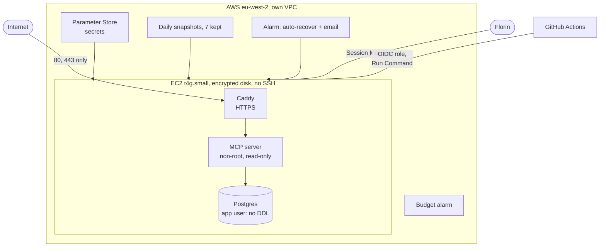
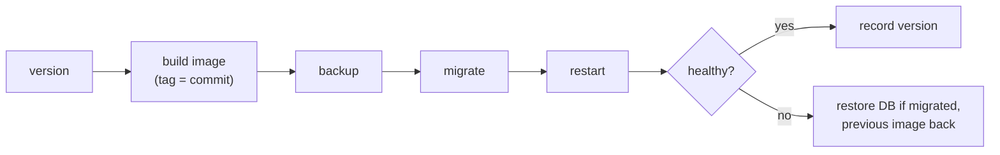

# Design: server

MCP server, security, data and deployment. Code: `system/api/`. Flows: [sequences/server.md](../sequences/server.md). Up: [architecture](../ARCHITECTURE.md).

Updated 20 Nov 2026. Solid = built. Dashed = planned.

## Components

## Security layers (ADR 0007)

## Tools

| Tool | Reads | Demo moment |
|---|---|---|
| `list_jobs` | jobs, emails | 1 |
| `get_job` | jobs, emails, attachments, facts, contract terms | 2 |
| `search_job_documents` | emails, attachments | 2 |
| `list_missing_items` | required items, attachments, facts | 3 |
| `search_regulations` | corpus or fallback | 4, 7 |
| `get_payment_dates` | contract terms | 7 |
| `sync_inbox` | Gmail (planned) | 1 |
| `save_facts` (planned) | writes facts | 1 |

## Data (database state)

Also: `schema_migrations` (applied files and hashes), `server_flags` (kill switch).

## Deployment (ADR 0008; code in `deploy/`, not yet run in AWS)

## Upgrade

## Rules this design keeps

- No chat model on the server (ADR 0006).
- Every tool call: one trace row with tool version and sources.
- Texts versioned, never edited in place.
- Retries only for retryable errors. Users see plain errors, never stack traces.
- Every shortcut in the [parking lot](../../requirements/parking-lot.md).
