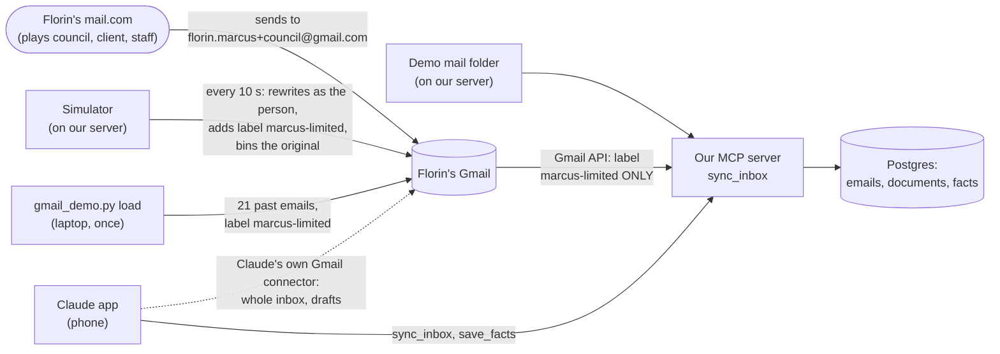
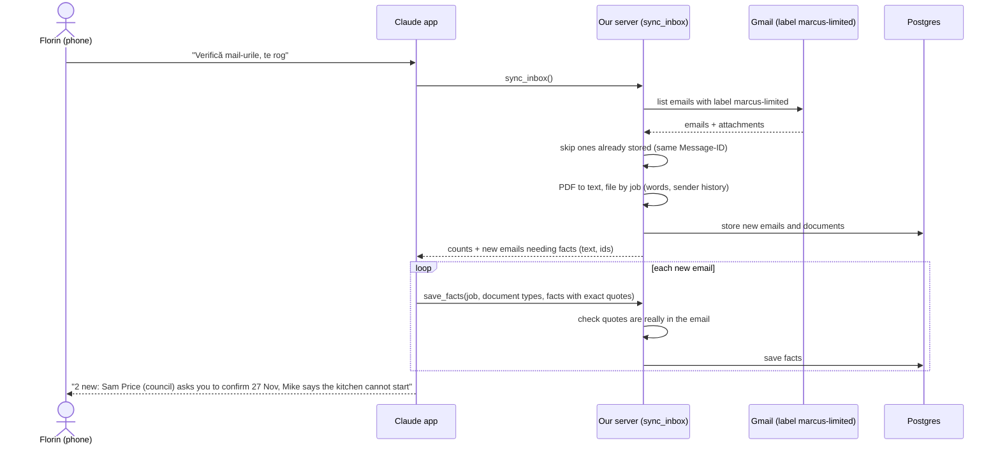
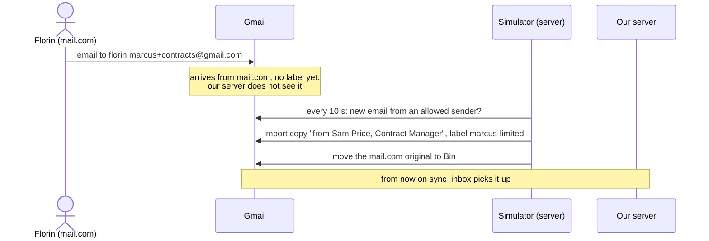

# Sequences: how email reaches the assistant

What happens when Florin says "check my emails" ("Verifică mail-urile"). Up: [server flows](server.md), [architecture](../ARCHITECTURE.md). Updated 20 Nov 2026.

## The parts

## "Check my emails", step by step

## A live email from the "council"

## Good to know

- Our server reads **only** the `marcus-limited` label, never the rest of the inbox (ADR 0005).
- Ask "check my emails" **after** the email shows under the label (about 10 to 20 seconds after sending).
- Claude's own Gmail connector can also read the inbox and write drafts; our tools do the filing, facts and checks.
- The demo mail folder on the server is a second source used for resets; Gmail and the folder never double-count (same Message-ID).
