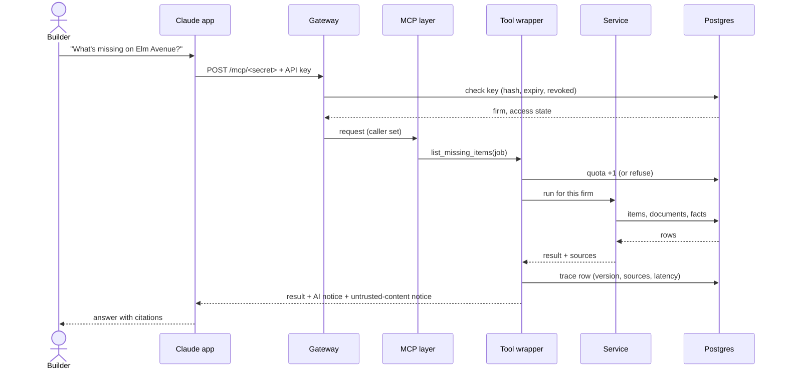
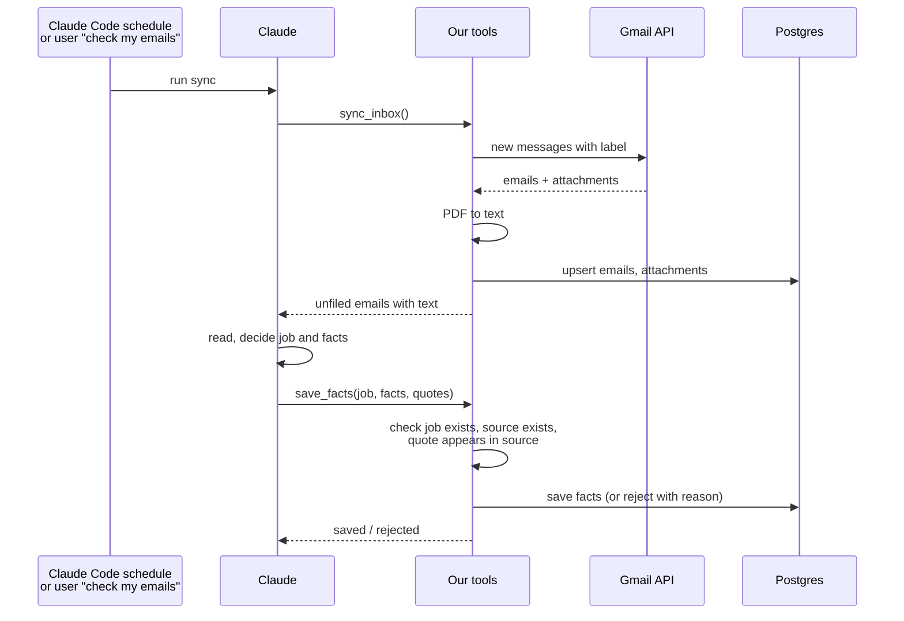
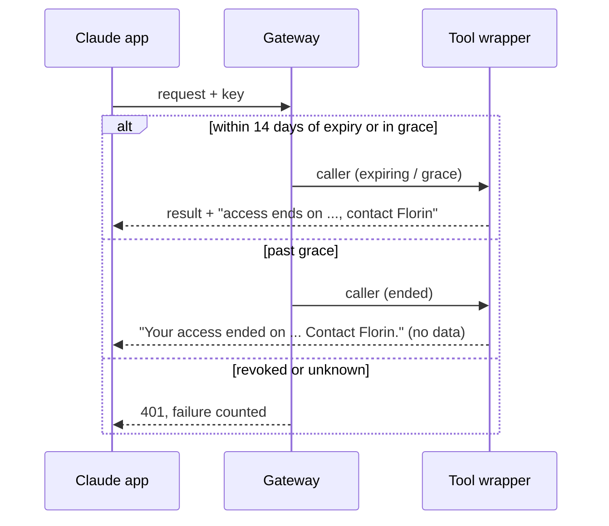
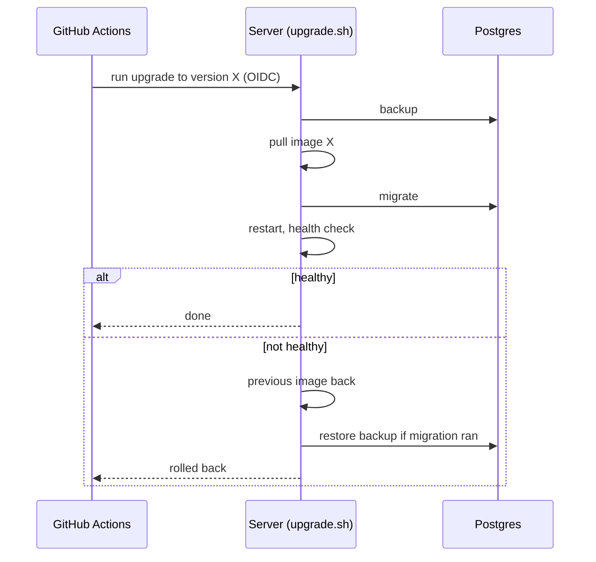

# Sequences: server

Step-by-step flows for [design/server.md](../design/server.md). Updated 20 Nov 2026.

## 1. A tool call (built)

## 2. New emails: sync and save facts (planned, ADR 0006)

## 3. Expired key (built)

## 4. Upgrade (planned, ADR 0008)

