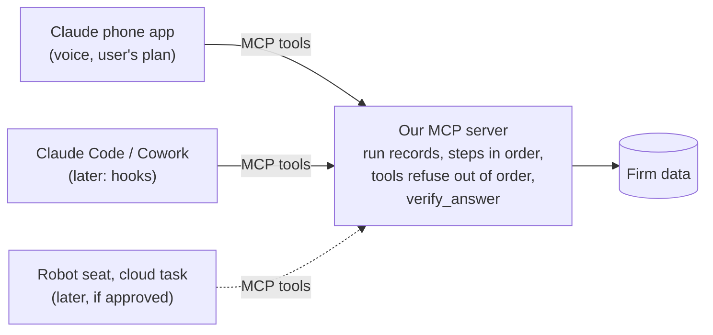

# 0017: Workflow control lives on our server; no agent runtime of our own

Date: 25 Nov 2026. Status: accepted (Florin, grill session 24-25 Nov 2026). Keeps ADR 0006 (no model on our server)
and adds to it. Touches ADR 0011 (plugin) and ADR 0014 (pilot business model).

## Context

We plan two offers:

1. **The plain MCP server.** A firm connects it to its own Claude.
2. **The full app.** A builder and their team work by voice on phones and laptops. They do not read or write email
   themselves.

Florin wants deterministic control over the steps, like a LangGraph-style graph, without Bedrock. The question was
where that control runs: in an agent runtime on our server, or in Claude on the user's side.

Facts found on 24 Nov 2026 from Anthropic's docs. Some features are research previews, so check again before relying
on them.

- **A Claude plan cannot be used from our own server.** Third-party apps, including Agent SDK apps, must use an API
  key. Plan credentials may not be routed for other users.
  ([legal and compliance](https://code.claude.com/docs/en/legal-and-compliance),
  [Agent SDK overview](https://code.claude.com/docs/en/agent-sdk/overview)). A runtime on our server therefore means
  paying per token on our key.
- **A Claude plan can run work with nobody chatting.**
  - Claude Code cloud scheduled tasks run on a schedule (hourly at most often), on a GitHub event, or when called
    through their own fire URL with a token. Our server could call that URL when an email arrives.
    ([scheduled tasks](https://code.claude.com/docs/en/routines))
  - Cowork scheduled tasks run on a timer only.
- **Those tasks belong to one person's account.** They are not shared with teammates and they use that person's
  limits.
  - Hourly caps: 100 scheduled runs per account, 30 runs per task from "Run now" and the fire URL together, and
    100 fire URL calls per account.
- **Hooks give real enforcement, but only where Claude Code runs.**
  - Hooks can refuse a tool call, record steps, and stop Claude finishing early.
  - They work in the terminal, the desktop app and cloud sessions.
  - They don't work in the Claude phone app, which is where a voice-first team lives.
  - Hooks run on the user's side, so the user can switch them off.
- **A shared "robot" seat is a grey area.**
  - No source says a Team seat must be one person.
  - None clearly allows a seat that only automation uses.
  - Anthropic's usage policy bans "services that route requests through consumer subscriptions" and points
    automated use to API keys. ([usage policy](https://www.anthropic.com/legal/aup))

## Decision

1. **No model and no agent runtime on our server, for both offers.** ADR 0006 stands. All thinking runs in Claude
   on the user's own plan.
2. **Step control lives on our server.**
   - Each workflow run gets a record of the steps done and the steps left.
   - Tools refuse to run out of order. For example, a draft is refused until `verify_answer` has passed for that run.
   - The server's plain code is the locked door. Skills and, later, hooks only keep Claude on track.
3. **The same rules apply to everyone.** That includes a firm that only connects the plain MCP server (offer 1).
   Offer 2 adds the phone set-up and the plugin on top. The rules don't change.
4. **For the pilot, everything is fetched live.**
   - A user asks "what's new?" in the Claude phone app, and Claude calls `sync_inbox` at that moment.
   - There is no robot seat and no background task.
   - There are no alerts. People find out by asking.
5. **The first workflow built this way is new emails:** fetch, file by job, save facts, check.
6. **Later, not in the pilot:**
   - A dedicated robot seat on a Team plan, running cloud scheduled tasks hourly. Hooks would run in those sessions,
     with live fetching still there for whatever arrived since the last run.
   - This happens only after Anthropic confirms in writing that such a seat is allowed, or if live answers prove too
     slow.
   - If Anthropic says no, the background work moves to our own API key (option B below).
7. **Hooks come with the robot seat**, not before. Pilot users are on the phone, where hooks don't run.

## Options considered

- **Our own runtime on the server (LangGraph-style), calling Claude through the API.**
  - It gives full control and unattended runs.
  - But we pay per token, take on prompts, cost tracking and a runtime to run, and it reverses ADR 0006.
  - Kept as the fallback for background work only.
- **Control through hooks only.** It doesn't work on the phone, and a user can switch hooks off.
- **Step state in a client file, or in Google Drive through a connector.**
  - It is lost when a cloud session ends.
  - With Drive, Claude writes the state itself, so it could skip a step or write the wrong one.
  - Only our server's plain code can refuse.
- **A robot seat from the start.** This was rejected for the pilot because of the grey-area terms, the preview
  status and the per-account caps.
- **Server alerts by push, SMS or WhatsApp.** Florin chose "they ask" instead. A fixed-text alert from plain code
  stays possible later without breaking ADR 0006.

## Consequences

- **Our costs stay low.** We pay no tokens. The work is on our server: run records, step order, refusals.
- **The first answer can be slow** when a lot of email has piled up, because nothing is filed in advance. This
  is the trigger for adding the robot seat.
- **Nothing happens unless someone asks.** Urgent items still come by phone call, as they do now.
- **New server work:**
  - A workflow run table (a new migration).
  - Step checks in the service layer.
  - Tool descriptions that explain the order (new `.vN.md` files, locked).
- **Parking lot:**
  - N21: server step state for the new-emails workflow.
  - N22: robot seat and hooks.
  - Q14: ask Anthropic about the robot seat.
  - Q2 and Q4 are updated.
