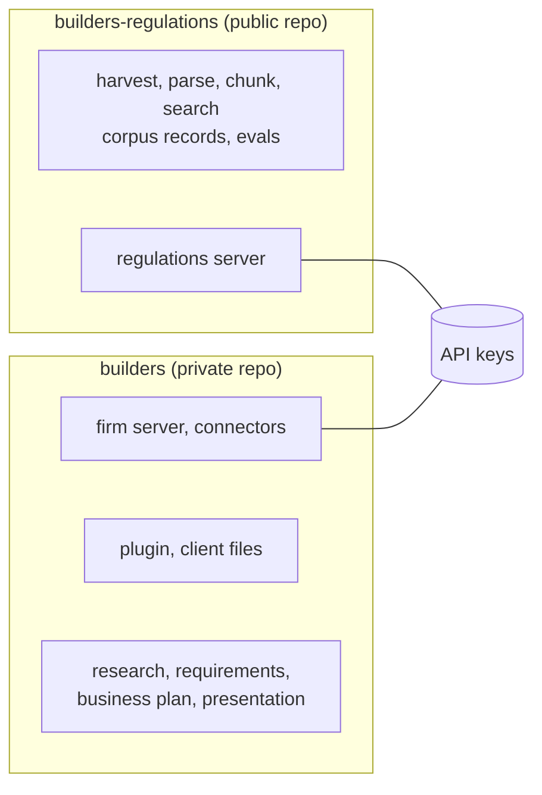

# 0023: Split into a public regulations project and a private builders project

Date: 27 Nov 2026. Status: proposed (Florin, 27 Nov 2026). Not started.

## Context

One repo and one server process hold both the regulations library (public text, the same for every firm) and the
firm side (firm data, connectors, plugin, client files). A deploy of either restarts both (ADR 0015 runs them in one
process). Florin wants the regulations library public, to share and to show as portfolio work, and the firm side
private, with one client file per firm (ADR 0022 era talks with a design-and-build firm, `research/interviews/`).

## Decision

1. **Two repos.** builders-regulations, public: `system/rag`, the regulations parts of `builders_api`, corpus
   records, evals and their docs. builders, private: everything else.
2. **A new public repo with a clean history.** builders_lab is not made public: its history holds the business plan,
   prices, research on real firms and interview notes.
3. **Two server programs, deployed on their own.** They may share one machine (cost first); a deploy of one does not
   restart the other.
4. **Keys.** Both servers keep checking keys in one store at first. Later the regulations server may get its own
   keys or open access with rate limits; decided when it goes public.
5. **Licence check before going public.** Every source in the corpus records is checked for what text may be
   published (Open Government Licence or not). Text that may not be published stays out of the public repo.
6. **Order:** regulations server as its own program first (fixes the deploy dependency), then the repo split, then
   the public release after the licence check.

## Options considered

- **Make builders_lab public as it is:** quickest, but exposes the business plan, prices and research history.
- **One repo, two programs:** fixes deploys but not the public/private wish.
- **Three repos (public plugin too):** a public plugin shows prompts to competitors; firms get the plugin as a ZIP
  from the private repo instead.

## Consequences

- Shared code (versions, security, tracing, tests, deploy pipeline) is split or copied; several sessions of work.
- ADR 0015 (two servers, one process) is changed by this ADR once accepted.
- Parking lot items move with their code; many regulations items go to the public repo's own list.
