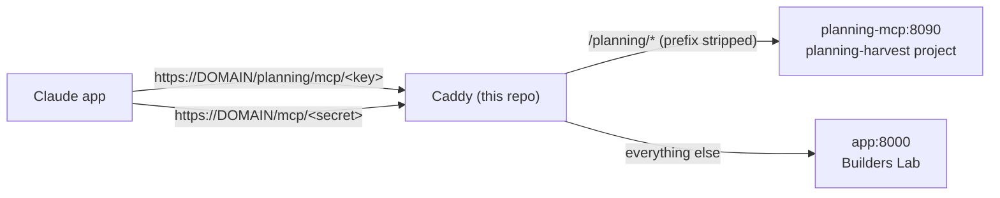

# 0024: The Builders Lab gateway also serves the planning-harvest MCP server

Date: 28 Nov 2026. Status: accepted (Florin, 28 Nov 2026: "yes" to routing /planning through this Caddy).

## Context

planning-harvest (a separate, private project) runs on this server as its own Docker project (its ADR 0012). Its MCP
server needs HTTPS and a public address. This server already has both.

## Decision

- One `handle_path /planning/*` block in `deploy/Caddyfile`; everything else goes to the app as before.
- The planning container joins the `builders-lab_frontend` network as `planning-mcp`; no new port.
- Log masking now also hides `/planning/mcp/<key>`.
- Keys, data and code of planning-harvest stay in its own repo and database.

## Options considered

- Its own Caddy and domain: a second certificate and ports 80/443 already taken.
- Expose port 8090: no HTTPS, key visible on the wire.

## Consequences

- A Caddyfile change needs a Caddy restart: `upgrade.sh` does not restart it when only the file changes (P-number in
  the parking lot).
- If the planning container is down, `/planning/*` returns 502; Builders Lab is not affected.
