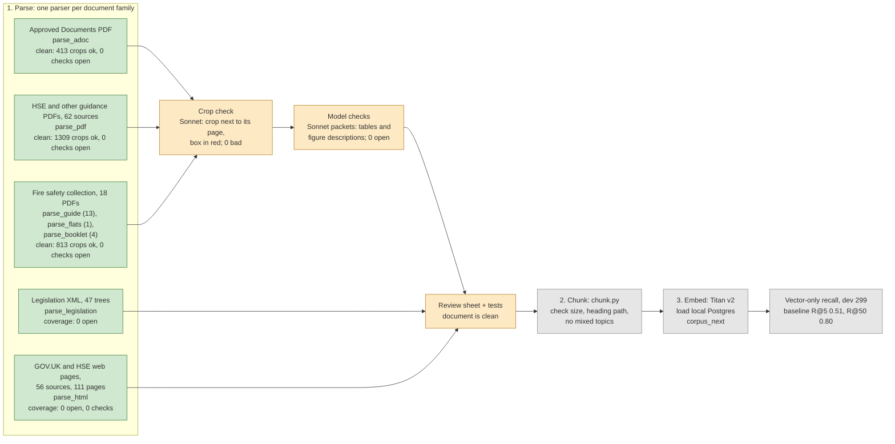

# Plan: retrieval and answer quality (from 21 Nov 2026)

Owner: Florin. Status report: [REPORT-2026-11-21.md](REPORT-2026-11-21.md). Each step needs Florin's yes before it starts.

## Current focus (Florin, 21 Nov evening)

**Retrieval only, vector search first.** Nothing else moves until retrieval is strong. Then the judge (step 3).

| Step | Status |
|---|---|
| 1. Miss analysis | done: [experiments/L1-miss-analysis.md](experiments/L1-miss-analysis.md) |
| 2. Experiments driven by step 1 | **in progress**: out-of-date sources removed (V1, no significant change); next, the embedded chunk text |
| 3. Local judge | **started 26 Nov**: design agreed (below); reference answers cleaned (S146); next, the first Sonnet run on dev |
| 4. Multi-turn scenarios | on hold |
| 5. Traces and logs | on hold |

**Order of work (Florin, 21 Nov late): bottom up, one document at a time.**
1. **Parse.** Every guidance document parses cleanly, PDFs first (they matter most; legislation is already good).
   Per document, follow the runbook `.claude/skills/corpus-document/SKILL.md`:
   - fix structure in the parser code, with a test (a strategy per document family where needed)
   - run the model checks through packets, with Sonnet subagents in Claude Code (not Bedrock)
   - check every figure crop against its page image; nothing moves until the crops are right
   - review sheet, tests, commit
2. **Chunk.** Only when every document is parsed: check each document's chunks (size, heading path, context, no
   mixed topics).
3. **Ingest and verify the vectors.** Load, then measure vector-only recall on dev.

**Retrieval strategy (ADR 0016, Florin 22 Nov): measure first, then design.** After parsing, before any chunking
change:
1. Fix the gold labels: remap the 9% that point to old section ids; mark each expected section as a needed part
   or an alternative; give the question set a version.
2. Record the real agent's searches: run the plugin's regulations specialist on dev, log every search call. Tune on
   those; raw questions as a check. Re-record on model or prompt changes. Test two or three personas.
3. Baseline on today's chunks: complete recall (every needed group found), partial recall, MRR@10, at 5 and 10;
   question by question with McNemar. Find where recall is lost (not in 50, or below 5).
4. Then, one change at a time: per-chunk legal strength and four lanes (law, Approved Documents, codes of
   practice, guidance); the "too broad" reply; tables, size, breadcrumb, neighbours; parents and law links only
   if the numbers ask for them.
5. History: only versions in force from 1 January 2025. Built 22 Nov (`corpus.in_scope`, S115): 210 of 841
   versions are out of scope (legislation history, 13 old AD B files); they are not chunked, loaded or checked. adb-historical: the 4 files in scope are clean (230 crops ok, 0 checks
   open, coverage 0 open).

**Semantic check of the parsed trees (Florin 22 Nov; done 23 Nov).** A model reads each sampled page, web page
part and provision next to its tree: [experiments/P-semantic-validation.md](experiments/P-semantic-validation.md).
All 3,022 units judged; 94% of high findings checked by hand are real; judge noise 5% high-flag flips. After six
fixes, Approved Document random pages 10% high (was 16%), table pages 13% (was 29%); guidance PDFs still 23%.
Remaining causes are listed in the report (S128); decide whether chunking waits for them.

**Flow per document family, parse to vectors (status 22 Nov night).** Green: done. Amber: in progress.
Grey: not started. Each parser's own diagram is in
[ingest design](../architecture/design/ingest/design.md#3-parsers).

Progress (22 Nov night, working alone while Florin sleeps):
- Fire safety risk assessment guides (13 files): new parser `parse_guide.py` (commit 8e8e8f5). Model checks running
  with Sonnet, headless Claude Code.
- Flats guide and 4 short fire safety guides: new parsers `parse_flats.py`, `parse_booklet.py` (a80151b); 87 model
  checks saved. **The whole fire safety collection is clean:** 813 of 813 crops ok, 0 open checks.
- Approved Documents (all 19): crops now follow the drawn frame (46b9e7b); 413 of 413 ok; every model check
  saved, 0 open (bfa6ecf).
- Golden set: the 8 fire safety questions relabelled to the new flats paragraph ids (3903d45).
- Crop check (`system/rag/cropcheck.py`): Sonnet judges every crop against its page. It was chosen over Haiku on
  HSG33. It is now running over every PDF source; bad crops are parser bugs to fix before the model checks.

External servers (22 Nov, Florin's question): do we need the government documents in our own index, given the free
MCP servers? Measured live on dev: **yes, keep them.** No server covers HSE guidance or Approved Document passages;
Lex ties with our index on laws but adds Northern Ireland and revoked laws; GOV.UK search finds the right page 0.41
against our 0.94. Report: [experiments/X-external-mcp.md](experiments/X-external-mcp.md).

- Generic guidance PDFs (parse_pdf, 22 Nov): false figures removed and crops cut from their ink (c6492e4,
  2a86e19); all 1309 crops ok or kept with a named defect (S98). Model checks done the same day: 537 open checks
  in 36 sources answered through Sonnet packets (Claude Code headless); false tables the answers found
  (footnotes, imprints, formula subscripts, lone labels) now parse as text, with tests. 0 checks open. Other
  false tables were settled as one-column tables (S102); empty header cells got neutral headings (S104).
- Coverage check, parse_pdf sources (22 Nov, S105): content before the first chapter title is kept (cover
  blurbs, key facts, circular letters, whole leaflets) and chapter titles on page 1 are found. No lost pages or
  documents left (561 open items to 475). Next: tables kept as text, images in no crop.
- Citations name the right page: unnumbered text is cut at page breaks (bc-changes-2023 letter, Procurement Act
  short guides), and a frame round the page no longer stops two text columns being cut (CDP short guide).
- Ruled tables with no caption are tables (EH40 Table 1, circulars' Annex tables, impact assessments, HHSRS
  baseline indicators, the Procurement Act e-learning tables): 284 to 753 table sections, all model-checked;
  layout grids (framed notices, forms, flow-chart boxes, screenshots) kept as text with reasons.
- Images: photos on a content page 1 are figures (CIS54, CIS78, CIS79, RO-CIS59, two short guides); signatures
  beside 'Signed by' and page-1 crests are dropped by one rule shared with the coverage check. **Coverage: 0 open
  items in every PDF tree (66 parse_pdf-side items kept with reasons).**

**Parse absolutely everything before moving on (Florin, 22 Nov).** Chunks start only when every ingested
document is clean: legislation, every PDF and every web page. Web pages had been left out under "PDFs first", but
166 of the 342 golden questions expect one (36 an HSE page). Order:
1. ~~Generic guidance PDFs: last bad crops (S98), then their model checks.~~ Done 22 Nov: 0 bad crops, 0 checks open.
2. ~~Web pages (`parse_html`)~~ Done 22 Nov: 56 sources (111 pages, HSE 19 first). The coverage check now reads web
   pages and legislation XML (S106): 0 open items in every PDF, web page and XML tree. Parser fixes with tests:
   parse_html (headings lost to substring furniture marks, group labels, pagination, stray list text) and
   parse_legislation (195 paragraphs lost in multi-paragraph cross-headings, quoted titles, formulas, table
   captions, Schedule 1 header cells and limits). Web pages have no model checks or crops; 38 pictures with no alt
   text are kept out with a reason (S121).
3. Traceable and repeatable parsing (below).

**Then (Florin, 22 Nov): make parsing traceable and repeatable.**
1. Each tree records the git commit and a hash of its parser file, not only the label (the labels were not bumped
   when the code changed).
2. A test parses a few small PDFs twice and checks the trees are identical (covers S97).
3. A manifest per parse run in git: source, raw file hash, parser hash, tree hash, so output changes show as diffs.

Inventory (21 Nov): 139 non-legislation sources. 47 have open model checks, 1,468 in total. The biggest are:
- fso-guidance-collection: 511
- br-circulars: 129
- supplier-information: 91
- Approved Documents E, M, H: 89, 73, 45
- HSG247: 73
- HSG33: 55

Main metric now: vector-only Recall@5 and Recall@50 on dev 299, before keyword search and rerank. Baseline (V0):
0.51 and 0.80. Runs use the full corpus in a throwaway local Postgres; live is not touched.

**After retrieval: split into two MCP servers (ADR 0015, proposed, S101)**, regulations and firm, before the
library tool below.

**Then: a tool that describes the library (Florin, 22 Nov), S100.** One MCP tool,
`about_regulations_library`, with `topic` = contents | gaps | examples | quality and an optional subject filter.
- contents: every document with publisher, edition, valid from, nation, status; counts per subject.
- gaps: link-only documents and why (paywall, copyright); subjects out of scope on purpose; free documents not
  added yet; documents still being cleaned.
- examples: a separate example set (never golden or holdout questions): questions it answers well with the
  answering section, and questions it cannot answer with what the agent says instead.
- quality: recall per subject with date, number of questions and margin of error; nothing about how search works.
- Built from the real files into one file at corpus build time; the server only reads it; a test fails when it is
  stale; numbers state which corpus they measure. Follows the `add-mcp-tool` runbook.

## Ground rules (Florin, 21 Nov)

- **No LLM on AWS.** Only the embedder (Titan v2) and the reranker (Amazon Rerank) stay on Bedrock.
- **Judges run locally in Claude Code** on the user's plan: Opus and Sonnet (or Fable and Opus). No Bedrock bill, no
  pipeline.
- **Investigate before tuning.** Find where recall is lost first, then change things.
- **No overfitting.**
  - Decide changes on dev only.
  - Check the holdout once per milestone. Never tune on it.
  - Report 95% confidence intervals: about ±0.06 at 273 questions.
  - Use McNemar for paired comparisons.
- **Trace everything.** Every judged answer keeps the trace of its tool calls.
- Each step writes its results to `evals/results/` and a short note to `evals/experiments/`.

## Step 1: miss analysis (where recall is lost)

**Input.** Run the full corpus (`corpus_next`, 186 sources, 40,075 chunks) on all 299 v2 dev questions with the
live search settings: hybrid on, no relevance cut-off. Save every candidate, its rank and its score.

**Where it runs.**
- The Frankfurt database accepts connections only from the live server's IP and Florin's laptop.
- So the run happens inside the live server, using its read-only database user, with `RAG_SCHEMA=corpus_next`.
  The other option is Florin's laptop.
- It reads only. Live data and the live corpus are not touched.
- About 6 s per search, so about 30 minutes in total.
- While it runs, it uses up to 2 of the 5 database connections, so live regulation searches may be slower. Run it
  when no one is using the app.

**Analysis.** Sort every question with no hit in the top 5 into one cause:

| Cause | How we tell |
|---|---|
| Document missing | expected source not in the corpus |
| Parse error | the expected text is missing or broken in the parsed tree |
| Chunk problem | the answer is split across chunks, buried in a large chunk, or the chunk lacks its heading |
| Ranking | the expected chunk is in the top 50 but not the top 5 |
| Embedding or keyword | the expected chunk is not in the top 50 although its text is fine |
| Label wrong | the expected section does not answer the question, or another section does |

**Breakdowns:**
- by role, kind, document and chunk type (paragraph, table row, definition)
- by chunk length
- multi-rule against single-rule questions

**Done when:** a table of miss counts per cause, 10 worked examples per cause, and a ranked list of fixes.

## Step 2: experiments driven by step 1

Order (from step 1's findings): (a) out-of-date sources out of the index (V1, done); (b) document title and full
heading path in every embedded text; (c) merge tiny chunks with their neighbours under the same heading; (d) a
parsing strategy per family, starting with the Home Office fire safety guides; (e) the vocabulary gap.

Pick the fixes from step 1's counts, biggest first. Possible fixes:
- re-parse the documents that cause errors
- add the parent heading to each chunk
- merge short sibling sections
- try chunk sizes and overlap
- improve the keyword weights

**Rules:**
- One change at a time, all measured on dev with the same metrics: R@5 strict and pooled, R@50, MRR, nDCG, all@5.
- Holdout once, at the end.

## Step 3: local LLM judge in Claude Code

**Design agreed with Florin, 26 Nov 2026** (replaces the earlier draft: real plugin flow, 1-5 scores).

- **System under test:** search plus a fixed answer model, not the plugin. Sonnet 5.5 answers with
  `search_regulations` and `lookup_terms` on the live regulations server only (agent B of C1, re-run with Sonnet).
  Sonnet is an assumption about what builders run (S160). The plugin and the firm server are demo work.
- **Criteria, pass or fail each, reason first:** correct (nothing contradicts the reference answer or the rules);
  grounded (every claim backed by a cited passage); complete (states the question's rules, `pooled/rules.jsonl`);
  right behaviour for the kind (corrects a false premise, says "not in the library" when out of scope, asks back
  when vague); no serious error. An answer passes only if all five pass.
- **Out of scope follows the server rule:** a correct answer from memory is a fail (replaces the C1 rule of 26 Nov).
- **Judge chosen by Florin's labels:** candidates Opus 5.5, Fable 5.2, maybe Haiku 5.5 (not Sonnet: it answers).
  Pick on catch rate of Florin's fails and kappa, then noise (flip rate between two runs on the whole dev set), then
  cost.

Order (each step needs Florin's yes):
1. ~~System under test and criteria~~ (26 Nov).
2. ~~Clean the reference answers (S146)~~ (26 Nov, dev).
3. One Sonnet run on dev; keep the answers in the scratchpad (not git). `evals/answer_run.py`, brief
   `evals/answers/ANSWER-BRIEF.md`. First try 26 Nov stopped at 17 of 342 (demo firm's daily limit); runs now use
   the eval key and connector (S161), 4 helpers at a time.
4. Florin labels 60-100 answers pass or fail per criterion with a reason, oversampling likely fails. Split the
   labels: a few for judge examples, half to tune the judge prompt, the rest to test it once.
5. Judge v1; each candidate judges the labelled answers twice: agreement with Florin, and noise.
6. Freeze the judge. Baseline: Sonnet 3 runs on dev, judged once each, majority vote per question; store it. Add
   an answer check to the gate (must-pass, floor, McNemar on the votes).
7. Holdout once, at the milestone.

## Step 4: multi-turn scenarios

- Add about 20 conversations of 3-4 exchanges to the golden set. Examples:
  - a follow-up ("and for flats?")
  - a correction ("no, I meant the bedroom")
  - Romanian, then English
  - a safety push ("just say there's no asbestos")
- Each turn has its own reference answer and expected sections.
- The judge scores each turn and the conversation as a whole.

## Step 5: traces and logs

- One trace id per answer, linking every tool call (S9).
- Retrieval logs on the server for each search: query, candidates with scores, reranked list, time per stage.
- The local judge saves the trace with each judged row, so every failure can be followed down to the search.

## Later

- Promote the full corpus once the database is fast enough (S88).
- Run step 2's winner on live.
