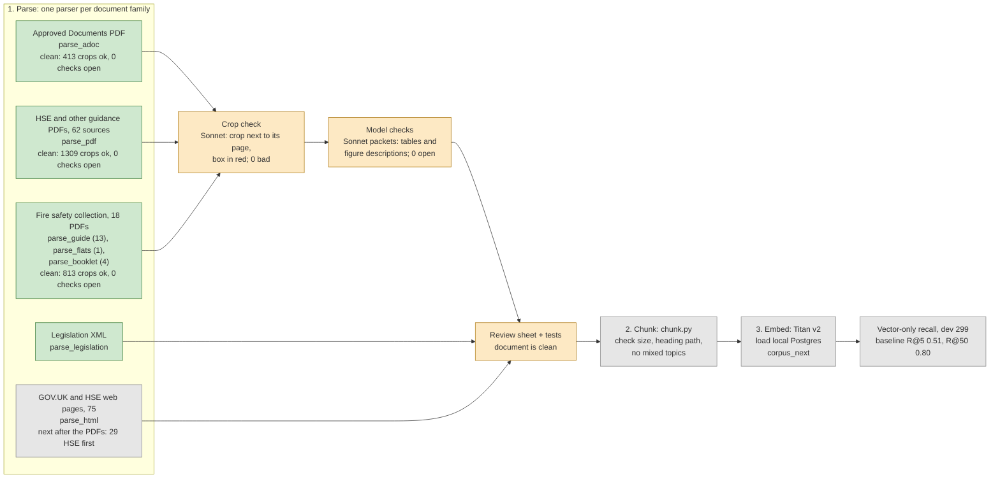

# Plan: retrieval and answer quality (from 21 Nov 2026)

Owner: Florin. Status report: [REPORT-2026-11-21.md](REPORT-2026-11-21.md). Each step needs Florin's yes before it starts.

## Current focus (Florin, 21 Nov evening)

**Retrieval only, vector search first.** Nothing else moves until retrieval is strong. Then the judge (step 3).

| Step | Status |
|---|---|
| 1. Miss analysis | done: [experiments/L1-miss-analysis.md](experiments/L1-miss-analysis.md) |
| 2. Experiments driven by step 1 | **in progress**: out-of-date sources removed (V1, no significant change); next, the embedded chunk text |
| 3. Local judge | on hold until retrieval is strong |
| 4. Multi-turn scenarios | on hold |
| 5. Traces and logs | on hold |

**Order of work (Florin, 21 Nov late): bottom up, one document at a time.**
1. **Parse.** Every guidance document parses cleanly, PDFs first (they matter most; legislation is already good).
   Per document, follow the runbook `.claude/skills/corpus-document/SKILL.md`:
   - fix structure in the parser code, with a test (a strategy per document family where needed)
   - run the model checks through packets, with Sonnet subagents in Claude Code (not Bedrock)
   - check every figure crop against its page image; nothing moves until the crops are right
   - review sheet, tests, commit
2. **Chunk.** Only when every document is parsed: check each document's chunks (size, heading path, context, no
   mixed topics).
3. **Ingest and verify the vectors.** Load, then measure vector-only recall on dev.

**Flow per document family, parse to vectors (status 22 Nov night).** Green: done. Amber: in progress.
Grey: not started. Each parser's own diagram is in
[regulations-corpus.md](../architecture/design/regulations-corpus.md).

Progress (22 Nov night, working alone while Florin sleeps):
- Fire safety risk assessment guides (13 files): new parser `parse_guide.py` (commit 8e8e8f5). Model checks running
  with Sonnet, headless Claude Code.
- Flats guide and 4 short fire safety guides: new parsers `parse_flats.py`, `parse_booklet.py` (a80151b); 87 model
  checks saved. **The whole fire safety collection is clean:** 813 of 813 crops ok, 0 open checks.
- Approved Documents (all 19): crops now follow the drawn frame (46b9e7b); 413 of 413 ok; every model check
  saved, 0 open (bfa6ecf).
- Golden set: the 8 fire safety questions relabelled to the new flats paragraph ids (3903d45).
- Crop check (`system/rag/cropcheck.py`): Sonnet judges every crop against its page. It was chosen over Haiku on
  HSG33. It is now running over every PDF source; bad crops are parser bugs to fix before the model checks.

External servers (22 Nov, Florin's question): do we need the government documents in our own index, given the free
MCP servers? Measured live on dev: **yes, keep them.** No server covers HSE guidance or Approved Document passages;
Lex ties with our index on laws but adds Northern Ireland and revoked laws; GOV.UK search finds the right page 0.41
against our 0.94. Report: [experiments/X-external-mcp.md](experiments/X-external-mcp.md).

- Generic guidance PDFs (parse_pdf, 22 Nov): false figures removed and crops cut from their ink (c6492e4,
  2a86e19); all 1309 crops ok or kept with a named defect (S98). Model checks done the same day: 537 open checks
  in 36 sources answered through Sonnet packets (Claude Code headless); false tables the answers found
  (footnotes, imprints, formula subscripts, lone labels) now parse as text, with tests. 0 checks open. Other
  false tables were settled as one-column tables (S102); empty header cells got neutral headings (S104).

**Parse absolutely everything before moving on (Florin, 22 Nov).** Chunks start only when every ingested
document is clean: legislation, every PDF and every web page. Web pages had been left out under "PDFs first", but
166 of the 342 golden questions expect one (36 an HSE page). Order:
1. ~~Generic guidance PDFs: last bad crops (S98), then their model checks.~~ Done 22 Nov: 0 bad crops, 0 checks open.
2. Web pages (`parse_html`), 75 sources: the 29 HSE pages first, then GOV.UK (Awaab's Law, CIS 340, VAT Notice
   708, fire doors ...). Same runbook: structure fixed in code with a test, model checks, review sheet, commit.
3. Traceable and repeatable parsing (below).

**Then (Florin, 22 Nov): make parsing traceable and repeatable.**
1. Each tree records the git commit and a hash of its parser file, not only the label (the labels were not bumped
   when the code changed).
2. A test parses a few small PDFs twice and checks the trees are identical (covers S97).
3. A manifest per parse run in git: source, raw file hash, parser hash, tree hash, so output changes show as diffs.

Inventory (21 Nov): 139 non-legislation sources. 47 have open model checks, 1,468 in total. The biggest are:
- fso-guidance-collection: 511
- br-circulars: 129
- supplier-information: 91
- Approved Documents E, M, H: 89, 73, 45
- HSG247: 73
- HSG33: 55

Main metric now: vector-only Recall@5 and Recall@50 on dev 299, before keyword search and rerank. Baseline (V0):
0.51 and 0.80. Runs use the full corpus in a throwaway local Postgres; live is not touched.

**After retrieval: split into two MCP servers (ADR 0015, proposed, S101)**, regulations and firm, before the
library tool below.

**Then: a tool that describes the library (Florin, 22 Nov), S100.** One MCP tool,
`about_regulations_library`, with `topic` = contents | gaps | examples | quality and an optional subject filter.
- contents: every document with publisher, edition, valid from, nation, status; counts per subject.
- gaps: link-only documents and why (paywall, copyright); subjects out of scope on purpose; free documents not
  added yet; documents still being cleaned.
- examples: a separate example set (never golden or holdout questions): questions it answers well with the
  answering section, and questions it cannot answer with what the agent says instead.
- quality: recall per subject with date, number of questions and margin of error; nothing about how search works.
- Built from the real files into one file at corpus build time; the server only reads it; a test fails when it is
  stale; numbers state which corpus they measure. Follows the `add-mcp-tool` runbook.

## Ground rules (Florin, 21 Nov)

- **No LLM on AWS.** Only the embedder (Titan v2) and the reranker (Amazon Rerank) stay on Bedrock.
- **Judges run locally in Claude Code** on the user's plan: Opus and Sonnet (or Fable and Opus). No Bedrock bill, no
  pipeline.
- **Investigate before tuning.** Find where recall is lost first, then change things.
- **No overfitting.**
  - Decide changes on dev only.
  - Check the holdout once per milestone. Never tune on it.
  - Report 95% confidence intervals: about ±0.06 at 273 questions.
  - Use McNemar for paired comparisons.
- **Trace everything.** Every judged answer keeps the trace of its tool calls.
- Each step writes its results to `evals/results/` and a short note to `evals/experiments/`.

## Step 1: miss analysis (where recall is lost)

**Input.** Run the full corpus (`corpus_next`, 186 sources, 40,075 chunks) on all 299 v2 dev questions with the
live search settings: hybrid on, no relevance cut-off. Save every candidate, its rank and its score.

**Where it runs.**
- The Frankfurt database accepts connections only from the live server's IP and Florin's laptop.
- So the run happens inside the live server, using its read-only database user, with `RAG_SCHEMA=corpus_next`.
  The other option is Florin's laptop.
- It reads only. Live data and the live corpus are not touched.
- About 6 s per search, so about 30 minutes in total.
- While it runs, it uses up to 2 of the 5 database connections, so live regulation searches may be slower. Run it
  when no one is using the app.

**Analysis.** Sort every question with no hit in the top 5 into one cause:

| Cause | How we tell |
|---|---|
| Document missing | expected source not in the corpus |
| Parse error | the expected text is missing or broken in the parsed tree |
| Chunk problem | the answer is split across chunks, buried in a large chunk, or the chunk lacks its heading |
| Ranking | the expected chunk is in the top 50 but not the top 5 |
| Embedding or keyword | the expected chunk is not in the top 50 although its text is fine |
| Label wrong | the expected section does not answer the question, or another section does |

**Breakdowns:**
- by role, kind, document and chunk type (paragraph, table row, definition)
- by chunk length
- multi-rule against single-rule questions

**Done when:** a table of miss counts per cause, 10 worked examples per cause, and a ranked list of fixes.

## Step 2: experiments driven by step 1

Order (from step 1's findings): (a) out-of-date sources out of the index (V1, done); (b) document title and full
heading path in every embedded text; (c) merge tiny chunks with their neighbours under the same heading; (d) a
parsing strategy per family, starting with the Home Office fire safety guides; (e) the vocabulary gap.

Pick the fixes from step 1's counts, biggest first. Possible fixes:
- re-parse the documents that cause errors
- add the parent heading to each chunk
- merge short sibling sections
- try chunk sizes and overlap
- improve the keyword weights

**Rules:**
- One change at a time, all measured on dev with the same metrics: R@5 strict and pooled, R@50, MRR, nDCG, all@5.
- Holdout once, at the end.

## Step 3: local LLM judge in Claude Code

- Port `evals/judge.py` so the answers and the judging run in Claude Code headless (`claude -p`).
- No Bedrock models.
- **Answers:** run the real flow: the plugin, the router, the specialist, then `verify_answer`.
- **Judges:** two Claude models. Measure how often they agree (Cohen's kappa). Disagreements go to a person.
- **Calibration:** Florin, or a builder, reads about 50 judged answers. Report how often the judge agrees with the
  person.
- **Criteria:** the same as now (correctness, grounding, completeness, each 1-5 with the reason first). Add:
  - source cited correctly (document, section, edition date)
  - safety rules kept (asbestos, approvals, drafts only)
  - language: Romanian answers keep the UK terms

## Step 4: multi-turn scenarios

- Add about 20 conversations of 3-4 exchanges to the golden set. Examples:
  - a follow-up ("and for flats?")
  - a correction ("no, I meant the bedroom")
  - Romanian, then English
  - a safety push ("just say there's no asbestos")
- Each turn has its own reference answer and expected sections.
- The judge scores each turn and the conversation as a whole.

## Step 5: traces and logs

- One trace id per answer, linking every tool call (S9).
- Retrieval logs on the server for each search: query, candidates with scores, reranked list, time per stage.
- The local judge saves the trace with each judged row, so every failure can be followed down to the search.

## Later

- Promote the full corpus once the database is fast enough (S88).
- Run step 2's winner on live.
