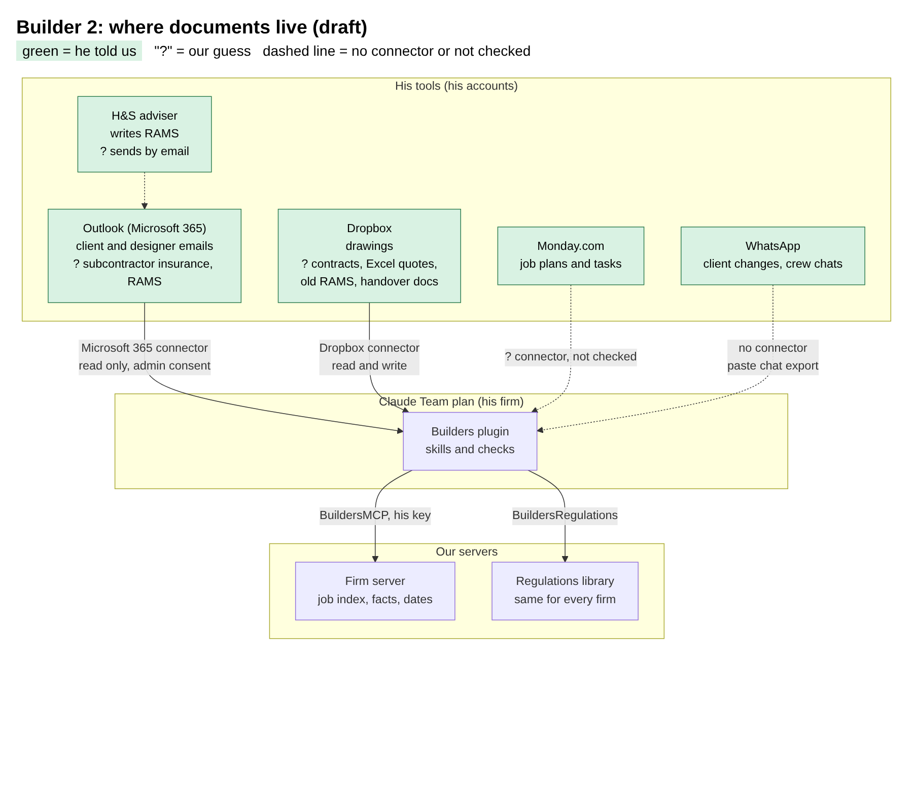
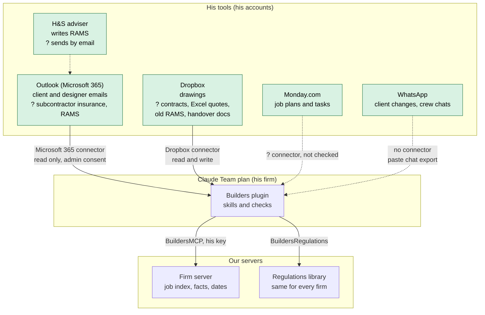

# Builder 2: where each document lives (first draft, 27 Nov 2026)

Draft to check with the owner. Green: he told us (`builder-2.md`). "?": our guess. Dashed line: no connector, or not checked. Connector facts from `research/integrations/connector-map.md` (checked 19 Nov 2026); Monday.com not checked yet.

## Open points

- His real documents stay in his tools. Our firm server keeps only the job index, facts and dates.
- Outlook: the connector looks read-only, so drafts would need our own Microsoft Graph server.
- Monday.com: check whether Claude has a connector for it.
- WhatsApp: no way to read existing chats; a pasted export for now.
