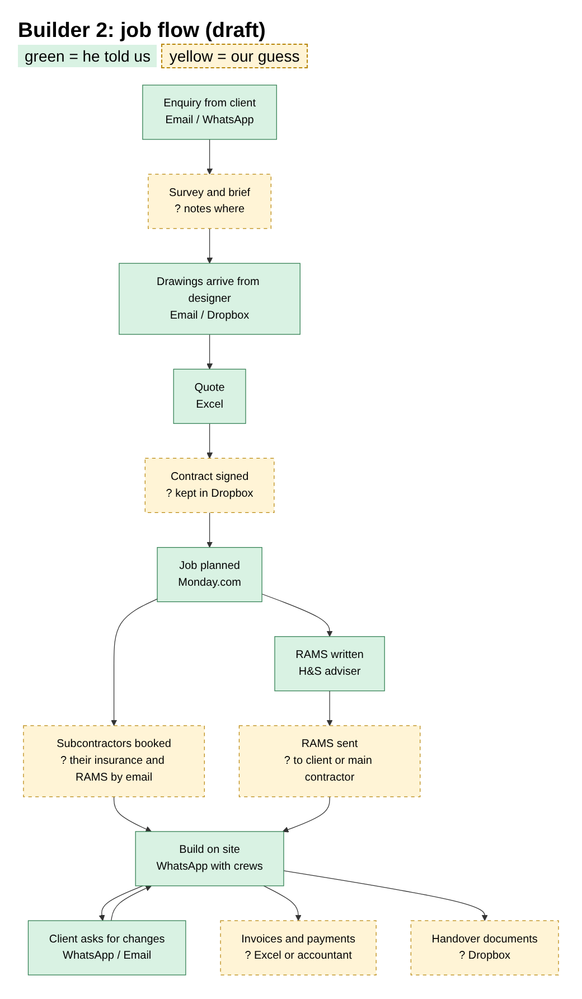
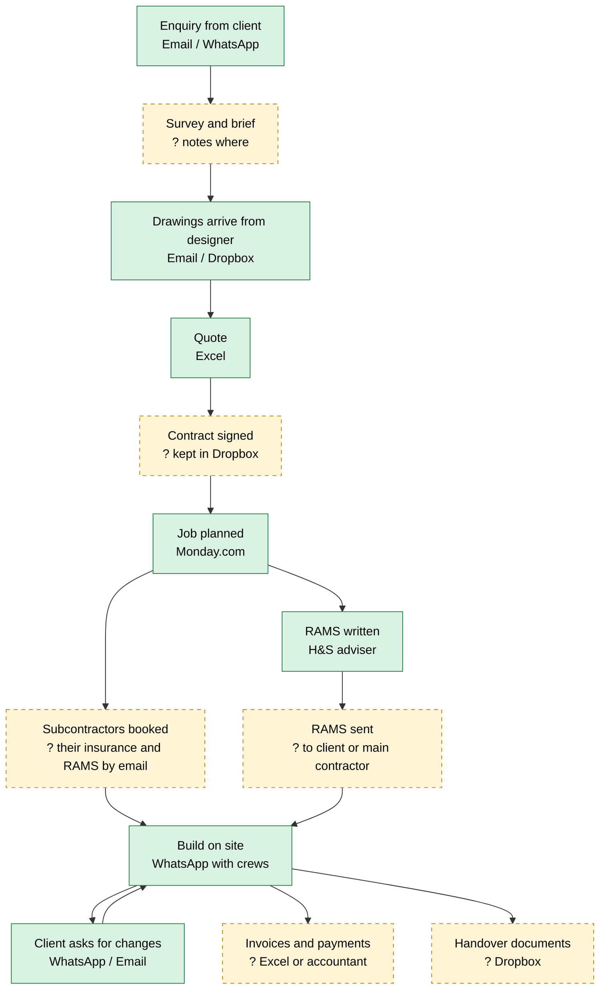

# Builder 2: how a job flows (first draft, 27 Nov 2026)

Draft to check with the owner. Solid boxes: tools he named in writing (`builder-2.md`). Dashed boxes: our guesses, to confirm. The order of steps is a guess from typical design-and-build firms (`research/research_notes/Builder tools and integrations/design_and_build_firms.md`).

## Questions the diagram raises

1. Where do survey notes, contracts and old RAMS live: Dropbox?
2. Who asks him for RAMS, and who does he ask (subcontractors)?
3. Who does invoices and payment applications, and in what?
4. What goes in Monday.com, and what stays in Excel?
5. Who holds the Microsoft 365 admin account? (Needed to approve the Outlook connector for the firm.)
